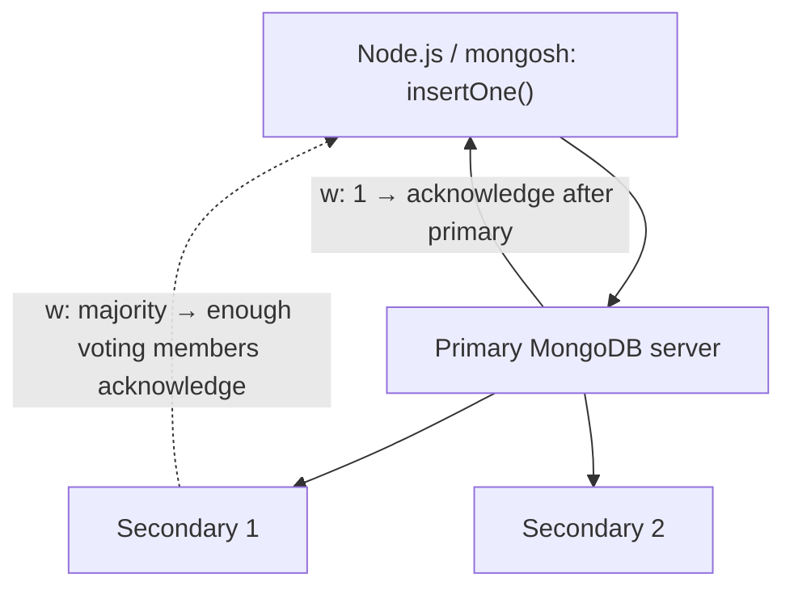

# Lesson 009 — Insert Documents: insertOne and insertMany

[← Section 2](./README.md) · [Full curriculum](../README.md)

## 1. What does inserting mean?

**Insert** means saving a new document inside a MongoDB collection. Example: when an admin adds a product, the application must store it so customers can see it later.

```text
Product form → Express API → MongoDB insert → products collection
```

This lesson uses **mongosh** to learn MongoDB behavior. A short Mongoose comparison appears at the end.

## 2. Prepare a practice database

Connect using `mongosh`, then run:

```js
use shopLearning
db.products.find()
```

If the collection does not exist yet, that is fine: the first successful insert can create it automatically.

## 3. insertOne() — save one document

```js
db.products.insertOne({
  name: "Laptop",
  price: 55000,
  stock: 5,
  category: "Electronics",
  specifications: { ram: "16 GB", storage: "512 GB" },
  tags: ["computer", "work"]
})
```

**What happens?**
1. `db` refers to `shopLearning`; `products` is the collection.
2. `insertOne()` receives **one document** (a BSON object).
3. MongoDB stores the document and creates the collection if needed.
4. If `_id` is missing, the driver or server normally generates an ObjectId.
5. With acknowledged writes, the result includes `acknowledged: true` and `insertedId`.

Example response (your ObjectId will differ):

```js
{
  acknowledged: true,
  insertedId: ObjectId("507f1f77bcf86cd799439011")
}
```

Verify:

```js
db.products.findOne({ name: "Laptop" })
```

**Why useful?** Creating one user, one order, or one product at a time.

## 4. insertMany() — save several documents

```js
db.products.insertMany([
  { name: "Mouse", price: 700, stock: 25 },
  { name: "Keyboard", price: 1600, stock: 10 },
  { name: "Monitor", price: 12000, stock: 8 }
])
```

The argument is an **array of documents**, not one document. The acknowledged result contains `acknowledged` and `insertedIds` (IDs keyed by input position).

**Why useful?** Importing a product catalog, seeding test data, or inserting several records in a batch. It generally avoids making a separate client-to-server call for each document.

## 5. insertOne vs insertMany

| Feature | insertOne | insertMany |
| --- | --- | --- |
| Input | One document | Array of documents |
| Result ID | `insertedId` | `insertedIds` |
| Common use | Registration, single product | Imports, initial data |
| Failure | One insert fails | Some inserts may succeed before a failure |
| Options | Write concern | Ordered/unordered, write concern |

**Important:** `insertMany()` is not automatically an all-or-nothing transaction.

## 6. How _id and uniqueness work

Every document has an `_id`, unique **within that collection**.

```js
db.products.insertOne({ _id: "product-101", name: "Desk" })
```

Trying the same `_id` again fails:

```js
db.products.insertOne({ _id: "product-101", name: "Chair" })
// E11000 duplicate key error
```

The `_id` can be a supported BSON type, but using automatically generated ObjectIds is common. A duplicate `email` or `sku` is **not** automatically rejected: create a unique index if the business requires uniqueness (covered in Section 4).

## 7. Ordered vs unordered bulk insertion

**Ordered** is the default. If an insert fails, later documents are not attempted.

Use a fresh practice collection for this example:

```js
db.orderedDemo.insertMany([
  { _id: 1, name: "A" },
  { _id: 1, name: "Duplicate" },
  { _id: 2, name: "B" }
], { ordered: true })
```

Expected: A is inserted, the second document causes a duplicate-key error, and B is not attempted. Inspect:

```js
db.orderedDemo.find()
```

**Unordered** continues attempting other documents even when one fails:

```js
db.unorderedDemo.insertMany([
  { _id: 1, name: "A" },
  { _id: 1, name: "Duplicate" },
  { _id: 2, name: "B" }
], { ordered: false })
```

Expected: a duplicate-key error is still reported, but A and B can be inserted. The server may reorder unordered writes; do not rely on execution order.

```js
db.unorderedDemo.find()
```

**When to choose?** Ordered when later writes should stop after a failure; unordered when independent valid records should still be attempted. Neither option provides transaction-wide atomicity.

## 8. What is write concern?

**Write concern** tells MongoDB **when it can acknowledge an insert, update, or delete**. In simple words: *"How much confirmation do I want before the database says my write was accepted?"*

Imagine your application saves a new order. MongoDB might run as a **replica set** with one **primary** (receives normal writes) and two **secondaries** (replicate writes). Do you want a reply as soon as the primary acknowledges, or only after a majority have acknowledged?

### 8.1 Diagram — how a write reaches MongoDB



**Diagram note:** The majority arrow is a simplified illustration. For a replica set with **three voting data-bearing members**, two acknowledgments (typically primary + one secondary) satisfy `w: "majority"`; *it does not specifically have to be Secondary 1*. Replication can be asynchronous and order/timing can vary.

### 8.2 Main write-concern levels

| Setting | When does the application get acknowledgment? | Trade-off |
| --- | --- | --- |
| `w: 0` | No server acknowledgment requested | Faster, but you cannot confirm success from an acknowledgment |
| `w: 1` | Primary acknowledges the write | Does not wait for replicas; an acknowledged write can be rolled back after failover |
| `w: "majority"` | Required majority of voting data-bearing replica-set members acknowledge | Stronger durability against replica-set failover; may take longer |

**Example — primary acknowledgment:**

```js
db.products.insertOne(
  { name: "Mouse", price: 700 },
  { writeConcern: { w: 1 } }
)
```

The primary acknowledges without waiting for secondaries.

**Example — majority acknowledgment:**

```js
db.products.insertOne(
  { name: "Webcam", price: 2200 },
  { writeConcern: { w: "majority" } }
)
```

On our three-member example, two members must acknowledge under the replica-set write-concern rules.

### 8.3 What are `j` and `wtimeout`?

Besides `w`, write concern supports these useful options:

- **`j: true`** — asks for acknowledgment after the write is recorded in the on-disk journal (where journaling applies).
- **`wtimeout: 5000`** — wait **up to 5,000 milliseconds (5 seconds)** to satisfy the requested write concern. This controls the acknowledgment wait, not a guaranteed cancellation of the write.

```js
db.products.insertOne(
  { name: "Keyboard", price: 1600 },
  {
    writeConcern: {
      w: "majority",
      j: true,
      wtimeout: 5000
    }
  }
)
```

**Important:** A write-concern timeout does **not** mean the write was rolled back. The primary may already have applied it. Before blindly retrying a sensitive operation (such as creating an order), verify the result or use an idempotent design.

### 8.4 Quick visual comparison

```text
Example: 3 voting data-bearing members

w: 0          App does not wait for write acknowledgment
w: 1          Primary ✓         Secondary 1 ?     Secondary 2 ?
w: majority   Primary ✓         Secondary 1 ✓     Secondary 2 ?
              (any 2 of the 3 voting members satisfy majority)

✓ = acknowledged    ? = not required for this acknowledgment
```

### 8.5 Write concern vs read concern

- **Write concern** = acknowledgment/durability required for a **write** (insert/update/delete).
- **Read concern** = consistency/visibility guarantees requested when **reading** data.

**Where useful in projects?** For orders and payments, majority acknowledgment can be useful, but you still need transactions (when multiple documents must change together), idempotency, and correct payment verification. For routine inserts, start with your deployment's **default** write concern; do not assume every deployment has the same default.

**Remember:** Write concern does **not** check whether fields like `price` are valid. That is handled by application validation, MongoDB schema validation, or Mongoose validation.

## 9. Validation, errors and safety

MongoDB collections are flexible by default. That means this may be accepted without schema validation:

```js
db.products.insertOne({ name: "Invalid product", price: "not a number" })
```

In production, validate incoming data and use appropriate database schema validation or Mongoose schemas. Common errors include duplicate keys (code `11000`), schema validation failures, connection errors, and write concern errors.

Other important details:
- A document has a **16 MiB BSON size limit**.
- `insertMany()` may be split into internal batches for large input.
- Do not assume a failed batch inserted zero documents.
- Avoid inserting passwords, secrets, or untrusted input without proper security handling.
- Do not repeatedly rerun examples with manually fixed `_id` values unless you expect duplicate-key errors.

## 10. Equivalent Mongoose operations

After connecting Mongoose and defining a `Product` model:

```js
// One product
const product = await Product.create({
  name: "Laptop",
  price: 55000
});

// Multiple products
const products = await Product.insertMany([
  { name: "Mouse", price: 700 },
  { name: "Keyboard", price: 1600 }
]);
```

MongoDB still performs the database write. **Mongoose adds model-based casting and validation**, and Mongoose `create()` and `insertMany()` have different middleware behavior (covered in the Mongoose section). Do not treat their return values as identical to mongosh's insert result objects.

## 11. Practice exercises

Create a new collection called `practiceBooks`:
1. Insert one book with title, author, price and categories.
2. Insert three books with `insertMany()`.
3. Read the documents with `find()` and identify their `_id` values.
4. Try a duplicate `_id` using `insertOne()`. Explain the error.
5. Use **separate new collections** to test `ordered: true` and `ordered: false`. Compare which records remain.

## 12. Interview questions

**Q: What is the difference between insertOne and insertMany?** One inserts a single document; the other inserts an array of documents.

**Q: Does insertMany roll back every document if one fails?** No, not by default.

**Q: What happens if _id is omitted?** The driver or server typically generates an ObjectId.

**Q: What is ordered: false?** MongoDB continues attempting other documents after an individual insert error, potentially in a different order.

**Q: Does MongoDB enforce required fields automatically?** No, not unless configured through schema validation or enforced by application code.

## Quick revision

**insertOne = one document. insertMany = array of documents. _id = unique identifier. Ordered = stop on error; unordered = continue attempts.**

**Next:** Lesson 010 — Read Documents: find and findOne (not yet published).

### Official references
- [insertOne](https://www.mongodb.com/docs/manual/reference/method/db.collection.insertOne/)
- [insertMany](https://www.mongodb.com/docs/manual/reference/method/db.collection.insertMany/)
- [Write Concern](https://www.mongodb.com/docs/manual/reference/write-concern/)
