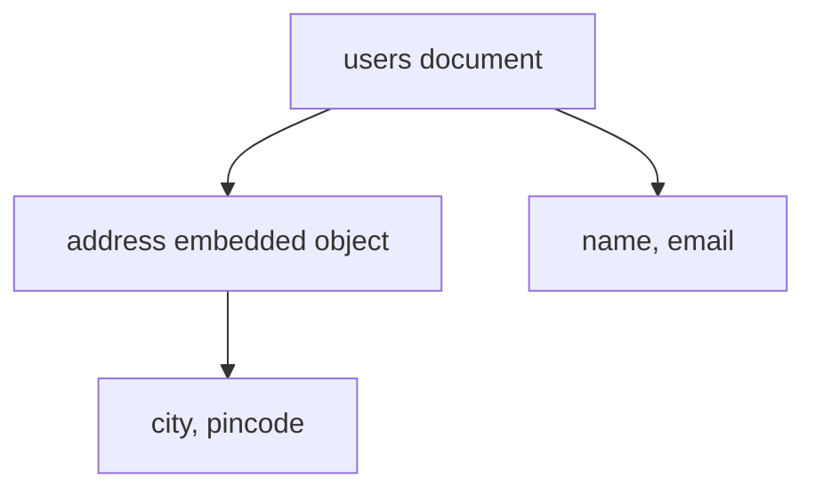
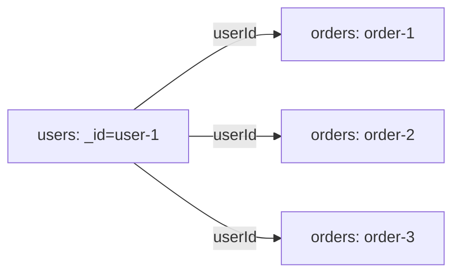

# Lesson 021 — Embedding vs Referencing

[← Section 3](./README.md) · [Full curriculum](../README.md)

## Goal
Learn when to keep related data **inside one document** and when to keep it in **separate collections** with IDs. MongoDB does not force SQL-style joins; design around what the application reads and updates together.

## 1. What is embedding?
A customer's small shipping address is stored directly inside the customer document.



```js
use mongoCourse
db.embedUsers.insertOne({
  _id: "user-1",
  name: "Asha",
  address: { city: "Patna", pincode: "800001" }
})
db.embedUsers.findOne({ "address.city": "Patna" })
```
One read gets the user's details and address. Updating both fields in a **single document** is atomic. However, repeating large data and letting arrays grow forever can become problematic.

## 2. What is referencing?
Each order belongs to a user but is stored separately because users may place thousands of orders.



```js
db.refUsers.insertOne({ _id: "user-1", name: "Asha" })
db.refOrders.insertMany([
  { _id: "order-1", userId: "user-1", total: 499 },
  { _id: "order-2", userId: "user-1", total: 899 }
])
db.refOrders.find({ userId: "user-1" })
```
An application can fetch the user and their orders separately or use an aggregation `$lookup`. **MongoDB references are not automatically foreign-key constraints**: you must prevent or clean up orphaned records yourself.

## 3. Decide using actual access patterns
| Question | Often embed | Often reference |
| --- | --- | --- |
| Read together every time? | Yes | Not usually |
| Child can grow without limit? | No | Yes |
| Child needs its own lifecycle? | No | Yes |
| Need atomic updates to parent + child? | Same document is easiest | Multi-document transaction may be needed |
| Shared entity reused elsewhere? | Rarely | Often |

**Typical examples:** embed small product dimensions; reference users from orders; embed order line-item **snapshots** so an old purchase retains the price even after product prices change.

## 4. Hybrid is common
A blog post can embed a **bounded** summary of recent comments and store the complete, growing comment history separately. Duplicated fields need a plan to stay fresh.

## 5. Mongoose comparison
```js
const userSchema = new mongoose.Schema({
  name: String,
  address: { city: String, pincode: String }
});
const orderSchema = new mongoose.Schema({
  userId: { type: mongoose.Schema.Types.ObjectId, ref: "User", required: true },
  total: Number
});
```
Mongoose's `ref` can work with `populate()` later; MongoDB itself stores the identifier. A ref does **not** enforce that the target exists.

## Pitfalls
- Embedding all chat messages in a user document.
- Assuming every relationship must use `populate()` or `$lookup`.
- Keeping one shared address document for an order when the delivery address must be historically preserved.
- Denormalizing without a strategy for stale copies.

## Practice
Model a user's profile, an address book (small/bounded), and order history (unbounded). Explain each embedding/reference choice.

**Interview:** **When should you embed?** Related bounded data read together. **When reference?** Independently accessed, shared, or unbounded data.

[Official modeling guide](https://www.mongodb.com/docs/manual/data-modeling/)
