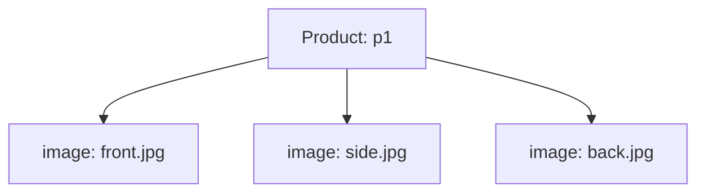
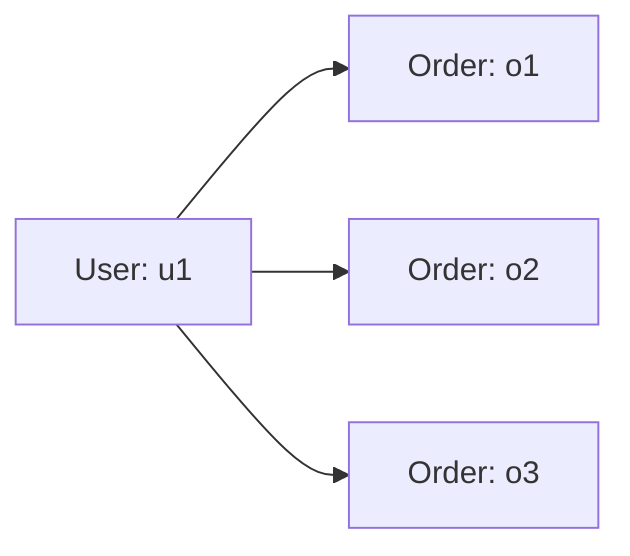

# Lesson 022 — One-to-One and One-to-Many Relationships

[← Section 3](./README.md) · [Full curriculum](../README.md)

## Why relationships?
A user may have one profile and many orders. MongoDB has no mandatory relational tables: you represent the link using embedded documents or IDs.

## 1. One-to-one (1:1)
One user → one profile.


**Option A: embed** when the profile is normally read with the user:
```js
db.usersOneToOne.insertOne({
 _id:"u1", name:"Asha", profile:{bio:"Developer",city:"Patna"}
})
```
**Option B: reference** when the profile is large, rare to fetch, or managed independently:
```js
db.usersSeparated.insertOne({_id:"u1",name:"Asha"})
db.profilesSeparated.insertOne({_id:"u1",bio:"Developer",city:"Patna"})
```
Using the same `_id` makes the profile logically one-to-one. Alternatively create a **unique index** on `profiles.userId`, because MongoDB will not enforce 1:1 just because your app assumes it.

## 2. One-to-many (1:N), bounded children
One product → a **small fixed** set of images:



```js
db.productsOneToMany.insertOne({
  _id:"p1", name:"Shoes",
  images:["front.jpg","side.jpg","back.jpg"]
})
```
Embedding saves extra reads when images are shown with products. Limit the number and length in application/database validation.

## 3. One-to-many (1:N), unbounded children
One user → potentially thousands of orders.



**Avoid** adding every order to one enormous `user.orders` array. Instead store the parent's ID in each child:

```js
db.ordersOneToMany.insertMany([
  {_id:"o1",userId:"u1",total:501},
  {_id:"o2",userId:"u1",total:999}
])
db.ordersOneToMany.createIndex({userId:1,createdAt:-1})
db.ordersOneToMany.find({userId:"u1"})
```
The compound index is useful when fetching a user's orders sorted by date, **provided orders contain createdAt**.

## 4. Which side should store the reference?
Usually the **many side**: `orders.userId`. It prevents continuously growing `users.orderIds` arrays. If you need the count frequently, a separate derived count can be maintained carefully.

## 5. Query related documents together
```js
db.usersSeparated.aggregate([
 {$match:{_id:"u1"}},
 {$lookup:{
   from:"ordersOneToMany",
   localField:"_id",
   foreignField:"userId",
   as:"orders"
 }}
])
```
A lookup returns an array of matching orders. For unbounded history this could become huge: typically query orders separately with pagination instead.

## 6. Mongoose model example
```js
const orderSchema = new mongoose.Schema({
 userId:{type:mongoose.Schema.Types.ObjectId,ref:"User",required:true},
 total:{type:Number,required:true}
});
orderSchema.index({userId:1,createdAt:-1});
```
**Type rule:** this Mongoose example expects ObjectId user IDs; the earlier shell demo uses strings. Keep types consistent in your own application.

## Pitfalls and practice
- A reference does not automatically cascade deletes.
- A `unique` constraint comes from an index, not simply a `ref`.
- Avoid unbounded parent arrays for many children.
- Design both an embedded profile and a referenced order list; explain why the choices differ.

**Interview:** Why put `userId` on orders? It scales with one row/document per order and lets us index/filter by user.

[Relationships reference](https://www.mongodb.com/docs/manual/data-modeling/concepts/embedding-vs-references/)
