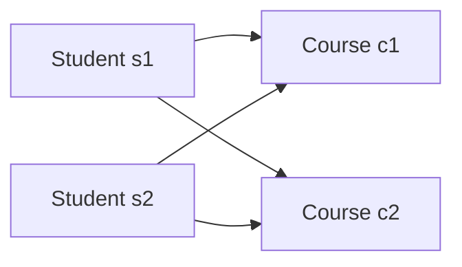

# Lesson 023 — Many-to-Many Relationships

[← Section 3](./README.md) · [Full curriculum](../README.md)

## What is many-to-many?
Many students enroll in many courses; many products belong to many categories. Neither side is limited to one match.



## 1. Small/bounded relationship: arrays of IDs
```js
use mongoCourse
db.coursesM2M.insertMany([
 {_id:"c1",title:"MongoDB"},
 {_id:"c2",title:"Node.js"}
])
db.studentsM2M.insertMany([
 {_id:"s1",name:"Asha",courseIds:["c1","c2"]},
 {_id:"s2",name:"Ravi",courseIds:["c2"]}
])
db.studentsM2M.find({courseIds:"c2"})
```
This is simple when enrollment counts are modest. Avoid maintaining both `students.courseIds` **and** `courses.studentIds` without a synchronization strategy.

## 2. Large relationship or relationship metadata: junction collection
If enrollment has a date, status, grade, or grows independently, create **enrollments**.


```js
db.enrollments.insertMany([
 {studentId:"s1",courseId:"c1",status:"active",joinedAt:new Date()},
 {studentId:"s1",courseId:"c2",status:"active",joinedAt:new Date()},
 {studentId:"s2",courseId:"c2",status:"completed",joinedAt:new Date()}
])
db.enrollments.createIndex({studentId:1,courseId:1},{unique:true})
db.enrollments.createIndex({courseId:1,studentId:1})
db.enrollments.find({studentId:"s1"})
```
The unique compound index prevents a duplicate student-course pair; the reverse index helps list students by course. Check product rules first: if multiple historical enrollments in the same course must coexist, a blanket unique pair may be inappropriate.

## 3. Join details with aggregation
```js
db.enrollments.aggregate([
 {$match:{studentId:"s1"}},
 {$lookup:{
  from:"coursesM2M",
  localField:"courseId",foreignField:"_id",as:"course"
 }},
 {$unwind:"$course"},
 {$project:{_id:0,status:1,"course.title":1}}
])
```
Expected two entries for s1: MongoDB and Node.js.

## 4. Real backend use: CodeBuddy connections
```text
users (A, B) <-> connections (requesterId, recipientId, status)
```
Store relationship state such as `pending` and `accepted` in a separate connection document. For unordered user pairs, a **canonical pair key** created by sorting IDs and indexing it uniquely helps prevent A→B and B→A duplicates.

## 5. Mongoose equivalent
```js
const enrollmentSchema = new mongoose.Schema({
 studentId:{type:mongoose.Schema.Types.ObjectId,ref:"Student",required:true},
 courseId:{type:mongoose.Schema.Types.ObjectId,ref:"Course",required:true},
 status:{type:String,enum:["active","completed"],default:"active"}
});
enrollmentSchema.index({studentId:1,courseId:1},{unique:true});
```
Mongoose `populate()` can fetch the related records later, but the database still stores references.

## Mistakes
- Unlimited arrays of IDs on both sides.
- No uniqueness rules, causing duplicate connections/enrollments.
- Forgetting to index both common query directions.
- Assuming deleting a course removes all enrollments automatically.

## Practice
Model products↔categories and users↔groups. Decide which needs a junction collection, and write queries for both sides.

**Interview:** Why use a junction collection? Many-to-many relationships can grow and often carry their own fields.

[Official data modeling](https://www.mongodb.com/docs/manual/data-modeling/)
