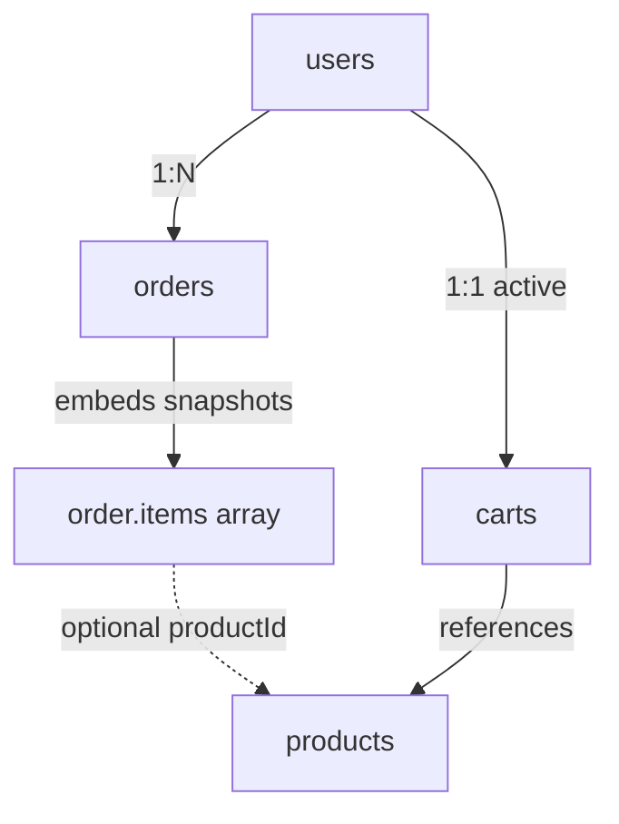

# Lesson 024 — Designing E-commerce Schemas

[← Section 3](./README.md) · [Full curriculum](../README.md)

## Goal
Design a realistic shopping backend with **users, products, carts, orders**. Think about data ownership, historical accuracy, stock, and queries before choosing collections.

## Relationship overview


## 1. Products (current catalog)
```js
use mongoCourse
db.shopProducts.insertOne({
 _id:"sku-laptop",
 name:"Laptop",
 priceMinor:5500000,
 currency:"INR",
 stock:5,
 images:["front.jpg"],
 active:true
})
```
`priceMinor` is money in the smallest unit (paise for INR); this example means **₹55,000.00**. Using a consistently defined integer currency unit avoids common binary floating-point mistakes. Validate amounts and currency in application code.

## 2. Users and address books
```js
db.shopUsers.insertOne({
 _id:"user-1",
 email:"asha@example.test",
 addresses:[{label:"home",city:"Patna",pincode:"800001"}]
})
db.shopUsers.createIndex({email:1},{unique:true})
```
Bound address books can be embedded. Orders should preserve a **delivery address snapshot** because a user's address can change.

## 3. Cart (mutable, temporary)
```js
db.shopCarts.insertOne({
 _id:"cart-user-1",
 userId:"user-1",
 items:[{productId:"sku-laptop",quantity:1}],
 updatedAt:new Date()
})
db.shopCarts.createIndex({userId:1},{unique:true})
```
A cart is allowed to change. Store product references and quantities; look up current price/availability during checkout. For a very large marketplace, use a separate `cartItems` collection instead of an unbounded array.

## 4. Order (historical record)
```js
db.shopOrders.insertOne({
 _id:"order-1",
 userId:"user-1",
 items:[{
   productId:"sku-laptop",
   name:"Laptop",
   unitPriceMinor:5500000,
   quantity:1
 }],
 deliveryAddress:{city:"Patna",pincode:"800001"},
 currency:"INR",
 totalMinor:5500000,
 status:"CREATED",
 createdAt:new Date()
})
db.shopOrders.createIndex({userId:1,createdAt:-1})
```
**Why duplicate product name/price in order.items?** It is an intentional **snapshot**. If the laptop later costs ₹60,000 or is renamed, an old invoice still shows what was purchased. Keep quantities and monetary totals validated/reconciled on the backend; never trust client-side prices.

## 5. Read and write flows
**Product page:** `shopProducts.findOne({_id:"sku-laptop"})`.

**Cart:** `shopCarts.findOne({userId:"user-1"})`; fetch product details/prices as necessary.

**Order history:** `shopOrders.find({userId:"user-1"}).sort({createdAt:-1,_id:-1}).limit(10)`.

**Checkout:**
1. Confirm authenticated user and validate cart items.
2. Read **current** prices and check inventory.
3. Safely reserve/decrement stock with conditional atomic updates.
4. Create the immutable order snapshot; coordinate multi-document correctness using a transaction or a carefully designed compensation workflow.
5. Integrate a payment provider using verified server-to-server results and idempotency; never mark an order paid just because a browser says so.

## 6. Which data is embedded vs referenced?
| Data | Design | Why |
| --- | --- | --- |
| Product images | Bounded embedded array | Read with product |
| User addresses | Bounded embedded array | Read with user |
| Cart items | Small embedded array + productId | Mutable, usually fetched together |
| Order items | Embedded snapshots | Historical purchase facts |
| Order → user | Reference `userId` | User has many orders |
| Product reviews | Separate collection if growing | Potentially unbounded |

## 7. Mongoose model sketch
```js
const itemSchema = new mongoose.Schema({
 productId:{type:mongoose.Schema.Types.ObjectId,ref:"Product"},
 name:{type:String,required:true},
 unitPriceMinor:{type:Number,required:true,min:0},
 quantity:{type:Number,required:true,min:1}
}, {_id:false});

const orderSchema = new mongoose.Schema({
 userId:{type:mongoose.Schema.Types.ObjectId,ref:"User",required:true},
 items:{type:[itemSchema],required:true},
 totalMinor:{type:Number,required:true,min:0},
 status:{type:String,enum:["CREATED","PAID","SHIPPED","DELIVERED"],default:"CREATED"}
},{timestamps:true});
```
The shell examples above use **string IDs** for clarity; the Mongoose sketch demonstrates **ObjectId references**. In one application pick matching identifier types; don't copy mixed types into production.

## Mistakes and exercises
- Don't store only productId in orders and later calculate historical price from today's product.
- Don't store all of a user's orders in their user document.
- Don't treat price values submitted by the frontend as trusted.
- Don't decrement inventory non-atomically or assume a transaction automatically handles external payment calls.

**Practice:** Add coupons, shipping charges and refunds. Decide which facts should be order snapshots and which records need their own collections.

**Interview:** Why denormalize order items? Historical accuracy and efficient order reads.

[Official data modeling](https://www.mongodb.com/docs/manual/data-modeling/)
