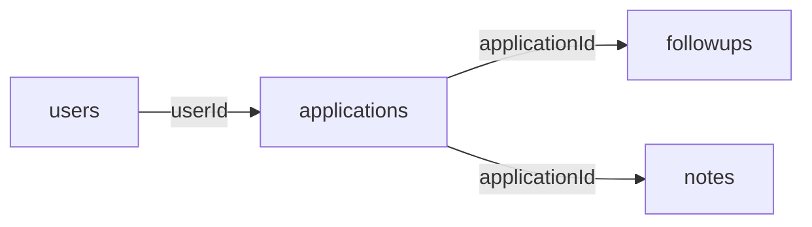
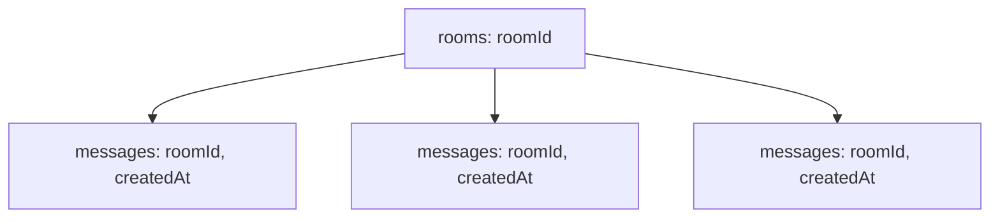

# Lesson 025 — Schema Design for Queries and Growth

[← Section 3](./README.md) · [Full curriculum](../README.md)

## Learning goal
Design documents around the queries your application runs **most often**, while preparing for growing datasets and changing requirements. MongoDB's flexible schema does not remove the need for thoughtful design.

## 1. Start with queries—not collections
Imagine a job application tracker. The UI needs:
1. Show a user's 20 newest applications.
2. Filter by status: APPLIED, SCREENING, INTERVIEW, OFFER, REJECTED.
3. Open one application with its notes.
4. List upcoming follow-ups.

A poor initial approach is to place **every application** inside a user's document; that user's document grows forever. Prefer one document per application.



```js
use mongoCourse
db.applicationsDesign.insertMany([
 { _id:"a1",userId:"u1",company:"Acme",status:"APPLIED",appliedAt:ISODate("2026-10-01") },
 { _id:"a2",userId:"u1",company:"Nova",status:"INTERVIEW",appliedAt:ISODate("2026-10-05") }
])
db.applicationsDesign.find({userId:"u1",status:"INTERVIEW"})
 .sort({appliedAt:-1,_id:-1}).limit(20)
```

## 2. Design an index for the access pattern
```js
db.applicationsDesign.createIndex({userId:1,status:1,appliedAt:-1,_id:-1})
```
This index can support the equality filters on `userId` and `status`, then a date-based sort with a stable `_id` tie-breaker. A query using only `userId` and sorting by `appliedAt` may need **another** index; do not assume the index above optimizes every query. Check `explain("executionStats")`.

## 3. Bounded vs unbounded arrays
**Bounded:** A product has at most five gallery images; embed them.

**Unbounded:** A chat room receives millions of messages; store messages separately.



```js
db.chatMessagesDesign.createIndex({roomId:1,createdAt:-1,_id:-1})
db.chatMessagesDesign.find({roomId:"room-1"})
 .sort({createdAt:-1,_id:-1}).limit(30)
```

## 4. Selective duplication (denormalization)
An order may save product name and sale price even though the current product has those fields. This snapshot protects purchase history. But keeping live fields duplicated everywhere means updates must synchronize all copies. Ask: **is the copied value a historical snapshot or supposed to stay current?**

## 5. Changes and schema versions
Your app may start with `address.city` and later add `address.country`. An optional `schemaVersion` lets you migrate older records incrementally.

```js
db.applicationsDesign.updateMany(
 {schemaVersion:{$exists:false}},
 {$set:{schemaVersion:1}}
)
```
For large production collections, plan staged migration, rollout and rollback rather than applying a huge update blindly.

## 6. Mongoose equivalent
```js
const applicationSchema = new mongoose.Schema({
 userId:{type:mongoose.Schema.Types.ObjectId,ref:"User",required:true},
 company:{type:String,required:true},
 status:{type:String,enum:["APPLIED","SCREENING","INTERVIEW","OFFER","REJECTED"]},
 appliedAt:{type:Date,default:Date.now}
});
applicationSchema.index({userId:1,status:1,appliedAt:-1,_id:-1});
```
The shell demo uses string IDs; actual Mongoose ObjectId fields require real ObjectIds.

## Design checklist
- List the top queries and required sort orders.
- Identify fields updated together.
- Identify potentially unbounded data.
- Decide which duplicated values are immutable snapshots.
- Enforce IDs/uniqueness and index common paths.
- Plan for growing document sizes and version changes.

## Practice
Design a company collection and application collection for a job tracker. Add queries for (a) one user's recent applications and (b) status-filtered applications; choose indexes and explain them.

**Interview:** **Why query-first design?** Because document shapes and indexes should support actual application reads/writes efficiently.

[Official design principles](https://www.mongodb.com/docs/manual/data-modeling/)
