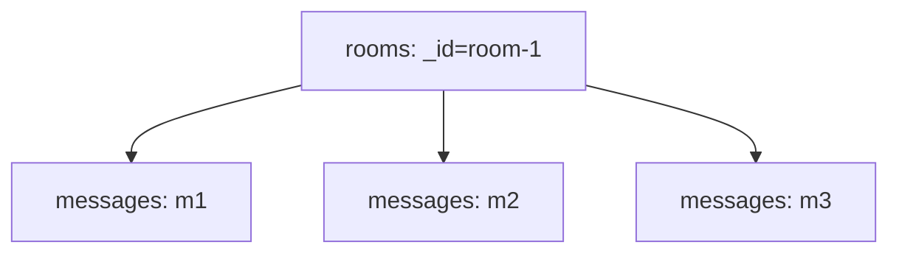

# Lesson 026 — Document Limits and Modeling Anti-patterns

[← Section 3](./README.md) · [Full curriculum](../README.md)

## Learning goal
Recognize designs that look easy today but fail when data grows.

## 1. MongoDB document size limit
The maximum BSON document size is **16 MiB**. Documents also have nesting limits. A collection can contain many documents; the limit is **per document**, not per collection.

**Bad:** Store every message ever sent in one conversation document:

```js
// Anti-pattern — do not use in production
{_id:"room-1",messages:[/* unlimited messages */]}
```

**Better:** Store the room separately, and each message as an independent document.



```js
use mongoCourse
db.roomsDesign.insertOne({_id:"room-1",name:"Developers"})
db.messagesDesign.insertMany([
 {_id:"m1",roomId:"room-1",text:"Hello",createdAt:new Date()},
 {_id:"m2",roomId:"room-1",text:"Welcome",createdAt:new Date()}
])
db.messagesDesign.createIndex({roomId:1,createdAt:-1})
```

## 2. Unbounded arrays
Repeated `$push` on a single document can make it very large and increase write contention. A bounded recent-items array can be appropriate:

```js
db.roomsDesign.updateOne(
 {_id:"room-1"},
 {$push:{recentMessages:{$each:[{text:"New message"}],$slice:-10}}}
)
```
This maintains only the latest 10 **preview entries**; complete message history stays in the messages collection. The preview is a cache/denormalized view, so decide how to keep it consistent.

## 3. Hot document
If thousands of users update the **same document**, it becomes a contention point. Example: every view increments `products.viewCount` simultaneously. Depending on write rate, consider sharded counters, event aggregation, or asynchronous batching rather than every request updating one record.

## 4. Giant document / over-embedding
Embedding every order inside a user creates:
- document growth;
- expensive rewrites/updates;
- difficult pagination;
- 16 MiB failure risk.
Put unbounded orders in `orders` with `userId` and index it.

## 5. Excessive referencing / over-normalization
The opposite extreme also hurts: five queries to read tiny product details that could be embedded together. If the data is small, bounded and commonly read together, embedding may be better.

## 6. Massive duplication without ownership
Copying a user's mutable email into thousands of application records causes stale data. Prefer referencing the user where a live value is needed. Snapshot fields only when historical accuracy is intentional.

## 7. Mixed types and missing indexes
Avoid storing `userId` sometimes as an ObjectId, sometimes as a string; joins and filters may silently miss records. Index relationship fields used in frequent queries.

## 8. MongoDB is schema-flexible, not rule-free
Use application validation, database-level schema validation where appropriate, and unique indexes. A Mongoose schema helps only writes that pass through Mongoose; direct database writes bypass it.

## Practical exercise
For each design decide whether it is safe:
1. User with unlimited `orders:[]`.
2. Product with five embedded images.
3. Chat room with all messages embedded.
4. Order with copied price at purchase time.
5. Course with unlimited `studentIds:[]`.

Explain how to redesign unsafe cases and which queries become easier.

**Interview:** **Why is an unbounded array risky?** It grows one document toward its size limit and can concentrate writes.

[MongoDB limits](https://www.mongodb.com/docs/manual/reference/limits/) · [Anti-patterns](https://www.mongodb.com/docs/manual/data-modeling/design-antipatterns/)
