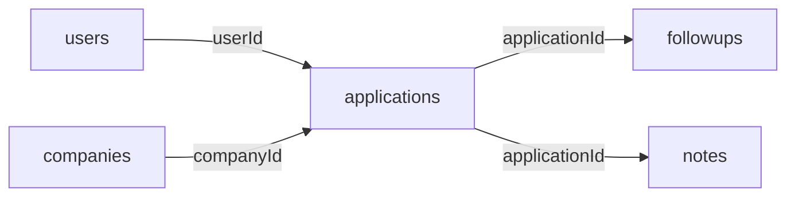
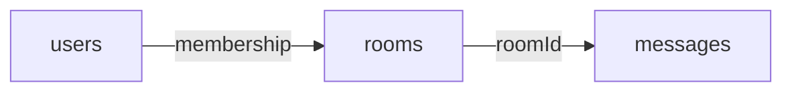
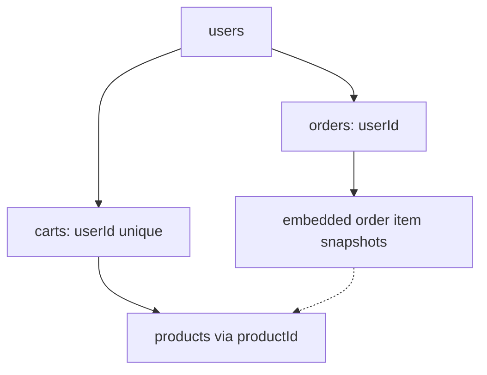
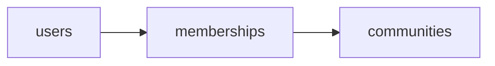

# Lesson 028 — Data Modeling Exercises and Review

[← Section 3](./README.md) · [Full curriculum](../README.md)

## Goal
Practice choosing collections, embedding/referencing, indexes and consistency rules. A good model is judged by **the real queries it serves**, not the number of collections.

## Exercise 1 — Job application tracker
Requirements: Each user applies to many companies; an application has status, notes, and follow-ups. Users filter recent applications by status.



**Suggested documents**:
```js
use mongoCourse
db.trackerApplications.insertOne({
 _id:"app-1",userId:"user-1",companyId:"company-1",
 status:"SCREENING",appliedAt:ISODate("2026-10-15")
})
db.trackerNotes.insertOne({
 applicationId:"app-1",text:"Recruiter called",createdAt:new Date()
})
db.trackerApplications.createIndex({userId:1,status:1,appliedAt:-1,_id:-1})
db.trackerNotes.createIndex({applicationId:1,createdAt:-1})
```
**Why separate notes?** They may grow indefinitely and support their own pagination. A fixed number of tiny notes might instead be embedded.

**Query challenge:** Fetch the newest 10 SCREENING applications for user-1. Expected query uses `find({userId:"user-1",status:"SCREENING"})` and sorts by appliedAt, _id descending.

## Exercise 2 — Real-time chat
Requirements: Rooms have members; messages grow continuously. Fetch last 30 messages quickly.



```js
db.chatRoomsReview.insertOne({
 _id:"room-1",type:"group",name:"Developers",memberIds:["user-1","user-2"]
})
db.chatMessagesReview.insertMany([
 {_id:"m1",roomId:"room-1",senderId:"user-1",text:"Hello",createdAt:new Date()},
 {_id:"m2",roomId:"room-1",senderId:"user-2",text:"Hi",createdAt:new Date()}
])
db.chatMessagesReview.createIndex({roomId:1,createdAt:-1,_id:-1})
db.chatMessagesReview.find({roomId:"room-1"})
 .sort({createdAt:-1,_id:-1}).limit(30)
```
For large groups or membership metadata, use a `roomMemberships` collection rather than an unbounded `memberIds` array. Enforce that the requester belongs to the room **in your API**, not through indexes alone.

## Exercise 3 — Shopping cart and orders
Requirements: One active cart per user; products change price; orders must retain purchased prices.



```js
db.reviewProducts.insertOne({_id:"p1",name:"Laptop",priceMinor:5500000,stock:5})
db.reviewCarts.insertOne({
 userId:"u1",items:[{productId:"p1",quantity:1}]
})
db.reviewCarts.createIndex({userId:1},{unique:true})
db.reviewOrders.insertOne({
 userId:"u1",
 items:[{productId:"p1",name:"Laptop",unitPriceMinor:5500000,quantity:1}],
 totalMinor:5500000,
 currency:"INR",
 status:"CREATED",
 createdAt:new Date()
})
```
**Important:** This setup demonstrates modeling, **not** a complete checkout transaction. Real checkout needs inventory concurrency control, payment verification, server-side calculations and idempotency.

## Exercise 4 — Many-to-many membership
Design a user-to-community relationship with role, joinedAt, and notification preferences. A separate `memberships` collection allows per-relationship metadata and uniqueness on `{userId:1,communityId:1}`.



## Self-review questions
1. Which entities grow without limits?
2. Which data is read together?
3. Which data must be preserved as a historical snapshot?
4. Which fields need unique indexes?
5. Which queries need compound indexes and stable sorting?
6. How will deleted users/products affect references?
7. Is multi-document atomicity required for the workflow?

## Common errors
- Putting all messages/orders inside their parent.
- Confusing database references with enforced foreign keys.
- Indexing everything without measuring.
- Using string IDs in one collection and ObjectIds in another without deliberate conversion.
- Trusting user-supplied prices or IDs without authorization and validation.

## Final practice challenge
Design a simple schema for an event gift register:
- An event has many guests and cash entries.
- Search by guest name + village.
- Prevent duplicate entry submissions using a unique `entryRequestId`.
- Store the contribution amount in integer minor units.
- List latest entries per event using `{eventId:1,createdAt:-1,_id:-1}`.

Explain why storing every contribution in an unbounded `events.entries` array is risky.

## Section recap
**Embed** small bounded data read together. **Reference** independent/unbounded data. Use **junction collections** when many-to-many relationships grow or need metadata. Add **validators and indexes** for important database rules; design using your actual query patterns.

[Official data modeling reference](https://www.mongodb.com/docs/manual/data-modeling/)
