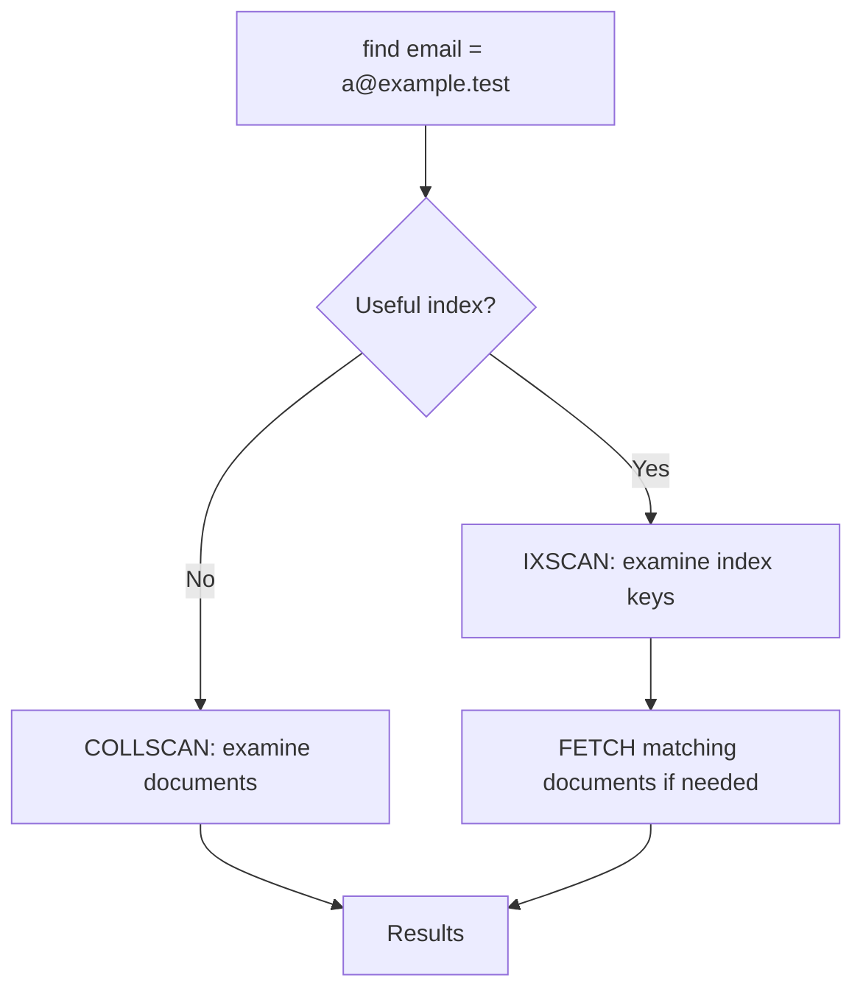

# Lesson 029 — What Is an Index and Why Is It Needed?

[← Section 4](./README.md) · [Full curriculum](../README.md)

## Goal
Understand why indexes speed up **some** queries, how they work, and why creating indexes on every field is a bad idea.

## Analogy: finding a name in a book
Without an index you inspect every page. With a sorted index, you find the relevant location and fetch the page.



## Example in mongosh
```js
use mongoCourse
db.indexIntro.insertMany([
 {name:"Asha",email:"asha@example.test",city:"Patna"},
 {name:"Ravi",email:"ravi@example.test",city:"Pune"},
 {name:"Neha",email:"neha@example.test",city:"Delhi"}
])
db.indexIntro.find({email:"ravi@example.test"}).explain("executionStats")
db.indexIntro.createIndex({email:1})
db.indexIntro.find({email:"ravi@example.test"}).explain("executionStats")
```
`1` means ascending index order. Before indexing, MongoDB may use **COLLSCAN**; after indexing it may use **IXSCAN**, possibly followed by **FETCH**. For a tiny collection the planner may still choose COLLSCAN: do not assume indexes are always faster.

## What is stored?
A typical B-tree index stores sorted keys and references to documents, not a second complete copy of every document. MongoDB creates a unique index on `_id` by default.

## Benefits and costs
- Faster selective filtering and certain sorts.
- May enable covered queries that avoid fetching full documents.
- Costs extra disk/memory and work on inserts, updates, and deletes.
- An index does not guarantee speed for every query.

## Mongoose equivalent
```js
const userSchema = new mongoose.Schema({email:String,name:String});
userSchema.index({email:1});
```
This **declares** an index; deployment/index creation must still be managed. An index is a MongoDB feature, not a Mongoose-only feature.

## Practice
Explain why a query by `email` may benefit from an index but returning the entire collection often does not. Compare explain plans before and after indexing.

**Interview:** **COLLSCAN vs IXSCAN?** Scanning collection documents vs scanning index keys.

[Official indexes](https://www.mongodb.com/docs/manual/indexes/)
