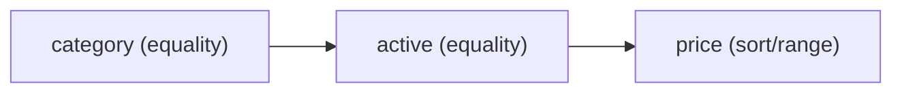

# Lesson 030 — Single-Field and Compound Indexes

[← Section 4](./README.md) · [Full curriculum](../README.md)

## Goal
Choose index field order for equality filters, sorts and ranges.

## 1. Single-field indexes
```js
use mongoCourse
db.indexProducts.insertMany([
 {_id:1,category:"Laptop",price:50000,active:true},
 {_id:2,category:"Laptop",price:70000,active:true},
 {_id:3,category:"Phone",price:20000,active:false},
 {_id:4,category:"Laptop",price:45000,active:true}
])
db.indexProducts.createIndex({category:1})
db.indexProducts.find({category:"Laptop"})
```
This index helps queries selecting a category, depending on selectivity and planner choice.

## 2. Compound indexes
```js
db.indexProducts.createIndex({category:1,active:1,price:1})
db.indexProducts.find({category:"Laptop",active:true})
 .sort({price:1})
```
A compound index stores keys in order: first category, then active, then price.



## 3. ESR guideline
**E = Equality, S = Sort, R = Range**. A useful starting point: put equality fields first, then sort fields, then range fields.

```js
db.indexProducts.find({
 category:"Laptop",
 active:true,
 price:{$gte:40000}
}).sort({price:1})
```
For this query, `{category:1,active:1,price:1}` can support both filtering and price order. ESR is a **guideline**, not a law: with highly selective range filters, a different order can be faster. Measure with `explain()`.

## 4. Prefix behavior
An index on `{category:1,active:1,price:1}` commonly supports queries on `category` alone or `category + active`. It generally cannot efficiently target an `active`-only equality as if `active` were the first field.

## 5. Sort direction
```js
db.indexProducts.createIndex({category:1,price:-1})
db.indexProducts.find({category:"Laptop"}).sort({price:-1})
```
MongoDB can scan an index in either direction. For multi-field sorts, relative index direction matters.

## 6. Mongoose
```js
productSchema.index({category:1,active:1,price:1});
```
Do not create every possible index. Each has storage and write overhead.

## Practice
Design an index for `find({userId, status}).sort({createdAt:-1})`; then explain why `find({status})` may not benefit from the same index.

**Interview:** **Why does field order matter?** Compound keys are sorted lexicographically by their defined sequence.

[Compound indexes](https://www.mongodb.com/docs/manual/core/indexes/index-types/index-compound/)
