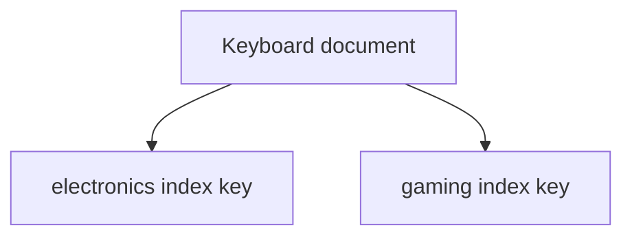

# Lesson 032 — Multikey and Text Indexes

[← Section 4](./README.md) · [Full curriculum](../README.md)

## Goal
Index arrays and support basic keyword search.

## 1. Multikey indexes for arrays
```js
use mongoCourse
db.multikeyProducts.insertMany([
 {_id:1,name:"Mouse",tags:["electronics","office"]},
 {_id:2,name:"Keyboard",tags:["electronics","gaming"]},
 {_id:3,name:"Notebook",tags:["stationery"]}
])
db.multikeyProducts.createIndex({tags:1})
db.multikeyProducts.find({tags:"gaming"})
```
When indexing an array, MongoDB creates a **multikey index** with keys for its elements. You query the array using familiar operators; you do not need to write a special multikey query.



## 2. Multikey limitations
A compound multikey index has restrictions: for a given document, it cannot index more than one array field in the same compound index. Some sorting and covered-query optimizations are limited for array fields. Test with explain rather than assuming all index combinations are valid.

## 3. Text indexes
```js
db.textProducts.insertMany([
 {_id:1,name:"Wireless Mouse",description:"Bluetooth office accessory"},
 {_id:2,name:"Gaming Keyboard",description:"Mechanical RGB keyboard"},
 {_id:3,name:"Mouse Pad",description:"Desk accessory"}
])
db.textProducts.createIndex({name:"text",description:"text"})
db.textProducts.find({$text:{$search:"keyboard"}})
db.textProducts.find(
 {$text:{$search:"mouse"}},
 {name:1,score:{$meta:"textScore"}}
).sort({score:{$meta:"textScore"}})
```
Text indexes tokenize words; they are not generic substring/autocomplete indexes. A collection has restrictions on how many classic text indexes it can have (typically one, which may cover multiple fields).

## 4. Atlas Search vs classic text
MongoDB Search/Atlas Search is a separate search capability using dedicated search indexes, useful for autocomplete, fuzzy matching, and richer relevance. It is not enabled by creating a classic text index.

## 5. Mongoose
```js
productSchema.index({tags:1});
productSchema.index({name:"text",description:"text"});
```

## Practice
Index product tags; find all products with `gaming`; create a text index and search `mouse`; explain why searching `ous` as a substring needs a different approach.

**Interview:** **What makes an index multikey?** It indexes array elements. **Text vs regex?** Token-based keyword search vs pattern matching.

[Multikey](https://www.mongodb.com/docs/manual/core/indexes/index-types/index-multikey/) · [Text indexes](https://www.mongodb.com/docs/manual/core/indexes/index-types/index-text/)
