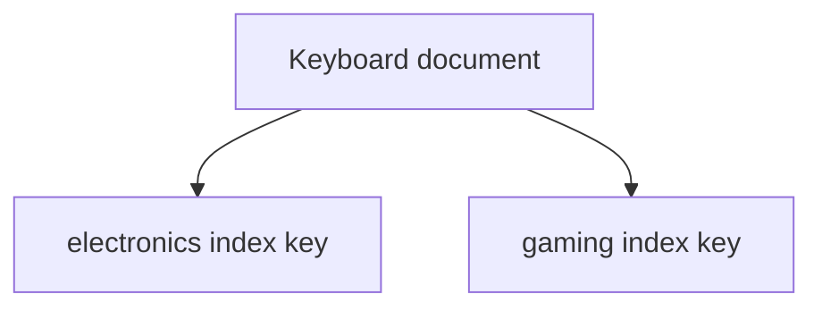

# Lesson 032 — Multikey and Text Indexes

[← Section 4](./README.md) · [Full curriculum](../README.md)

## Goal
Index arrays and support basic keyword search.

## 1. Multikey indexes for arrays
```js
use mongoCourse
db.multikeyProducts.insertMany([
 {_id:1,name:"Mouse",tags:["electronics","office"]},
 {_id:2,name:"Keyboard",tags:["electronics","gaming"]},
 {_id:3,name:"Notebook",tags:["stationery"]}
])
db.multikeyProducts.createIndex({tags:1})
db.multikeyProducts.find({tags:"gaming"})
```
When indexing an array, MongoDB creates a **multikey index** with keys for its elements. You query the array using familiar operators; you do not need to write a special multikey query.



## 2. Multikey limitations
A compound multikey index has restrictions: for a given document, it cannot index more than one array field in the same compound index. Some sorting and covered-query optimizations are limited for array fields. Test with explain rather than assuming all index combinations are valid.

## 3. Text indexes
```js
db.textProducts.insertMany([
 {_id:1,name:"Wireless Mouse",description:"Bluetooth office accessory"},
 {_id:2,name:"Gaming Keyboard",description:"Mechanical RGB keyboard"},
 {_id:3,name:"Mouse Pad",description:"Desk accessory"}
])
db.textProducts.createIndex({name:"text",description:"text"})
db.textProducts.find({$text:{$search:"keyboard"}})
db.textProducts.find(
 {$text:{$search:"mouse"}},
 {name:1,score:{$meta:"textScore"}}
).sort({score:{$meta:"textScore"}})
```
Text indexes tokenize words; they are not generic substring/autocomplete indexes. A collection has restrictions on how many classic text indexes it can have (typically one, which may cover multiple fields).

## 4. Atlas Search vs classic text
MongoDB Search/Atlas Search is a separate search capability using dedicated search indexes, useful for autocomplete, fuzzy matching, and richer relevance. It is not enabled by creating a classic text index.

## 5. Mongoose
```js
productSchema.index({tags:1});
productSchema.index({name:"text",description:"text"});
```

## 6. Detailed explanation with e-commerce examples

### 6.1 Why do we need a multikey index?

Imagine a products collection where every product has a `tags` array:

```js
db.products.insertMany([
  { _id: 1, name: "Laptop", tags: ["electronics", "gaming", "computer"] },
  { _id: 2, name: "Mouse", tags: ["electronics", "accessories"] },
  { _id: 3, name: "Shoes", tags: ["fashion", "sports"] }
]);

db.products.find({ tags: "gaming" }); // Laptop
```

MongoDB can match a scalar value against elements inside an array even without an index. But on a large collection, scanning documents may be expensive.

Create an index on the array field:

```js
db.products.createIndex({ tags: 1 });
```

MongoDB **automatically treats an index on an array field as multikey**. Each distinct indexed array value contributes an index key pointing to the relevant document.

```text
Document: Laptop
tags = ["electronics", "gaming", "computer"]
                   |
                   v
Multikey index (conceptual)
"computer"    --> Laptop
"electronics" --> Laptop, Mouse
"gaming"      --> Laptop
```

A query for `{tags:"gaming"}` can locate Laptop using the index rather than inspecting every document.

**Mongoose example:**

```js
const productSchema = new mongoose.Schema({
  name: String,
  tags: [String]
});

productSchema.index({ tags: 1 });

const Product = mongoose.model("Product", productSchema);
const gamingProducts = await Product.find({ tags: "gaming" });
```

### 6.2 Multikey indexes on arrays of objects

Consider product reviews:

```js
{
  name: "Laptop",
  reviews: [
    { user: "A", stars: 2 },
    { user: "B", stars: 5 },
    { user: "C", stars: 4 }
  ]
}
```

To find a product with **one review** where user B gave at least four stars:

```js
db.products.find({
  reviews: {
    $elemMatch: {
      user: "B",
      stars: { $gte: 4 }
    }
  }
});
```

A compound multikey index may help this query:

```js
db.products.createIndex({
  "reviews.user": 1,
  "reviews.stars": 1
});
```

**Why `$elemMatch`?** Without it, conditions on `reviews.user` and `reviews.stars` might be satisfied by **different** reviews. With `$elemMatch`, both conditions must match the **same array element**; this can also allow better compound index bounds.

**Restriction:** A compound multikey index cannot index two independent array fields from the same document (parallel arrays).

### 6.3 What is a text index and why use it?

Suppose customers search for products using words in their names and descriptions:

```js
db.searchProducts.insertMany([
  { name: "Gaming Laptop", description: "Powerful laptop for gaming" },
  { name: "Wireless Mouse", description: "Ergonomic office mouse" },
  { name: "Gaming Keyboard", description: "Mechanical keyboard for gamers" }
]);

db.searchProducts.createIndex({
  name: "text",
  description: "text"
});

db.searchProducts.find({
  $text: { $search: "gaming" }
});
```

A classic text index processes text into searchable terms (with language-dependent stemming and stop-word handling).

```text
"Powerful laptop for gaming"
             |
             v
   Text processing / tokenization
             |
             v
   powerful | laptop | gaming
             |
             v
   $text search for "gaming"
             |
             v
       Gaming Laptop
```

This is a conceptual view: actual terms depend on configured language rules. **Text indexing is not a generic substring or autocomplete mechanism.**

### 6.4 Relevance scores

```js
db.searchProducts.find(
  { $text: { $search: "gaming laptop" } },
  { name: 1, score: { $meta: "textScore" } }
).sort({ score: { $meta: "textScore" } });
```

The score is useful when sorting matching documents by text relevance.

### 6.5 Full Mongoose schema and Express search endpoint

```js
import mongoose from "mongoose";

const productSchema = new mongoose.Schema({
  name: String,
  description: String,
  tags: [String]
});

productSchema.index({ tags: 1 }); // Multikey when tags is an array
productSchema.index({ name: "text", description: "text" }); // Classic text

export const Product = mongoose.model("Product", productSchema);
```

```js
// Express 5 route
app.get("/api/products/search", async (req, res) => {
  const search = req.query.search;

  if (typeof search !== "string" || !search.trim() || search.length > 100) {
    return res.status(400).json({ message: "Valid search text is required" });
  }

  const products = await Product.find({
    $text: { $search: search.trim() }
  }).limit(20).lean();

  return res.json({ success: true, data: products });
});
```

### 6.6 Using tags and text search together

```js
const products = await Product.find({
  tags: "electronics",
  $text: { $search: "gaming" }
});
```

This means: **match products tagged electronics AND containing the search term gaming**. Both index definitions can exist, but MongoDB does not necessarily combine them for every query; inspect the query plan.

### 6.7 Multikey vs text index

| Feature | Multikey | Text |
| --- | --- | --- |
| Main purpose | Search array elements | Search words in text |
| Typical field | `tags: [String]` | `name: String`, `description: String` |
| Index declaration | `{ tags: 1 }` | `{ name: "text" }` |
| Query | `{ tags: "gaming" }` | `{ $text: { $search: "gaming" } }` |
| Common use | Tags, reviews, categories | Product/article keyword search |
| Automatic? | Becomes multikey when indexed field is an array | Must explicitly define text index |

**Interview takeaway:** A multikey index indexes array elements. A text index supports word-based search. For advanced autocomplete and fuzzy matching, use MongoDB Search/Atlas Search rather than expecting those capabilities from classic `$text` indexes.

## Practice
Index product tags; find all products with `gaming`; create a text index and search `mouse`; explain why searching `ous` as a substring needs a different approach.

**Interview:** **What makes an index multikey?** It indexes array elements. **Text vs regex?** Token-based keyword search vs pattern matching.

[Multikey](https://www.mongodb.com/docs/manual/core/indexes/index-types/index-multikey/) · [Text indexes](https://www.mongodb.com/docs/manual/core/indexes/index-types/index-text/)
