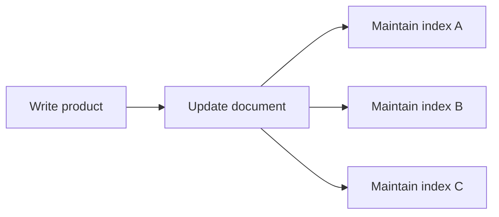

# Lesson 035 — Index Design and Trade-offs

[← Section 4](./README.md) · [Full curriculum](../README.md)

## Goal
Choose **useful** indexes, not the maximum number of indexes.

## 1. Why not index every field?
Indexes consume storage and memory and must be maintained when indexed data changes. Extra indexes can slow inserts, updates, deletes and migrations.



## 2. Selectivity matters
An `email` index is often selective (one match); a boolean `active` index may match half the collection. A low-selectivity index can still help in compound indexes or selective partial indexes, but may not help alone.

## 3. Start from workload
Job tracker queries:
```js
db.jobApplications.find({userId:"u1",status:"INTERVIEW"})
 .sort({appliedAt:-1,_id:-1}).limit(20)
db.jobApplications.find({userId:"u1"})
 .sort({appliedAt:-1,_id:-1}).limit(20)
```
Potential indexes:
```js
db.jobApplications.createIndex({userId:1,status:1,appliedAt:-1,_id:-1})
db.jobApplications.createIndex({userId:1,appliedAt:-1,_id:-1})
```
The first helps filtered-by-status listings; the second helps all-status recent listings. Whether both are worthwhile depends on workload, storage and explain measurements.

## 4. Avoid redundant indexes
If a compound index begins with `userId`, a standalone `{userId:1}` may be redundant **for some queries**, but unique/sparse/partial behavior, sort requirements and workloads can change that decision. Don't drop an index solely from prefix rules.

## 5. Covered queries and index size
A query can sometimes be served from index keys alone if all needed fields are indexed and other conditions allow it. Adding every response field to indexes increases index size, so measure the trade-off.

## 6. Operational habits
```js
db.jobApplications.getIndexes()
db.jobApplications.find({userId:"u1"}).explain("executionStats")
```
Use profiler/monitoring data and slow query logs where appropriate. Create/drop indexes through reviewed migrations, especially on large production collections.

## 7. Mongoose
```js
applicationSchema.index({userId:1,status:1,appliedAt:-1,_id:-1});
```
Avoid relying on automatic index creation as an uncontrolled production migration mechanism.

## Practice
Pick the best index for a product catalog filtered by category, sorted by price; explain why a separate `{active:1}` index might be poor. Measure using explain.

**Interview:** **What is the cost of an index?** Storage, memory and extra write maintenance.

[Index strategies](https://www.mongodb.com/docs/manual/applications/indexes/)
