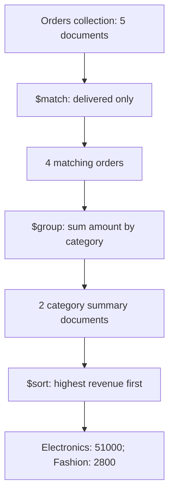
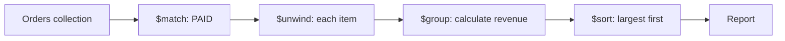

# Lesson 037 — Aggregation Concepts and Pipeline Flow

[← Section 5](./README.md) · [Full curriculum](../README.md)

## Beginner-friendly explanation — Aggregation from zero

### 1. Why do we need aggregation?

Imagine an e-commerce `orders` collection:

| _id | product | category | amount | status |
| --- | --- | --- | ---: | --- |
| 1 | Laptop | Electronics | 50000 | delivered |
| 2 | Mouse | Electronics | 1000 | delivered |
| 3 | Shoes | Fashion | 2000 | delivered |
| 4 | Keyboard | Electronics | 3000 | pending |
| 5 | T-Shirt | Fashion | 800 | delivered |

`find()` is great when you want **existing documents**, such as all delivered orders. But an admin dashboard may need **revenue by category**, **total delivered orders**, or **top-selling categories**. Aggregation can calculate those answers in MongoDB rather than sending all orders to Node.js and calculating everything there.

### 2. What does "pipeline" mean?

A pipeline is an **ordered chain of stages**. Each stage takes documents produced by the previous stage, performs one operation, and passes the resulting documents to the next stage.



**Mental model:** Think of an assembly line. Stage 1 filters; Stage 2 calculates; Stage 3 arranges the results.

### 3. Understand the syntax

```js
db.orders.aggregate([
  { $match: { status: "delivered" } },
  {
    $group: {
      _id: "$category",
      totalRevenue: { $sum: "$amount" }
    }
  },
  { $sort: { totalRevenue: -1 } }
]);
```

`aggregate([...])` receives an **array of stage objects**. The order matters.

**Stage 1 — `$match`:** Keep only delivered orders. The pending Keyboard order is excluded; 4 orders continue.

**Stage 2 — `$group`:** Combine orders with the same category:

- `_id: "$category"` means **group by the value of the category field**. It is not the original document `_id`.
- `totalRevenue: { $sum: "$amount" }` means **add the amount field of each order in the group**.
- `"$category"` and `"$amount"` are **field references**; `"category"` without the dollar sign is a literal string in expression contexts.

Intermediate group results:

```js
[
  { _id: "Electronics", totalRevenue: 51000 },
  { _id: "Fashion", totalRevenue: 2800 }
]
```

**Stage 3 — `$sort`:** `{totalRevenue:-1}` means descending (largest first). `1` would mean ascending.

### 4. See how data changes at each stage

**Original collection (5 documents):**

```text
Laptop     Electronics 50000 delivered
Mouse      Electronics  1000 delivered
Shoes      Fashion      2000 delivered
Keyboard   Electronics  3000 pending
T-Shirt    Fashion       800 delivered
```

**After `$match` (4 documents):**

```text
Laptop     Electronics 50000
Mouse      Electronics  1000
Shoes      Fashion      2000
T-Shirt    Fashion       800
```

**After `$group` (2 new result documents):**

```text
Electronics -> 50000 + 1000 = 51000
Fashion     ->  2000 +  800 =  2800
```

**After `$sort`:** Electronics first, Fashion second.

The output documents are **new summary shapes**, not copies of the original orders.

### 5. Add an order count

```js
db.orders.aggregate([
  { $match: { status: "delivered" } },
  {
    $group: {
      _id: "$category",
      totalRevenue: { $sum: "$amount" },
      totalOrders: { $sum: 1 }
    }
  },
  { $sort: { totalRevenue: -1 } }
]);
```

Why `$sum: 1`? For every document in the group, add **one**, which counts the orders.

Expected result:

```js
[
  { _id: "Electronics", totalRevenue: 51000, totalOrders: 2 },
  { _id: "Fashion", totalRevenue: 2800, totalOrders: 2 }
]
```

### 6. Use aggregation in Express 5 + Mongoose

```js
const getSalesReport = async (req, res) => {
  const report = await Order.aggregate([
    { $match: { status: "delivered" } },
    {
      $group: {
        _id: "$category",
        totalRevenue: { $sum: "$amount" },
        totalOrders: { $sum: 1 }
      }
    },
    { $sort: { totalRevenue: -1 } }
  ]);

  return res.status(200).json({ success: true, data: report });
};
```

This assumes each order document contains `category` and numeric `amount`, as in this introductory dataset. In a real store where each order has multiple `items`, use `$unwind` and calculate each item's revenue; the existing practice dataset below demonstrates that richer order structure.

**Mongoose note:** Aggregation returns plain JavaScript objects, not hydrated Mongoose documents. Mongoose also does not generally cast pipeline values to schema types.

### 7. Common stages you will learn

| Stage | Purpose |
| --- | --- |
| `$match` | Filter documents |
| `$project` | Select or calculate fields |
| `$group` | Group documents and calculate totals |
| `$sort` | Order results |
| `$limit` | Keep first N results |
| `$skip` | Skip N results |
| `$unwind` | Expand array elements into separate documents |
| `$lookup` | Join related documents from another collection |
| `$addFields` / `$set` | Add computed fields |
| `$count` | Count documents |
| `$facet` | Run multiple sub-pipelines |

### 8. Important rules and mistakes

1. **Stage order matters.** An early `$match` often reduces later work, although MongoDB may optimize/reorder certain operations.
2. **Document count can change.** `$match` can reduce rows, `$group` can collapse many rows into one group, and `$unwind` can expand them.
3. **The shape can change.** If `$project` removes a field, later stages cannot rely on that field being present.
4. **Aggregation does not normally change saved documents.** Special stages such as `$merge` and `$out` can write results.
5. **Aggregation is not just for totals.** It can filter, reshape, join and analyze documents.

### 9. `find()` vs `aggregate()`

| `find()` | `aggregate()` |
| --- | --- |
| Retrieve and filter documents | Process documents through multiple stages |
| Supports projection and sorting | Also supports grouping, calculations and joins |
| Example: product list | Example: revenue report |

**Interview definition:** An aggregation pipeline is an ordered sequence of document-processing stages. Each stage receives the previous stage's output and passes its own output to the next stage.

**Practice:** From the five-order dataset above, predict the revenue totals if you remove `$match`. Then explain why the pending Keyboard order is included.

---

## What problem does aggregation solve?
`find()` answers questions like “give me paid orders.” But dashboards ask “**how much revenue came from paid orders, by month?**” That needs filtering, calculations, grouping, and sorting. An **aggregation pipeline** processes documents through a sequence of stages, each stage receiving the previous stage's output.



Think of an assembly line: every stage performs **one job**. The next stage sees the *transformed* documents, not necessarily the original shape.

## Shared practice dataset
Run this once in **mongosh** on a disposable learning database. All lessons use these same IDs and amounts, so you can follow the data from stage to stage.

```js
use mongoCourse
db.aggCustomers.deleteMany({_id:{$in:["u1","u2","u3"]}})
db.aggProducts.deleteMany({_id:{$in:["p1","p2","p3"]}})
db.aggOrders.deleteMany({_id:{$in:["o1","o2","o3","o4"]}})
db.aggCustomers.insertMany([
 {_id:"u1",name:"Asha",city:"Patna"},
 {_id:"u2",name:"Ravi",city:"Pune"},
 {_id:"u3",name:"Neha",city:"Patna"}
])
db.aggProducts.insertMany([
 {_id:"p1",name:"Mouse",category:"Accessories"},
 {_id:"p2",name:"Keyboard",category:"Accessories"},
 {_id:"p3",name:"Monitor",category:"Electronics"}
])
db.aggOrders.insertMany([
 {_id:"o1",customerId:"u1",status:"PAID",createdAt:ISODate("2026-01-10T10:00:00Z"),items:[{productId:"p1",qty:2,unitPrice:500},{productId:"p2",qty:1,unitPrice:1500}]},
 {_id:"o2",customerId:"u2",status:"PAID",createdAt:ISODate("2026-01-20T10:00:00Z"),items:[{productId:"p1",qty:1,unitPrice:500}]},
 {_id:"o3",customerId:"u1",status:"CANCELLED",createdAt:ISODate("2026-02-03T10:00:00Z"),items:[{productId:"p3",qty:1,unitPrice:12000}]},
 {_id:"o4",customerId:"u3",status:"PAID",createdAt:ISODate("2026-02-15T10:00:00Z"),items:[{productId:"p3",qty:1,unitPrice:12000}]}
])
```
Prices here are **illustrative whole currency units** for easy arithmetic. In a production shop, store money consistently as integer minor units or Decimal128 and handle currency and refunds explicitly.


## Your first pipeline
```js
db.aggOrders.aggregate([
 {$match:{status:"PAID"}},
 {$project:{_id:0,customerId:1,itemCount:{$size:"$items"}}},
 {$sort:{itemCount:-1,customerId:1}}
])
```
**Step 1 — $match:** keeps o1, o2, o4; removes cancelled o3.

**Step 2 — $project:** reshapes each remaining order to `{customerId,itemCount}`. The field path `"$items"` means **read the value of the items field**. `$size` counts array entries.

**Step 3 — $sort:** orders by itemCount descending, then customerId ascending. Output: `{customerId:"u1",itemCount:2}`, then u2 and u3 with count 1 (tie broken by ID).

## What aggregate() returns
In mongosh, `aggregate([...])` returns a **cursor**. For small learning results you can use `.toArray()`. Stages usually do not modify saved documents; they produce result documents. Write stages such as `$merge` or `$out` are exceptions.

## Aggregation expressions vs query operators
```js
{$match:{status:"PAID"}}        // query predicate
{$project:{doubleQty:{$multiply:["$qty",2]}}} // expression
```
Expressions evaluate values for **each input document**. Stages determine how the document stream changes.

## Mongoose equivalent
```js
const result = await Order.aggregate([
 {$match:{status:"PAID"}},
 {$project:{customerId:1,itemCount:{$size:"$items"}}}
]);
```
Mongoose aggregation returns plain objects and **does not generally cast pipeline values to schema types**. For ObjectId matches, construct an actual ObjectId.

## Common mistakes
- Assuming `aggregate()` is only for statistics; it can reshape and join data too.
- Confusing `"$price"` (field value) with `"price"` (literal string).
- Expecting a field removed by `$project` to be available in later stages.
- Assuming aggregation writes back to the collection.

## Practice
Filter CANCELLED orders, project customerId and status, then sort by customerId. Predict each intermediate result before running it.

**Interview:** **What is a pipeline?** An ordered set of document-processing stages.

[Official aggregation guide](https://www.mongodb.com/docs/manual/aggregation/)
