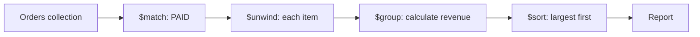

# Lesson 037 — Aggregation Concepts and Pipeline Flow

[← Section 5](./README.md) · [Full curriculum](../README.md)

## What problem does aggregation solve?
`find()` answers questions like “give me paid orders.” But dashboards ask “**how much revenue came from paid orders, by month?**” That needs filtering, calculations, grouping, and sorting. An **aggregation pipeline** processes documents through a sequence of stages, each stage receiving the previous stage's output.



Think of an assembly line: every stage performs **one job**. The next stage sees the *transformed* documents, not necessarily the original shape.

## Shared practice dataset
Run this once in **mongosh** on a disposable learning database. All lessons use these same IDs and amounts, so you can follow the data from stage to stage.

```js
use mongoCourse
db.aggCustomers.deleteMany({_id:{$in:["u1","u2","u3"]}})
db.aggProducts.deleteMany({_id:{$in:["p1","p2","p3"]}})
db.aggOrders.deleteMany({_id:{$in:["o1","o2","o3","o4"]}})
db.aggCustomers.insertMany([
 {_id:"u1",name:"Asha",city:"Patna"},
 {_id:"u2",name:"Ravi",city:"Pune"},
 {_id:"u3",name:"Neha",city:"Patna"}
])
db.aggProducts.insertMany([
 {_id:"p1",name:"Mouse",category:"Accessories"},
 {_id:"p2",name:"Keyboard",category:"Accessories"},
 {_id:"p3",name:"Monitor",category:"Electronics"}
])
db.aggOrders.insertMany([
 {_id:"o1",customerId:"u1",status:"PAID",createdAt:ISODate("2026-01-10T10:00:00Z"),items:[{productId:"p1",qty:2,unitPrice:500},{productId:"p2",qty:1,unitPrice:1500}]},
 {_id:"o2",customerId:"u2",status:"PAID",createdAt:ISODate("2026-01-20T10:00:00Z"),items:[{productId:"p1",qty:1,unitPrice:500}]},
 {_id:"o3",customerId:"u1",status:"CANCELLED",createdAt:ISODate("2026-02-03T10:00:00Z"),items:[{productId:"p3",qty:1,unitPrice:12000}]},
 {_id:"o4",customerId:"u3",status:"PAID",createdAt:ISODate("2026-02-15T10:00:00Z"),items:[{productId:"p3",qty:1,unitPrice:12000}]}
])
```
Prices here are **illustrative whole currency units** for easy arithmetic. In a production shop, store money consistently as integer minor units or Decimal128 and handle currency and refunds explicitly.


## Your first pipeline
```js
db.aggOrders.aggregate([
 {$match:{status:"PAID"}},
 {$project:{_id:0,customerId:1,itemCount:{$size:"$items"}}},
 {$sort:{itemCount:-1,customerId:1}}
])
```
**Step 1 — $match:** keeps o1, o2, o4; removes cancelled o3.

**Step 2 — $project:** reshapes each remaining order to `{customerId,itemCount}`. The field path `"$items"` means **read the value of the items field**. `$size` counts array entries.

**Step 3 — $sort:** orders by itemCount descending, then customerId ascending. Output: `{customerId:"u1",itemCount:2}`, then u2 and u3 with count 1 (tie broken by ID).

## What aggregate() returns
In mongosh, `aggregate([...])` returns a **cursor**. For small learning results you can use `.toArray()`. Stages usually do not modify saved documents; they produce result documents. Write stages such as `$merge` or `$out` are exceptions.

## Aggregation expressions vs query operators
```js
{$match:{status:"PAID"}}        // query predicate
{$project:{doubleQty:{$multiply:["$qty",2]}}} // expression
```
Expressions evaluate values for **each input document**. Stages determine how the document stream changes.

## Mongoose equivalent
```js
const result = await Order.aggregate([
 {$match:{status:"PAID"}},
 {$project:{customerId:1,itemCount:{$size:"$items"}}}
]);
```
Mongoose aggregation returns plain objects and **does not generally cast pipeline values to schema types**. For ObjectId matches, construct an actual ObjectId.

## Common mistakes
- Assuming `aggregate()` is only for statistics; it can reshape and join data too.
- Confusing `"$price"` (field value) with `"price"` (literal string).
- Expecting a field removed by `$project` to be available in later stages.
- Assuming aggregation writes back to the collection.

## Practice
Filter CANCELLED orders, project customerId and status, then sort by customerId. Predict each intermediate result before running it.

**Interview:** **What is a pipeline?** An ordered set of document-processing stages.

[Official aggregation guide](https://www.mongodb.com/docs/manual/aggregation/)
