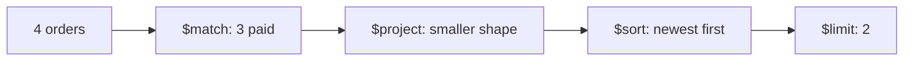

# Lesson 038 — $match, $project, $sort and $limit

[← Section 5](./README.md) · [Full curriculum](../README.md)

## Mental model
These four stages answer: **Which documents? Which fields? In what order? How many?**



## Shared practice dataset
Run this once in **mongosh** on a disposable learning database. All lessons use these same IDs and amounts, so you can follow the data from stage to stage.

```js
use mongoCourse
db.aggCustomers.deleteMany({_id:{$in:["u1","u2","u3"]}})
db.aggProducts.deleteMany({_id:{$in:["p1","p2","p3"]}})
db.aggOrders.deleteMany({_id:{$in:["o1","o2","o3","o4"]}})
db.aggCustomers.insertMany([
 {_id:"u1",name:"Asha",city:"Patna"},
 {_id:"u2",name:"Ravi",city:"Pune"},
 {_id:"u3",name:"Neha",city:"Patna"}
])
db.aggProducts.insertMany([
 {_id:"p1",name:"Mouse",category:"Accessories"},
 {_id:"p2",name:"Keyboard",category:"Accessories"},
 {_id:"p3",name:"Monitor",category:"Electronics"}
])
db.aggOrders.insertMany([
 {_id:"o1",customerId:"u1",status:"PAID",createdAt:ISODate("2026-01-10T10:00:00Z"),items:[{productId:"p1",qty:2,unitPrice:500},{productId:"p2",qty:1,unitPrice:1500}]},
 {_id:"o2",customerId:"u2",status:"PAID",createdAt:ISODate("2026-01-20T10:00:00Z"),items:[{productId:"p1",qty:1,unitPrice:500}]},
 {_id:"o3",customerId:"u1",status:"CANCELLED",createdAt:ISODate("2026-02-03T10:00:00Z"),items:[{productId:"p3",qty:1,unitPrice:12000}]},
 {_id:"o4",customerId:"u3",status:"PAID",createdAt:ISODate("2026-02-15T10:00:00Z"),items:[{productId:"p3",qty:1,unitPrice:12000}]}
])
```
Prices here are **illustrative whole currency units** for easy arithmetic. In a production shop, store money consistently as integer minor units or Decimal128 and handle currency and refunds explicitly.


## 1. $match filters
```js
db.aggOrders.aggregate([
 {$match:{status:"PAID",createdAt:{$gte:ISODate("2026-02-01")}}}
])
```
Only o4 matches. `$match` uses familiar MongoDB query predicates. Place selective `$match` early when possible so later stages process fewer documents and indexes can be used.

## 2. $project selects or calculates fields
```js
db.aggOrders.aggregate([
 {$match:{status:"PAID"}},
 {$project:{_id:0,customerId:1,status:1,lines:{$size:"$items"}}}
])
```
Output has customerId, status and computed `lines`, not the original items. `_id` is included by default unless excluded. Projection expressions differ from simple `find()` projection.

## 3. $sort establishes deterministic order
```js
db.aggOrders.aggregate([
 {$sort:{createdAt:-1,_id:-1}}
])
```
`1` ascending; `-1` descending. A unique tie-breaker such as `_id` prevents ambiguous order for identical dates.

## 4. $limit restricts result count
```js
db.aggOrders.aggregate([
 {$match:{status:"PAID"}},
 {$sort:{createdAt:-1,_id:-1}},
 {$limit:2},
 {$project:{_id:1,customerId:1,createdAt:1}}
])
```
Result: o4 then o2. **Sort before limit** when you mean “two newest.” If you limit first, you select an arbitrary subset and then sort only that subset.

## Stage order changes the answer
```js
// Correct: newest 2 paid orders
[{$match:{status:"PAID"}},{$sort:{createdAt:-1}},{$limit:2}]

// Different meaning: select 2 arbitrary orders, then filter paid
[{$limit:2},{$match:{status:"PAID"}}]
```
MongoDB can optimize stages internally, but it preserves pipeline semantics.

## Mongoose
```js
const latest = await Order.aggregate([
 {$match:{status:"PAID"}},
 {$sort:{createdAt:-1,_id:-1}},
 {$limit:10},
 {$project:{customerId:1,createdAt:1}}
]);
```

## Practice and checks
Return the newest PAID order with only customerId and date; explain why `$sort` must precede `$limit`. Try moving `$project` before a sort that needs a removed field and observe the difference.

**Interview:** **When can an index help?** Early match and compatible sort patterns, depending on the plan.

[$match](https://www.mongodb.com/docs/manual/reference/operator/aggregation/match/) · [$project](https://www.mongodb.com/docs/manual/reference/operator/aggregation/project/)
