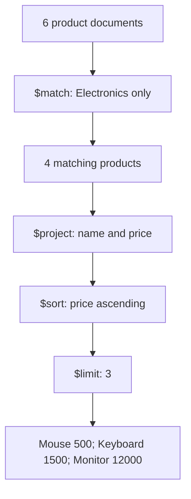
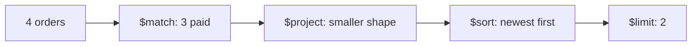

# Lesson 038 — $match, $project, $sort and $limit

[← Section 5](./README.md) · [Full curriculum](../README.md)

## Beginner-friendly walkthrough — Product listing example

The easiest way to remember these stages:

| Stage | Question | Similar SQL concept |
| --- | --- | --- |
| `$match` | Which documents do I need? | `WHERE` |
| `$project` | Which fields should I return? | `SELECT` |
| `$sort` | In what order? | `ORDER BY` |
| `$limit` | How many results? | `LIMIT` |

### 1. Sample products

Use a disposable practice collection:

```js
use mongoCourse
db.lesson38Products.drop();
db.lesson38Products.insertMany([
  { _id: 1, name: "Laptop", category: "Electronics", price: 50000, stock: 10 },
  { _id: 2, name: "Mouse", category: "Electronics", price: 500, stock: 50 },
  { _id: 3, name: "Keyboard", category: "Electronics", price: 1500, stock: 20 },
  { _id: 4, name: "Shoes", category: "Fashion", price: 2000, stock: 30 },
  { _id: 5, name: "Monitor", category: "Electronics", price: 12000, stock: 15 },
  { _id: 6, name: "T-Shirt", category: "Fashion", price: 800, stock: 40 }
]);
```

**Frontend requirement:** Show only Electronics products, return their names and prices, order by lowest price first, and display a maximum of three.

### 2. `$match` — Filter documents

```js
db.lesson38Products.aggregate([
  { $match: { category: "Electronics" } }
]);
```

This works like `find({category:"Electronics"})`: Laptop, Mouse, Keyboard and Monitor pass through. **`$match` filters documents; it does not remove fields from matching documents.**

You can combine conditions:

```js
{ $match: { category: "Electronics", price: { $gte: 1000 } } }
```

This means category is Electronics **AND** price is at least 1000.

### 3. `$project` — Select or calculate fields

```js
{
  $project: {
    _id: 0,
    name: 1,
    price: 1
  }
}
```

- `1` means **include** that field.
- `0` means **exclude** that field.
- `_id` is included by default unless explicitly excluded.

`$project` can also create calculated values:

```js
{
  $project: {
    _id: 0,
    name: 1,
    price: 1,
    discountedPrice: { $multiply: ["$price", 0.9] }
  }
}
```

Here `"$price"` means **read the current document's price field**. The calculation does **not** update the saved product price.

### 4. `$sort` — Choose the order

```js
{ $sort: { price: 1 } }  // cheapest first
{ $sort: { price: -1 } } // most expensive first
```

For stable pagination when prices can repeat, use a tie-breaker:

```js
{ $sort: { price: 1, _id: 1 } }
```

### 5. `$limit` — Return only N documents

```js
{ $limit: 3 }
```

This keeps at most three documents from the **current stage's output**. It does not itself decide which documents are cheapest or newest.

### 6. All four stages together

```js
db.lesson38Products.aggregate([
  { $match: { category: "Electronics" } },
  { $project: { _id: 0, name: 1, price: 1 } },
  { $sort: { price: 1 } },
  { $limit: 3 }
]);
```

**Stage-by-stage flow:**



**Expected output:**

```js
[
  { name: "Mouse", price: 500 },
  { name: "Keyboard", price: 1500 },
  { name: "Monitor", price: 12000 }
]
```

Laptop is the fourth Electronics product after sorting by price, so it is excluded by `$limit:3`.

### 7. Why stage order matters

**Cheapest three products:**

```js
[
  { $sort: { price: 1 } },
  { $limit: 3 }
]
```

**Not the same meaning:**

```js
[
  { $limit: 3 },
  { $sort: { price: 1 } }
]
```

The second version limits an otherwise unordered input first and sorts only that subset. It does not guarantee the collection's cheapest three products.

**Another common mistake:** Removing `price` before sorting by it:

```js
[
  { $project: { _id: 0, name: 1 } },
  { $sort: { price: 1 } }
]
```

After `$project`, the `price` field is missing from the documents. Instead, sort before removing it:

```js
[
  { $sort: { price: 1 } },
  { $project: { _id: 0, name: 1 } }
]
```

MongoDB's optimizer may rearrange some physical operations, but the logical meaning of the pipeline stays the same.

### 8. Express 5 + Mongoose example

```js
// Assume Product is an imported Mongoose model
const getProducts = async (req, res) => {
  const products = await Product.aggregate([
    { $match: { category: "Electronics" } },
    { $sort: { price: 1, _id: 1 } },
    { $project: { name: 1, price: 1 } },
    { $limit: 3 }
  ]);

  return res.status(200).json({
    success: true,
    data: products
  });
};
```

This assumes your Product model has `category`, `name`, and numeric `price` fields.

### 9. Practice and interview questions

1. Find the **top two most expensive Electronics products**. Hint: `$match`, then `$sort:{price:-1}`, then `$limit:2`.
2. Return only `name` and `price`, excluding `_id`.
3. Add a `discountedPrice` field equal to 90% of the original price.
4. Explain why `$sort` before `$limit` is important.
5. Explain the difference between `$match` and `$project`: **`$match` chooses documents; `$project` chooses or computes fields.**

---

## Mental model
These four stages answer: **Which documents? Which fields? In what order? How many?**



## Shared practice dataset
Run this once in **mongosh** on a disposable learning database. All lessons use these same IDs and amounts, so you can follow the data from stage to stage.

```js
use mongoCourse
db.aggCustomers.deleteMany({_id:{$in:["u1","u2","u3"]}})
db.aggProducts.deleteMany({_id:{$in:["p1","p2","p3"]}})
db.aggOrders.deleteMany({_id:{$in:["o1","o2","o3","o4"]}})
db.aggCustomers.insertMany([
 {_id:"u1",name:"Asha",city:"Patna"},
 {_id:"u2",name:"Ravi",city:"Pune"},
 {_id:"u3",name:"Neha",city:"Patna"}
])
db.aggProducts.insertMany([
 {_id:"p1",name:"Mouse",category:"Accessories"},
 {_id:"p2",name:"Keyboard",category:"Accessories"},
 {_id:"p3",name:"Monitor",category:"Electronics"}
])
db.aggOrders.insertMany([
 {_id:"o1",customerId:"u1",status:"PAID",createdAt:ISODate("2026-01-10T10:00:00Z"),items:[{productId:"p1",qty:2,unitPrice:500},{productId:"p2",qty:1,unitPrice:1500}]},
 {_id:"o2",customerId:"u2",status:"PAID",createdAt:ISODate("2026-01-20T10:00:00Z"),items:[{productId:"p1",qty:1,unitPrice:500}]},
 {_id:"o3",customerId:"u1",status:"CANCELLED",createdAt:ISODate("2026-02-03T10:00:00Z"),items:[{productId:"p3",qty:1,unitPrice:12000}]},
 {_id:"o4",customerId:"u3",status:"PAID",createdAt:ISODate("2026-02-15T10:00:00Z"),items:[{productId:"p3",qty:1,unitPrice:12000}]}
])
```
Prices here are **illustrative whole currency units** for easy arithmetic. In a production shop, store money consistently as integer minor units or Decimal128 and handle currency and refunds explicitly.


## 1. $match filters
```js
db.aggOrders.aggregate([
 {$match:{status:"PAID",createdAt:{$gte:ISODate("2026-02-01")}}}
])
```
Only o4 matches. `$match` uses familiar MongoDB query predicates. Place selective `$match` early when possible so later stages process fewer documents and indexes can be used.

## 2. $project selects or calculates fields
```js
db.aggOrders.aggregate([
 {$match:{status:"PAID"}},
 {$project:{_id:0,customerId:1,status:1,lines:{$size:"$items"}}}
])
```
Output has customerId, status and computed `lines`, not the original items. `_id` is included by default unless excluded. Projection expressions differ from simple `find()` projection.

## 3. $sort establishes deterministic order
```js
db.aggOrders.aggregate([
 {$sort:{createdAt:-1,_id:-1}}
])
```
`1` ascending; `-1` descending. A unique tie-breaker such as `_id` prevents ambiguous order for identical dates.

## 4. $limit restricts result count
```js
db.aggOrders.aggregate([
 {$match:{status:"PAID"}},
 {$sort:{createdAt:-1,_id:-1}},
 {$limit:2},
 {$project:{_id:1,customerId:1,createdAt:1}}
])
```
Result: o4 then o2. **Sort before limit** when you mean “two newest.” If you limit first, you select an arbitrary subset and then sort only that subset.

## Stage order changes the answer
```js
// Correct: newest 2 paid orders
[{$match:{status:"PAID"}},{$sort:{createdAt:-1}},{$limit:2}]

// Different meaning: select 2 arbitrary orders, then filter paid
[{$limit:2},{$match:{status:"PAID"}}]
```
MongoDB can optimize stages internally, but it preserves pipeline semantics.

## Mongoose
```js
const latest = await Order.aggregate([
 {$match:{status:"PAID"}},
 {$sort:{createdAt:-1,_id:-1}},
 {$limit:10},
 {$project:{customerId:1,createdAt:1}}
]);
```

## Practice and checks
Return the newest PAID order with only customerId and date; explain why `$sort` must precede `$limit`. Try moving `$project` before a sort that needs a removed field and observe the difference.

**Interview:** **When can an index help?** Early match and compatible sort patterns, depending on the plan.

[$match](https://www.mongodb.com/docs/manual/reference/operator/aggregation/match/) · [$project](https://www.mongodb.com/docs/manual/reference/operator/aggregation/project/)
