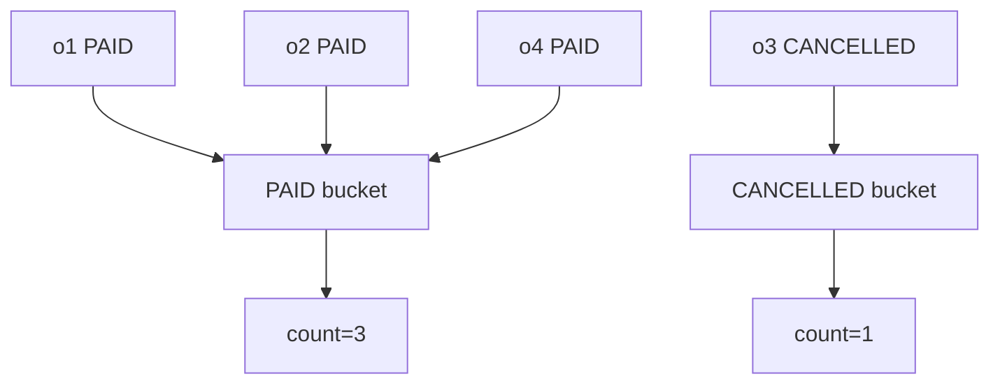

# Lesson 039 — $group and Accumulators

[← Section 5](./README.md) · [Full curriculum](../README.md)

## Mental model
`$group` puts documents into **buckets** according to a key and computes one result per bucket.



## Shared practice dataset
Run this once in **mongosh** on a disposable learning database. All lessons use these same IDs and amounts, so you can follow the data from stage to stage.

```js
use mongoCourse
db.aggCustomers.deleteMany({_id:{$in:["u1","u2","u3"]}})
db.aggProducts.deleteMany({_id:{$in:["p1","p2","p3"]}})
db.aggOrders.deleteMany({_id:{$in:["o1","o2","o3","o4"]}})
db.aggCustomers.insertMany([
 {_id:"u1",name:"Asha",city:"Patna"},
 {_id:"u2",name:"Ravi",city:"Pune"},
 {_id:"u3",name:"Neha",city:"Patna"}
])
db.aggProducts.insertMany([
 {_id:"p1",name:"Mouse",category:"Accessories"},
 {_id:"p2",name:"Keyboard",category:"Accessories"},
 {_id:"p3",name:"Monitor",category:"Electronics"}
])
db.aggOrders.insertMany([
 {_id:"o1",customerId:"u1",status:"PAID",createdAt:ISODate("2026-01-10T10:00:00Z"),items:[{productId:"p1",qty:2,unitPrice:500},{productId:"p2",qty:1,unitPrice:1500}]},
 {_id:"o2",customerId:"u2",status:"PAID",createdAt:ISODate("2026-01-20T10:00:00Z"),items:[{productId:"p1",qty:1,unitPrice:500}]},
 {_id:"o3",customerId:"u1",status:"CANCELLED",createdAt:ISODate("2026-02-03T10:00:00Z"),items:[{productId:"p3",qty:1,unitPrice:12000}]},
 {_id:"o4",customerId:"u3",status:"PAID",createdAt:ISODate("2026-02-15T10:00:00Z"),items:[{productId:"p3",qty:1,unitPrice:12000}]}
])
```
Prices here are **illustrative whole currency units** for easy arithmetic. In a production shop, store money consistently as integer minor units or Decimal128 and handle currency and refunds explicitly.


## 1. Count documents per status
```js
db.aggOrders.aggregate([
 {$group:{_id:"$status",orderCount:{$sum:1}}},
 {$sort:{_id:1}}
])
```
Expected: `{_id:"CANCELLED",orderCount:1}` and `{_id:"PAID",orderCount:3}`.

**Why _id?** Inside `$group`, `_id` is the **grouping key**, not necessarily an original document's ID. `_id:null` means all documents form one group.

## 2. $sum, $avg, $min, $max
```js
db.aggOrders.aggregate([
 {$project:{status:1,itemCount:{$size:"$items"}}},
 {$group:{
   _id:"$status",
   totalItems:{$sum:"$itemCount"},
   averageLines:{$avg:"$itemCount"},
   fewestLines:{$min:"$itemCount"},
   mostLines:{$max:"$itemCount"}
 }}
])
```
For PAID: totalItems = 4, averageLines = 4/3, min = 1, max = 2. These values describe **line counts**, not quantities or revenue.

## 3. $push vs $addToSet
```js
db.aggOrders.aggregate([
 {$group:{
  _id:"$status",
  customers:{$push:"$customerId"},
  uniqueCustomers:{$addToSet:"$customerId"}
 }}
])
```
`$push` retains duplicates (PAID customers: u1, u2, u3). `$addToSet` keeps unique values, but **does not guarantee array order**. For predictable `$push` order, sort documents before grouping.

## 4. Group by multiple fields
```js
db.aggOrders.aggregate([
 {$group:{
  _id:{status:"$status",customerId:"$customerId"},
  count:{$sum:1}
 }}
])
```
A composite key groups by both status and customer.

## 5. Group after calculating line totals
```js
db.aggOrders.aggregate([
 {$match:{status:"PAID"}},
 {$unwind:"$items"},
 {$group:{
   _id:"$customerId",
   revenue:{$sum:{$multiply:["$items.qty","$items.unitPrice"]}}
 }},
 {$sort:{revenue:-1}}
])
```
Expected: u3 → 12000, u1 → 2500, u2 → 500. **The multiplication happens per item**, and `$sum` adds those values for each customer.

## Mongoose
```js
const counts = await Order.aggregate([
 {$group:{_id:"$status",count:{$sum:1}}}
]);
```

## Mistakes
- Assuming `$sum:1` sums a price; it counts input documents.
- Forgetting `$unwind` when a metric needs individual array items.
- Expecting grouped output to retain fields not explicitly accumulated.
- Assuming group results are sorted automatically.

## Practice
Count orders per customer; calculate average number of line items per status; compute PAID revenue per customer.

**Interview:** **What is an accumulator?** An expression that combines values across documents in a group.

[$group](https://www.mongodb.com/docs/manual/reference/operator/aggregation/group/)
