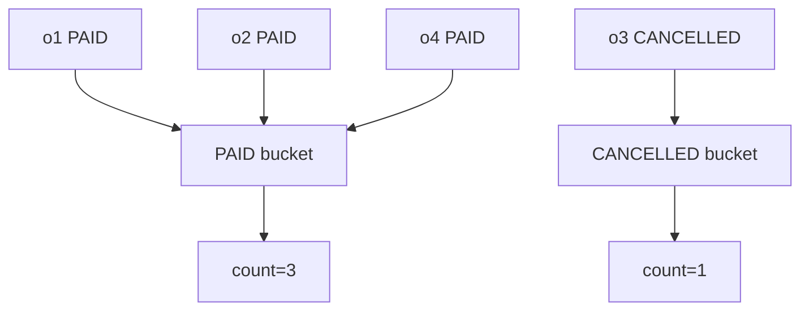

# Lesson 039 — $group and Accumulators

[← Section 5](./README.md) · [Full curriculum](../README.md)

## Mental model
`$group` puts documents into **buckets** according to a key and computes one result per bucket.



## Shared practice dataset
Run this once in **mongosh** on a disposable learning database. All lessons use these same IDs and amounts, so you can follow the data from stage to stage.

```js
use mongoCourse
db.aggCustomers.deleteMany({_id:{$in:["u1","u2","u3"]}})
db.aggProducts.deleteMany({_id:{$in:["p1","p2","p3"]}})
db.aggOrders.deleteMany({_id:{$in:["o1","o2","o3","o4"]}})
db.aggCustomers.insertMany([
 {_id:"u1",name:"Asha",city:"Patna"},
 {_id:"u2",name:"Ravi",city:"Pune"},
 {_id:"u3",name:"Neha",city:"Patna"}
])
db.aggProducts.insertMany([
 {_id:"p1",name:"Mouse",category:"Accessories"},
 {_id:"p2",name:"Keyboard",category:"Accessories"},
 {_id:"p3",name:"Monitor",category:"Electronics"}
])
db.aggOrders.insertMany([
 {_id:"o1",customerId:"u1",status:"PAID",createdAt:ISODate("2026-01-10T10:00:00Z"),items:[{productId:"p1",qty:2,unitPrice:500},{productId:"p2",qty:1,unitPrice:1500}]},
 {_id:"o2",customerId:"u2",status:"PAID",createdAt:ISODate("2026-01-20T10:00:00Z"),items:[{productId:"p1",qty:1,unitPrice:500}]},
 {_id:"o3",customerId:"u1",status:"CANCELLED",createdAt:ISODate("2026-02-03T10:00:00Z"),items:[{productId:"p3",qty:1,unitPrice:12000}]},
 {_id:"o4",customerId:"u3",status:"PAID",createdAt:ISODate("2026-02-15T10:00:00Z"),items:[{productId:"p3",qty:1,unitPrice:12000}]}
])
```
Prices here are **illustrative whole currency units** for easy arithmetic. In a production shop, store money consistently as integer minor units or Decimal128 and handle currency and refunds explicitly.


## 1. Count documents per status
```js
db.aggOrders.aggregate([
 {$group:{_id:"$status",orderCount:{$sum:1}}},
 {$sort:{_id:1}}
])
```
Expected: `{_id:"CANCELLED",orderCount:1}` and `{_id:"PAID",orderCount:3}`.

**Why _id?** Inside `$group`, `_id` is the **grouping key**, not necessarily an original document's ID. `_id:null` means all documents form one group.

### How grouping works, step by step

Think of `$group` as putting documents into **buckets**. All documents with the same grouping-key value go into one bucket. MongoDB then produces **one output document per bucket**.

In our dataset, o1, o2 and o4 have `status:"PAID"`, while o3 has `status:"CANCELLED"`. Thus 4 input orders become 2 output documents.

```js
// Group key only: one result per distinct status
db.aggOrders.aggregate([
  { $group: { _id: "$status" } }
]);
// Example output (order is not guaranteed):
// [{ _id: "PAID" }, { _id: "CANCELLED" }]
```

`"$status"` reads the status **value** from each document; the `_id` field in the grouped output contains that value. The original orders are not deleted or merged in the database.

**One group for everything:** `{ $group: { _id: null, totalOrders: { $sum: 1 } } }` produces a single count across the entire collection.

## 2. $sum, $avg, $min, $max
```js
db.aggOrders.aggregate([
 {$project:{status:1,itemCount:{$size:"$items"}}},
 {$group:{
   _id:"$status",
   totalItems:{$sum:"$itemCount"},
   averageLines:{$avg:"$itemCount"},
   fewestLines:{$min:"$itemCount"},
   mostLines:{$max:"$itemCount"}
 }}
])
```
### First understand the `$project` output

`$size:"$items"` counts how many **elements** are in each order's `items` array. It does **not** add up the `qty` fields.

| Order | status | itemCount after `$project` |
| --- | --- | ---: |
| o1 | PAID | 2 |
| o2 | PAID | 1 |
| o3 | CANCELLED | 1 |
| o4 | PAID | 1 |

The `$group` stage now receives these projected documents, not the original `items` arrays.

### What is an accumulator?

An **accumulator** combines values from the documents inside **each group**. In the PAID bucket, `itemCount` values are `[2,1,1]`.

| Accumulator | Meaning | PAID result |
| --- | --- | ---: |
| `totalItems:{$sum:"$itemCount"}` | Add item counts | 2 + 1 + 1 = **4** |
| `averageLines:{$avg:"$itemCount"}` | Average per order | 4 / 3 = **1.333...** |
| `fewestLines:{$min:"$itemCount"}` | Smallest count | **1** |
| `mostLines:{$max:"$itemCount"}` | Largest count | **2** |

For CANCELLED, all four metrics equal **1**, because there is one order with one line item.

```js
// Example result; group order is not guaranteed
[
  { _id: "PAID", totalItems: 4, averageLines: 1.3333333333333333, fewestLines: 1, mostLines: 2 },
  { _id: "CANCELLED", totalItems: 1, averageLines: 1, fewestLines: 1, mostLines: 1 }
]
```

### `$sum:1` versus `$sum:"$itemCount"`

```js
{
  $group: {
    _id: "$status",
    totalOrders: { $sum: 1 },            // counts documents in the group
    totalLines: { $sum: "$itemCount" }  // adds each document's line count
  }
}
```

For PAID, `totalOrders=3` but `totalLines=4`. Both differ from **total product quantity**, because o1 has a Mouse line with `qty:2`.

### Can we skip `$project`?

Yes, if every document's `items` field is an array:

```js
db.aggOrders.aggregate([
  { $group: {
      _id: "$status",
      totalOrders: { $sum: 1 },
      totalLines: { $sum: { $size: "$items" } }
  } }
]);
```

Here `$size` calculates a line count **for each order**, and `$sum` adds those counts **within each group**. If `items` can be null or missing, use `{ $size: { $ifNull: ["$items", []] } }` instead.

## 3. $push vs $addToSet
```js
db.aggOrders.aggregate([
 {$group:{
  _id:"$status",
  customers:{$push:"$customerId"},
  uniqueCustomers:{$addToSet:"$customerId"}
 }}
])
```
`$push` collects **all** input values into an array, including duplicates. `$addToSet` collects only **distinct** values. Both are **aggregation accumulators** here, not the similarly named update operators that modify stored arrays.

In the shared dataset PAID customers are `u1,u2,u3` (already unique), so both operators happen to produce the same members. To see the **difference clearly**, group all orders together, including the CANCELLED order from u1:

```js
db.aggOrders.aggregate([
  { $sort: { _id: 1 } },
  { $group: {
      _id: null,
      allCustomers: { $push: "$customerId" },
      uniqueCustomers: { $addToSet: "$customerId" },
      totalOrders: { $sum: 1 }
  } }
]);
```

```js
{
  _id: null,
  allCustomers: ["u1", "u2", "u1", "u3"],
  uniqueCustomers: ["u1", "u2", "u3"], // membership only; order can vary
  totalOrders: 4
}
```

`$push` respects the incoming document order; `$sort` before `$group` makes that order predictable. **`$addToSet` does not guarantee its array order.**

You can also collect **whole objects** instead of strings:

```js
db.aggOrders.aggregate([
  { $sort: { _id: 1 } },
  { $group: {
      _id: "$customerId",
      orders: {
        $push: { orderId: "$_id", status: "$status" }
      }
  } }
]);
```

For u1, `orders` becomes `[{orderId:"o1",status:"PAID"},{orderId:"o3",status:"CANCELLED"}]`.

**When to use which?** Use `$push` to collect all orders or events; use `$addToSet` for a unique list of customer IDs, categories or product IDs.

## 4. Group by multiple fields
```js
db.aggOrders.aggregate([
 {$group:{
  _id:{status:"$status",customerId:"$customerId"},
  count:{$sum:1}
 }}
])
```
A **composite group key** combines more than one field. Here documents are grouped only when **both** `status` **and** `customerId` match.

In the shared dataset:

| Group key | Matching orders | count |
| --- | --- | ---: |
| PAID + u1 | o1 | 1 |
| PAID + u2 | o2 | 1 |
| CANCELLED + u1 | o3 | 1 |
| PAID + u3 | o4 | 1 |

Notice that u1+PAID and u1+CANCELLED are **different groups** despite having the same customer.

### Another example with repeated combinations and amounts

To understand why multiple documents can enter the **same composite group**, imagine this separate `sales` collection:

| customerId | status | amount |
| --- | --- | ---: |
| u1 | PAID | 1000 |
| u1 | PAID | 2000 |
| u2 | PAID | 1500 |
| u1 | CANCELLED | 500 |
| u2 | PAID | 3000 |
| u2 | CANCELLED | 700 |

```js
db.sales.aggregate([
  { $group: {
      _id: { customer: "$customerId", status: "$status" },
      totalOrders: { $sum: 1 },
      totalAmount: { $sum: "$amount" }
  } }
]);
```

Results (order not guaranteed): u1+PAID → 2 orders / 3000; u2+PAID → 2 orders / 4500; u1+CANCELLED → 1 / 500; u2+CANCELLED → 1 / 700.

The `sales` example is **illustrative**; create that collection first if you want to execute it.

### Flatten the compound `_id` for frontend responses

```js
db.sales.aggregate([
  { $group: {
      _id: { customer: "$customerId", status: "$status" },
      totalOrders: { $sum: 1 },
      totalAmount: { $sum: "$amount" }
  } },
  { $project: {
      _id: 0,
      customerId: "$_id.customer",
      status: "$_id.status",
      totalOrders: 1,
      totalAmount: 1
  } }
]);
```

Here `"$_id.customer"` accesses the `customer` field inside the **grouped result's** `_id` object.

**Real-world combinations:** category+brand for sales reports, year+month for monthly revenue, city+paymentMethod for payment analytics.

## 5. Group after calculating line totals
```js
db.aggOrders.aggregate([
 {$match:{status:"PAID"}},
 {$unwind:"$items"},
 {$group:{
   _id:"$customerId",
   revenue:{$sum:{$multiply:["$items.qty","$items.unitPrice"]}}
 }},
 {$sort:{revenue:-1}}
])
```
Expected: u3 → 12000, u1 → 2500, u2 → 500. **The multiplication happens per item**, and `$sum` adds those values for each customer.

## Mongoose
```js
const counts = await Order.aggregate([
 {$group:{_id:"$status",count:{$sum:1}}}
]);
```

## Mistakes
- Assuming `$sum:1` sums a price; it counts input documents.
- Forgetting `$unwind` when a metric needs individual array items.
- Expecting grouped output to retain fields not explicitly accumulated.
- Assuming group results are sorted automatically.

## Practice
Count orders per customer; calculate average number of line items per status; compute PAID revenue per customer.

**Interview:** **What is an accumulator?** An expression that combines values across documents in a group.

[$group](https://www.mongodb.com/docs/manual/reference/operator/aggregation/group/)
