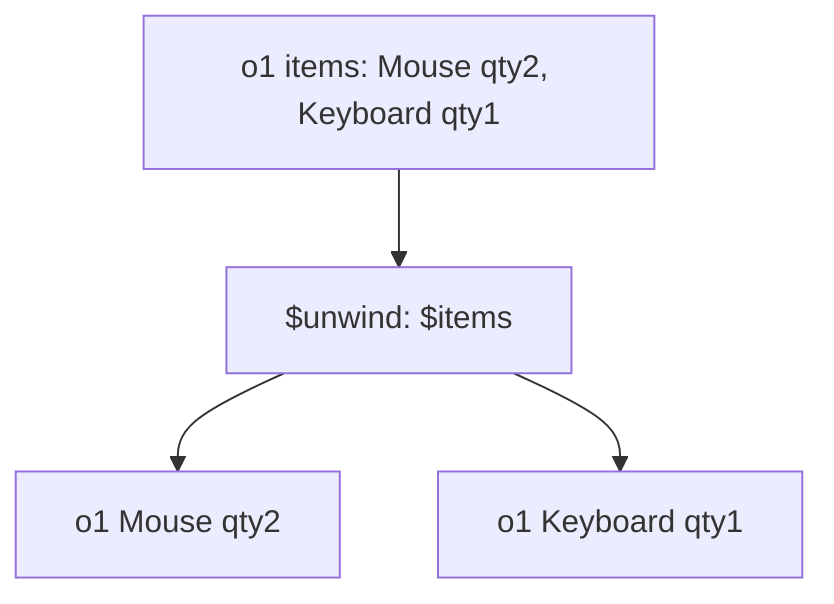

# Lesson 040 — $unwind and Array Processing

[← Section 5](./README.md) · [Full curriculum](../README.md)

## Why $unwind?
An order is **one document** but contains **multiple items**. To report top-selling products, you often need one pipeline row **per item**, not per order.



## Shared practice dataset
Run this once in **mongosh** on a disposable learning database. All lessons use these same IDs and amounts, so you can follow the data from stage to stage.

```js
use mongoCourse
db.aggCustomers.deleteMany({_id:{$in:["u1","u2","u3"]}})
db.aggProducts.deleteMany({_id:{$in:["p1","p2","p3"]}})
db.aggOrders.deleteMany({_id:{$in:["o1","o2","o3","o4"]}})
db.aggCustomers.insertMany([
 {_id:"u1",name:"Asha",city:"Patna"},
 {_id:"u2",name:"Ravi",city:"Pune"},
 {_id:"u3",name:"Neha",city:"Patna"}
])
db.aggProducts.insertMany([
 {_id:"p1",name:"Mouse",category:"Accessories"},
 {_id:"p2",name:"Keyboard",category:"Accessories"},
 {_id:"p3",name:"Monitor",category:"Electronics"}
])
db.aggOrders.insertMany([
 {_id:"o1",customerId:"u1",status:"PAID",createdAt:ISODate("2026-01-10T10:00:00Z"),items:[{productId:"p1",qty:2,unitPrice:500},{productId:"p2",qty:1,unitPrice:1500}]},
 {_id:"o2",customerId:"u2",status:"PAID",createdAt:ISODate("2026-01-20T10:00:00Z"),items:[{productId:"p1",qty:1,unitPrice:500}]},
 {_id:"o3",customerId:"u1",status:"CANCELLED",createdAt:ISODate("2026-02-03T10:00:00Z"),items:[{productId:"p3",qty:1,unitPrice:12000}]},
 {_id:"o4",customerId:"u3",status:"PAID",createdAt:ISODate("2026-02-15T10:00:00Z"),items:[{productId:"p3",qty:1,unitPrice:12000}]}
])
```
Prices here are **illustrative whole currency units** for easy arithmetic. In a production shop, store money consistently as integer minor units or Decimal128 and handle currency and refunds explicitly.


### Beginner mental model

`$unwind` takes **one document containing an array** and creates **one pipeline document per array element**. The other fields are repeated in each output row. This is useful when you want to analyze individual products rather than whole orders.

For example, an order with three items produces three pipeline documents. **It does not update or split the saved order in MongoDB.**

## 1. Before and after
```js
db.aggOrders.aggregate([
 {$match:{_id:"o1"}},
 {$unwind:"$items"},
 {$project:{_id:1,product:"$items.productId",qty:"$items.qty"}}
])
```
### Walk through the actual transformation

Before unwind, `o1` looks like this (simplified):

```js
{
  _id: "o1",
  customerId: "u1",
  items: [
    { productId: "p1", qty: 2, unitPrice: 500 },
    { productId: "p2", qty: 1, unitPrice: 1500 }
  ]
}
```

After `{$unwind:"$items"}`, it becomes **two pipeline documents**:

```js
[
  {
    _id: "o1", customerId: "u1",
    items: { productId: "p1", qty: 2, unitPrice: 500 }
  },
  {
    _id: "o1", customerId: "u1",
    items: { productId: "p2", qty: 1, unitPrice: 1500 }
  }
]
```

Notice: `_id` and `customerId` are repeated; `items` is now a **single object**, not an array. The original stored order stays unchanged. The example query above then projects each item into a smaller shape:

```js
[
  { _id: "o1", product: "p1", qty: 2 },
  { _id: "o1", product: "p2", qty: 1 }
]
```

**Important:** Output documents in an aggregation may share the same original `_id` after unwind. They are pipeline results, not newly inserted collection documents.

## 2. Calculate sold units per product
```js
db.aggOrders.aggregate([
 {$match:{status:"PAID"}},
 {$unwind:"$items"},
 {$group:{_id:"$items.productId",unitsSold:{$sum:"$items.qty"}}},
 {$sort:{unitsSold:-1,_id:1}}
])
```
### Why `$unwind` before `$group`?

The PAID orders are o1, o2 and o4. After unwind:

| Order | Product | qty |
| --- | --- | ---: |
| o1 | p1 (Mouse) | 2 |
| o1 | p2 (Keyboard) | 1 |
| o2 | p1 (Mouse) | 1 |
| o4 | p3 (Monitor) | 1 |

`$group:{_id:"$items.productId"}` now puts both p1 rows into the **same bucket**. `$sum:"$items.qty"` adds their quantities.

Expected: p1 → **3 units**; p2 → **1**; p3 → **1**. o3 is CANCELLED and excluded by `$match`.

`$sum:1` here would count **item lines**, whereas `$sum:"$items.qty"` counts **units sold**. For p1 that is 2 lines versus 3 units.

## 3. Revenue per product
```js
db.aggOrders.aggregate([
 {$match:{status:"PAID"}},
 {$unwind:"$items"},
 {$group:{
  _id:"$items.productId",
  revenue:{$sum:{$multiply:["$items.qty","$items.unitPrice"]}}
 }},
 {$sort:{revenue:-1}}
])
```
### How the nested calculation executes

For **each unwound item**, `$multiply:["$items.qty","$items.unitPrice"]` calculates line revenue. Then `$sum` adds those revenues **per product group**.

| Item | Calculation | Line revenue |
| --- | --- | ---: |
| o1 / p1 | 2 × 500 | 1000 |
| o1 / p2 | 1 × 1500 | 1500 |
| o2 / p1 | 1 × 500 | 500 |
| o4 / p3 | 1 × 12000 | 12000 |

So p1 = 1000 + 500 = **1500**, p2 = **1500**, and p3 = **12000**. This is different from the number of units sold.

You can calculate **both** metrics together:

```js
db.aggOrders.aggregate([
  { $match: { status: "PAID" } },
  { $unwind: "$items" },
  { $group: {
      _id: "$items.productId",
      unitsSold: { $sum: "$items.qty" },
      revenue: { $sum: { $multiply: ["$items.qty", "$items.unitPrice"] } }
  } },
  { $sort: { revenue: -1, _id: 1 } }
]);
```

For a real store, also decide how to handle returns, discounts, taxes and currency.

## 4. Empty or missing arrays
By default, `$unwind` drops documents whose target is empty, missing or null. Preserve them if required:
```js
db.aggOrders.aggregate([
 {$unwind:{path:"$items",preserveNullAndEmptyArrays:true}}
])
```
### Example: empty, missing and null arrays

Imagine these input documents:

```js
[
  { _id: 1, items: ["Mouse", "Keyboard"] },
  { _id: 2, items: [] },
  { _id: 3 },
  { _id: 4, items: null }
]
```

With `{$unwind:"$items"}`, only document 1 produces output (two rows). The other three produce **no rows**.

With `preserveNullAndEmptyArrays:true`, all three are preserved as one row each. A missing or empty `items` field may remain absent in the output, whereas an explicit null stays null.

### Include the array position

To retain the array position:
```js
db.aggOrders.aggregate([
 {$unwind:{path:"$items",includeArrayIndex:"itemIndex"}}
])
```

For `{_id:1,items:["Mouse","Keyboard"]}`, the indexed output is:

```js
[
  { _id: 1, items: "Mouse", itemIndex: 0 },
  { _id: 1, items: "Keyboard", itemIndex: 1 }
]
```

Array indexes start from **0**. The `includeArrayIndex` field is useful for preserving an item's original position.

## 5. When not to unwind
If you only need the count of items, `{$size:"$items"}` can be simpler. If you only need to transform an array while retaining one document, explore `$map`, `$filter`, and `$reduce`.

```js
db.aggOrders.aggregate([
 {$match:{_id:"o1"}},
 {$project:{quantities:{$map:{input:"$items",as:"item",in:"$$item.qty"}}}}
])
```
Expected quantities: `[2,1]`. The `$item` syntax refers to a variable inside `$map`.

### Compare four array operators

| Operator | What it does | Output shape |
| --- | --- | --- |
| `$unwind` | Expands each array element | Multiple documents |
| `$size` | Counts array elements | A number |
| `$filter` | Keeps elements matching a condition | An array |
| `$map` | Transforms each array element | An array |

**`$size`**: count the lines in an order:

```js
db.aggOrders.aggregate([
  { $match: { _id: "o1" } },
  { $project: { itemCount: { $size: "$items" } } }
]);
// itemCount: 2, not 3 (the total qty is 2 + 1)
```

**`$filter`**: keep only items with unitPrice greater than 1000:

```js
db.aggOrders.aggregate([
  { $match: { _id: "o1" } },
  { $project: {
      expensiveItems: {
        $filter: {
          input: "$items",
          as: "item",
          cond: { $gt: ["$item.unitPrice", 1000] }
        }
      }
  } }
]);
// expensiveItems: [{productId:"p2",qty:1,unitPrice:1500}]
```

Here `input` is the array, `as` names the current element, and `cond` tests it.

**`$map`**: calculate total cost of each line without splitting the order into multiple documents:

```js
db.aggOrders.aggregate([
  { $match: { _id: "o1" } },
  { $project: {
      calculatedItems: {
        $map: {
          input: "$items",
          as: "item",
          in: {
            productId: "$item.productId",
            lineTotal: { $multiply: ["$item.qty", "$item.unitPrice"] }
          }
        }
      }
  } }
]);
// calculatedItems: [
//   {productId:"p1",lineTotal:1000},
//   {productId:"p2",lineTotal:1500}
// ]
```

`$filter` and `$map` keep the array inside a single result document; `$unwind` changes the **number of result documents**.

## Mongoose
```js
const sold = await Order.aggregate([
 {$match:{status:"PAID"}},
 {$unwind:"$items"},
 {$group:{_id:"$items.productId",units:{$sum:"$items.qty"}}}
]);
```

### Real-world Express 5 controller: top-selling products

```js
// Assume Order is an imported Mongoose model
const getTopSellingProducts = async (req, res) => {
  const products = await Order.aggregate([
    { $match: { status: "PAID" } },
    { $unwind: "$items" },
    { $group: {
        _id: "$items.productId",
        totalQuantity: { $sum: "$items.qty" },
        totalRevenue: {
          $sum: { $multiply: ["$items.qty", "$items.unitPrice"] }
        }
    } },
    { $sort: { totalQuantity: -1, _id: 1 } },
    { $limit: 5 }
  ]);

  return res.status(200).json({ success: true, data: products });
};
```

Pipeline: **PAID orders → individual items → totals per product → highest quantities first → top five**.

## Practice
Unwind o1 and count rows; calculate paid quantity per product; explain why grouping directly by `"$items.productId"` without unwind gives different results.

### Extra practice: predict the number of rows

Given three orders with item arrays `["Mouse","Keyboard"]`, `["Monitor","Mouse","Laptop"]` and `["Keyboard"]`:

```js
db.orders.aggregate([
  { $unwind: "$items" },
  { $group: { _id: "$items", totalOrders: { $sum: 1 } } }
]);
```

After unwind there are **6 rows** (2 + 3 + 1). After grouping there are **4 distinct product groups**: Mouse (2), Keyboard (2), Monitor (1), Laptop (1). Here `totalOrders` counts **unwound item occurrences**; the name is accurate only if each product appears at most once per order.

**Interview:** **What does unwind do?** Expands array elements into separate pipeline documents. **How is it different from `$map`?** `$map` transforms elements while keeping them in an array.

[$unwind](https://www.mongodb.com/docs/manual/reference/operator/aggregation/unwind/)
