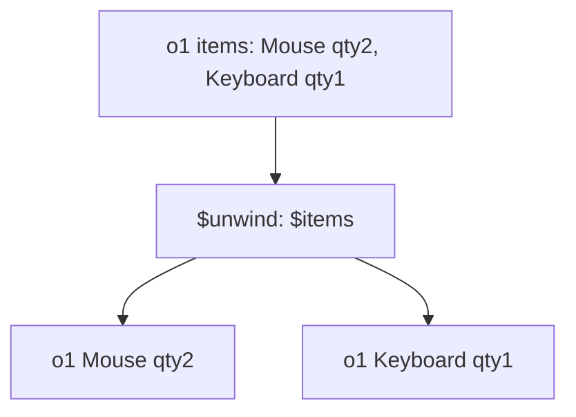

# Lesson 040 — $unwind and Array Processing

[← Section 5](./README.md) · [Full curriculum](../README.md)

## Why $unwind?
An order is **one document** but contains **multiple items**. To report top-selling products, you often need one pipeline row **per item**, not per order.



## Shared practice dataset
Run this once in **mongosh** on a disposable learning database. All lessons use these same IDs and amounts, so you can follow the data from stage to stage.

```js
use mongoCourse
db.aggCustomers.deleteMany({_id:{$in:["u1","u2","u3"]}})
db.aggProducts.deleteMany({_id:{$in:["p1","p2","p3"]}})
db.aggOrders.deleteMany({_id:{$in:["o1","o2","o3","o4"]}})
db.aggCustomers.insertMany([
 {_id:"u1",name:"Asha",city:"Patna"},
 {_id:"u2",name:"Ravi",city:"Pune"},
 {_id:"u3",name:"Neha",city:"Patna"}
])
db.aggProducts.insertMany([
 {_id:"p1",name:"Mouse",category:"Accessories"},
 {_id:"p2",name:"Keyboard",category:"Accessories"},
 {_id:"p3",name:"Monitor",category:"Electronics"}
])
db.aggOrders.insertMany([
 {_id:"o1",customerId:"u1",status:"PAID",createdAt:ISODate("2026-01-10T10:00:00Z"),items:[{productId:"p1",qty:2,unitPrice:500},{productId:"p2",qty:1,unitPrice:1500}]},
 {_id:"o2",customerId:"u2",status:"PAID",createdAt:ISODate("2026-01-20T10:00:00Z"),items:[{productId:"p1",qty:1,unitPrice:500}]},
 {_id:"o3",customerId:"u1",status:"CANCELLED",createdAt:ISODate("2026-02-03T10:00:00Z"),items:[{productId:"p3",qty:1,unitPrice:12000}]},
 {_id:"o4",customerId:"u3",status:"PAID",createdAt:ISODate("2026-02-15T10:00:00Z"),items:[{productId:"p3",qty:1,unitPrice:12000}]}
])
```
Prices here are **illustrative whole currency units** for easy arithmetic. In a production shop, store money consistently as integer minor units or Decimal128 and handle currency and refunds explicitly.


## 1. Before and after
```js
db.aggOrders.aggregate([
 {$match:{_id:"o1"}},
 {$unwind:"$items"},
 {$project:{_id:1,product:"$items.productId",qty:"$items.qty"}}
])
```
Output: two documents, both carrying `_id:"o1"`: one for p1 qty 2, one for p2 qty 1. `$unwind` **does not modify** the original order.

## 2. Calculate sold units per product
```js
db.aggOrders.aggregate([
 {$match:{status:"PAID"}},
 {$unwind:"$items"},
 {$group:{_id:"$items.productId",unitsSold:{$sum:"$items.qty"}}},
 {$sort:{unitsSold:-1,_id:1}}
])
```
Expected: p1 → 3 units; p2 → 1; p3 → 1. o3 is CANCELLED and excluded.

## 3. Revenue per product
```js
db.aggOrders.aggregate([
 {$match:{status:"PAID"}},
 {$unwind:"$items"},
 {$group:{
  _id:"$items.productId",
  revenue:{$sum:{$multiply:["$items.qty","$items.unitPrice"]}}
 }},
 {$sort:{revenue:-1}}
])
```
Expected: p3 → 12000, p1 → 1500, p2 → 1500. Units and revenue are **different metrics**.

## 4. Empty or missing arrays
By default, `$unwind` drops documents whose target is empty, missing or null. Preserve them if required:
```js
db.aggOrders.aggregate([
 {$unwind:{path:"$items",preserveNullAndEmptyArrays:true}}
])
```
To retain the array position:
```js
db.aggOrders.aggregate([
 {$unwind:{path:"$items",includeArrayIndex:"itemIndex"}}
])
```

## 5. When not to unwind
If you only need the count of items, `{$size:"$items"}` can be simpler. If you only need to transform an array while retaining one document, explore `$map`, `$filter`, and `$reduce`.

```js
db.aggOrders.aggregate([
 {$match:{_id:"o1"}},
 {$project:{quantities:{$map:{input:"$items",as:"item",in:"$$item.qty"}}}}
])
```
Expected quantities: `[2,1]`. The `$$item` syntax refers to a variable inside `$map`.

## Mongoose
```js
const sold = await Order.aggregate([
 {$match:{status:"PAID"}},
 {$unwind:"$items"},
 {$group:{_id:"$items.productId",units:{$sum:"$items.qty"}}}
]);
```

## Practice
Unwind o1 and count rows; calculate paid quantity per product; explain why grouping directly by `"$items.productId"` without unwind gives different results.

**Interview:** **What does unwind do?** Expands array elements into separate pipeline documents.

[$unwind](https://www.mongodb.com/docs/manual/reference/operator/aggregation/unwind/)
