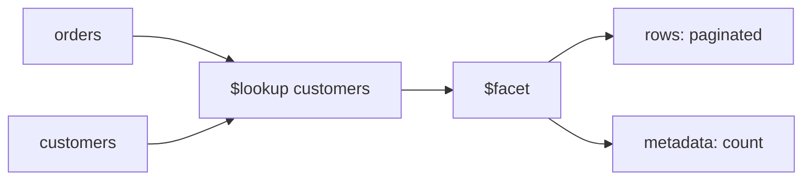

# Lesson 041 — $lookup and $facet

[← Section 5](./README.md) · [Full curriculum](../README.md)

## Two problems, two stages
**$lookup** combines related data from another collection. **$facet** runs several sub-pipelines on the same incoming documents, returning multiple result sets together.



## Shared practice dataset
Run this once in **mongosh** on a disposable learning database. All lessons use these same IDs and amounts, so you can follow the data from stage to stage.

```js
use mongoCourse
db.aggCustomers.deleteMany({_id:{$in:["u1","u2","u3"]}})
db.aggProducts.deleteMany({_id:{$in:["p1","p2","p3"]}})
db.aggOrders.deleteMany({_id:{$in:["o1","o2","o3","o4"]}})
db.aggCustomers.insertMany([
 {_id:"u1",name:"Asha",city:"Patna"},
 {_id:"u2",name:"Ravi",city:"Pune"},
 {_id:"u3",name:"Neha",city:"Patna"}
])
db.aggProducts.insertMany([
 {_id:"p1",name:"Mouse",category:"Accessories"},
 {_id:"p2",name:"Keyboard",category:"Accessories"},
 {_id:"p3",name:"Monitor",category:"Electronics"}
])
db.aggOrders.insertMany([
 {_id:"o1",customerId:"u1",status:"PAID",createdAt:ISODate("2026-01-10T10:00:00Z"),items:[{productId:"p1",qty:2,unitPrice:500},{productId:"p2",qty:1,unitPrice:1500}]},
 {_id:"o2",customerId:"u2",status:"PAID",createdAt:ISODate("2026-01-20T10:00:00Z"),items:[{productId:"p1",qty:1,unitPrice:500}]},
 {_id:"o3",customerId:"u1",status:"CANCELLED",createdAt:ISODate("2026-02-03T10:00:00Z"),items:[{productId:"p3",qty:1,unitPrice:12000}]},
 {_id:"o4",customerId:"u3",status:"PAID",createdAt:ISODate("2026-02-15T10:00:00Z"),items:[{productId:"p3",qty:1,unitPrice:12000}]}
])
```
Prices here are **illustrative whole currency units** for easy arithmetic. In a production shop, store money consistently as integer minor units or Decimal128 and handle currency and refunds explicitly.


## 1. Join orders with customers
```js
db.aggOrders.aggregate([
 {$match:{status:"PAID"}},
 {$lookup:{
  from:"aggCustomers",
  localField:"customerId",
  foreignField:"_id",
  as:"customer"
 }},
 {$project:{_id:1,customerId:1,customer:1}}
])
```
### Why do we need a join?

In the shared dataset, `aggOrders` stores `customerId`, but the customer's **name and city** live in `aggCustomers`. If an admin screen needs **order + customer name**, `$lookup` can combine them without permanently copying the customer fields into each order.

`$lookup` is similar to a **SQL LEFT OUTER JOIN**. It adds a new array field to each incoming document.

| Option | Meaning in this query |
| --- | --- |
| `from:"aggCustomers"` | Collection to search for matching customers |
| `localField:"customerId"` | Value in the current order (e.g., `"u1"`) |
| `foreignField:"_id"` | Field to compare in the customer collection |
| `as:"customer"` | Name of the new array field in the output |

For `o1`, the matching customer is u1:

```js
{
  _id: "o1",
  customerId: "u1",
  customer: [{ _id: "u1", name: "Asha", city: "Patna" }]
}
```

**Why is `customer` an array?** A lookup can match zero, one, or many foreign documents, so the result always uses an array—even when one customer matches.

### What if no customer matches?

Suppose an order has `customerId:"u99"`, but `aggCustomers` contains no u99. The order still appears with `customer:[]`. That is the left-join behavior. **The lookup itself does not delete or modify stored orders.**

```text
aggOrders.customerId "u1"  ──matches──> aggCustomers._id "u1"
          order o1          ──lookup───> customer: [{name:"Asha",city:"Patna"}]
```

## 2. Flatten the joined array
```js
db.aggOrders.aggregate([
 {$match:{_id:"o1"}},
 {$lookup:{from:"aggCustomers",localField:"customerId",foreignField:"_id",as:"customer"}},
 {$unwind:"$customer"},
 {$project:{_id:1,customerName:"$customer.name",city:"$customer.city"}}
])
```
### Why combine `$lookup`, `$unwind`, and `$project`?

After `$lookup`, `customer` is an array. After `$unwind:"$customer"`, the single matching customer becomes an **object**:

```js
{ _id: "o1", customer: { _id: "u1", name: "Asha", city: "Patna" } }
```

Then `$project` creates frontend-friendly fields:

```js
{ _id: "o1", customerName: "Asha", city: "Patna" }
```

**Important edge case:** By default, `$unwind` removes an order whose lookup returned `customer:[]`. If unmatched orders should still appear, use:

```js
{
  $unwind: {
    path: "$customer",
    preserveNullAndEmptyArrays: true
  }
}
```

For a one-to-many join (for example, customer → many orders), unwinding the lookup array can produce **multiple result rows per original document**.

## 3. $lookup with pipeline for selective joining
```js
db.aggOrders.aggregate([
 {$lookup:{
  from:"aggCustomers",
  let:{cid:"$customerId"},
  pipeline:[
   {$match:{$expr:{$eq:["$_id","$$cid"]}}},
   {$project:{_id:0,name:1}}
  ],
  as:"customer"
 }}
])
```
`let` exposes a field from the current order as a variable (`cid`) to the foreign pipeline. Inside that pipeline, `$cid` refers to the variable; `$_id` refers to the customer document's field.

The stages mean:
1. Read the order's `customerId` into `cid`.
2. Find customers whose `_id` equals `$cid` using `$expr`.
3. Return only `name` (excluding `_id`) inside the `customer` array.

For o1, the joined field is `customer:[{name:"Asha"}]`. This pipeline form is useful when a join needs **extra filters, transformations, or selected fields**.

**Performance note:** Index use inside expression-based lookups depends on the comparison and MongoDB's restrictions. Keep foreign-side matching efficient.

## 4. $facet: page and count in one aggregation
```js
db.aggOrders.aggregate([
 {$match:{status:"PAID"}},
 {$facet:{
  data:[
   {$sort:{createdAt:-1,_id:-1}},
   {$skip:0},
   {$limit:2},
   {$project:{_id:1,customerId:1,createdAt:1}}
  ],
  metadata:[{$count:"total"}]
 }}
])
```
Expected **one output document**:
```js
{
 data:[/* o4, o2 */],
 metadata:[{total:3}]
}
```
### Understand `$facet` from the beginning

Imagine a dashboard needs **two things at once**: a page of PAID orders and the **total number of PAID orders**. `$facet` runs separate named sub-pipelines on the **same incoming documents**, then packages their results into **one output document**.

```text
aggOrders (4 orders)
        |
  $match PAID → o1, o2, o4
        |
      $facet
      /    \
  data      metadata
  sort      count
  skip      → total 3
  limit
  → o4, o2
      \    /
    one result document
```

| Sub-pipeline | Operations | Result |
| --- | --- | --- |
| `data` | Sort newest first, skip 0, limit 2 | Orders o4 and o2 |
| `metadata` | Count all incoming PAID orders | `[{total:3}]` |

**Why isn't the count 2?** The `metadata` branch does **not** receive the limited `data` branch's output. Both branches independently receive all three PAID orders.

Expected one-element aggregation result array:

```js
[
  {
    data: [
      { _id: "o4", customerId: "u3", createdAt: ISODate("2026-02-15T10:00:00Z") },
      { _id: "o2", customerId: "u2", createdAt: ISODate("2026-01-20T10:00:00Z") }
    ],
    metadata: [{ total: 3 }]
  }
]
```

`$count` returns **no document** for empty input, so `metadata` may be `[]` instead of `[{total:0}]`.

### Another `$facet` example: multiple dashboard reports

```js
db.aggOrders.aggregate([
  { $facet: {
      totalOrders: [{ $count: "count" }],
      statusWiseOrders: [
        { $group: { _id: "$status", count: { $sum: 1 } } },
        { $sort: { _id: 1 } }
      ],
      latestOrders: [
        { $sort: { createdAt: -1, _id: -1 } },
        { $limit: 2 },
        { $project: { _id: 1, status: 1 } }
      ]
  } }
]);
```

Using the shared dataset, the result is:

```js
[
  {
    totalOrders: [{ count: 4 }],
    statusWiseOrders: [
      { _id: "CANCELLED", count: 1 },
      { _id: "PAID", count: 3 }
    ],
    latestOrders: [
      { _id: "o4", status: "PAID" },
      { _id: "o3", status: "CANCELLED" }
    ]
  }
]
```

Each facet name (`totalOrders`, `statusWiseOrders`, `latestOrders`) maps to its **own array of results**. One facet branch cannot directly feed another branch within the same `$facet` stage.

**Use cases:** dashboards, search results with category counts, paginated records with a total count. One query is convenient, but not automatically faster than separate queries.

## Performance and limitations
- Index `foreignField` used in frequent lookups; `_id` already has an index.
- Filter early and project only fields needed.
- `$lookup` can produce large arrays; do not join an entire unbounded order history into each user.
- `$facet` has stage/output memory limits and cannot spill its intermediate results to disk merely because `allowDiskUse` is enabled. Keep sub-results bounded.
- `$facet` as the first stage generally causes a collection scan; let a selective indexed `$match` run first.

## $lookup vs $facet — quick comparison

| Question | `$lookup` | `$facet` |
| --- | --- | --- |
| Main goal | Join related collections | Run several reports on the same input |
| Inputs | Current documents + foreign collection | Same incoming documents for each branch |
| Output | Adds a matched-documents array | Returns one document with named result arrays |
| Typical use | Order + customer details | Dashboard totals + pagination |

## Mongoose
```js
const result = await Order.aggregate([
 {$match:{status:"PAID"}},
 {$lookup:{from:"aggCustomers",localField:"customerId",foreignField:"_id",as:"customer"}}
]);
```
Collection names and field ID types must match the actual database. In Mongoose, the `from` value is the **MongoDB collection name**, not necessarily the model name. Mongoose also does not automatically cast values inside aggregation pipelines.

### Express 5 API: paginated orders with total count

```js
// Assume Order is your imported Mongoose model
const getPaidOrders = async (req, res) => {
  const page = Math.max(1, Number(req.query.page) || 1);
  const limit = 10;
  const skip = (page - 1) * limit;

  const [result] = await Order.aggregate([
    { $match: { status: "PAID" } },
    { $facet: {
        data: [
          { $sort: { createdAt: -1, _id: -1 } },
          { $skip: skip },
          { $limit: limit }
        ],
        metadata: [{ $count: "total" }]
    } }
  ]);

  return res.status(200).json({
    success: true,
    data: result.data,
    total: result.metadata[0]?.total ?? 0,
    page
  });
};
```

The `data` branch returns the current page, while `metadata` counts **all matching PAID orders**. In a production API, validate and cap query parameters and consider pagination performance for large offsets.

## Practice
Join each order with its customer city. Return page 1 of paid orders with total count. Explain why `$lookup` returns an array even for one matching customer.

**Interview:** **lookup vs populate?** `$lookup` is MongoDB's aggregation join; `populate()` is a Mongoose abstraction that resolves references.

[$lookup](https://www.mongodb.com/docs/manual/reference/operator/aggregation/lookup/) · [$facet](https://www.mongodb.com/docs/manual/reference/operator/aggregation/facet/)
