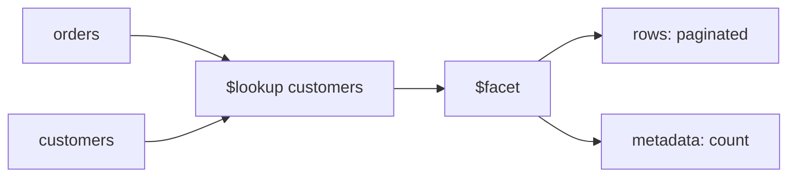

# Lesson 041 — $lookup and $facet

[← Section 5](./README.md) · [Full curriculum](../README.md)

## Two problems, two stages
**$lookup** combines related data from another collection. **$facet** runs several sub-pipelines on the same incoming documents, returning multiple result sets together.



## Shared practice dataset
Run this once in **mongosh** on a disposable learning database. All lessons use these same IDs and amounts, so you can follow the data from stage to stage.

```js
use mongoCourse
db.aggCustomers.deleteMany({_id:{$in:["u1","u2","u3"]}})
db.aggProducts.deleteMany({_id:{$in:["p1","p2","p3"]}})
db.aggOrders.deleteMany({_id:{$in:["o1","o2","o3","o4"]}})
db.aggCustomers.insertMany([
 {_id:"u1",name:"Asha",city:"Patna"},
 {_id:"u2",name:"Ravi",city:"Pune"},
 {_id:"u3",name:"Neha",city:"Patna"}
])
db.aggProducts.insertMany([
 {_id:"p1",name:"Mouse",category:"Accessories"},
 {_id:"p2",name:"Keyboard",category:"Accessories"},
 {_id:"p3",name:"Monitor",category:"Electronics"}
])
db.aggOrders.insertMany([
 {_id:"o1",customerId:"u1",status:"PAID",createdAt:ISODate("2026-01-10T10:00:00Z"),items:[{productId:"p1",qty:2,unitPrice:500},{productId:"p2",qty:1,unitPrice:1500}]},
 {_id:"o2",customerId:"u2",status:"PAID",createdAt:ISODate("2026-01-20T10:00:00Z"),items:[{productId:"p1",qty:1,unitPrice:500}]},
 {_id:"o3",customerId:"u1",status:"CANCELLED",createdAt:ISODate("2026-02-03T10:00:00Z"),items:[{productId:"p3",qty:1,unitPrice:12000}]},
 {_id:"o4",customerId:"u3",status:"PAID",createdAt:ISODate("2026-02-15T10:00:00Z"),items:[{productId:"p3",qty:1,unitPrice:12000}]}
])
```
Prices here are **illustrative whole currency units** for easy arithmetic. In a production shop, store money consistently as integer minor units or Decimal128 and handle currency and refunds explicitly.


## 1. Join orders with customers
```js
db.aggOrders.aggregate([
 {$match:{status:"PAID"}},
 {$lookup:{
  from:"aggCustomers",
  localField:"customerId",
  foreignField:"_id",
  as:"customer"
 }},
 {$project:{_id:1,customerId:1,customer:1}}
])
```
`from` names the other collection. `localField` is the key in orders, `foreignField` the key in customers, and `as` is the output array field. For o1, `customer` is `[{_id:"u1",name:"Asha",city:"Patna"}]`.

## 2. Flatten the joined array
```js
db.aggOrders.aggregate([
 {$match:{_id:"o1"}},
 {$lookup:{from:"aggCustomers",localField:"customerId",foreignField:"_id",as:"customer"}},
 {$unwind:"$customer"},
 {$project:{_id:1,customerName:"$customer.name",city:"$customer.city"}}
])
```
Expected: `{_id:"o1",customerName:"Asha",city:"Patna"}`. **Warning:** `$unwind` drops orders without matching customers unless you use `preserveNullAndEmptyArrays:true`.

## 3. $lookup with pipeline for selective joining
```js
db.aggOrders.aggregate([
 {$lookup:{
  from:"aggCustomers",
  let:{cid:"$customerId"},
  pipeline:[
   {$match:{$expr:{$eq:["$_id","$$cid"]}}},
   {$project:{_id:0,name:1}}
  ],
  as:"customer"
 }}
])
```
`let` passes values from the outer document into the lookup pipeline. `$expr` allows expression-based comparisons. Index support depends on expression shape and server restrictions.

## 4. $facet: page and count in one aggregation
```js
db.aggOrders.aggregate([
 {$match:{status:"PAID"}},
 {$facet:{
  data:[
   {$sort:{createdAt:-1,_id:-1}},
   {$skip:0},
   {$limit:2},
   {$project:{_id:1,customerId:1,createdAt:1}}
  ],
  metadata:[{$count:"total"}]
 }}
])
```
Expected **one output document**:
```js
{
 data:[/* o4, o2 */],
 metadata:[{total:3}]
}
```
The same three paid orders enter both sub-pipelines. `$count` returns no document for empty input, so `metadata` may be `[]` rather than `[{total:0}]`.

## Performance and limitations
- Index `foreignField` used in frequent lookups; `_id` already has an index.
- Filter early and project only fields needed.
- `$lookup` can produce large arrays; do not join an entire unbounded order history into each user.
- `$facet` has stage/output memory limits and cannot spill its intermediate results to disk merely because `allowDiskUse` is enabled. Keep sub-results bounded.
- `$facet` as the first stage generally causes a collection scan; let a selective indexed `$match` run first.

## Mongoose
```js
const result = await Order.aggregate([
 {$match:{status:"PAID"}},
 {$lookup:{from:"aggCustomers",localField:"customerId",foreignField:"_id",as:"customer"}}
]);
```
Collection names and field ID types must match the actual database.

## Practice
Join each order with its customer city. Return page 1 of paid orders with total count. Explain why `$lookup` returns an array even for one matching customer.

**Interview:** **lookup vs populate?** `$lookup` is MongoDB's aggregation join; `populate()` is a Mongoose abstraction that resolves references.

[$lookup](https://www.mongodb.com/docs/manual/reference/operator/aggregation/lookup/) · [$facet](https://www.mongodb.com/docs/manual/reference/operator/aggregation/facet/)
