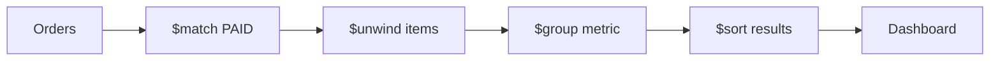

# Lesson 044 — Aggregations for E-commerce Analytics

[← Section 5](./README.md) · [Full curriculum](../README.md)

## Goal
Build three dashboard metrics from **real order line items**: total paid revenue, best-selling products, and monthly revenue. The point is to understand how stages combine—not memorize a long query.



## Shared practice dataset
Run this once in **mongosh** on a disposable learning database. All lessons use these same IDs and amounts, so you can follow the data from stage to stage.

```js
use mongoCourse
db.aggCustomers.deleteMany({_id:{$in:["u1","u2","u3"]}})
db.aggProducts.deleteMany({_id:{$in:["p1","p2","p3"]}})
db.aggOrders.deleteMany({_id:{$in:["o1","o2","o3","o4"]}})
db.aggCustomers.insertMany([
 {_id:"u1",name:"Asha",city:"Patna"},
 {_id:"u2",name:"Ravi",city:"Pune"},
 {_id:"u3",name:"Neha",city:"Patna"}
])
db.aggProducts.insertMany([
 {_id:"p1",name:"Mouse",category:"Accessories"},
 {_id:"p2",name:"Keyboard",category:"Accessories"},
 {_id:"p3",name:"Monitor",category:"Electronics"}
])
db.aggOrders.insertMany([
 {_id:"o1",customerId:"u1",status:"PAID",createdAt:ISODate("2026-01-10T10:00:00Z"),items:[{productId:"p1",qty:2,unitPrice:500},{productId:"p2",qty:1,unitPrice:1500}]},
 {_id:"o2",customerId:"u2",status:"PAID",createdAt:ISODate("2026-01-20T10:00:00Z"),items:[{productId:"p1",qty:1,unitPrice:500}]},
 {_id:"o3",customerId:"u1",status:"CANCELLED",createdAt:ISODate("2026-02-03T10:00:00Z"),items:[{productId:"p3",qty:1,unitPrice:12000}]},
 {_id:"o4",customerId:"u3",status:"PAID",createdAt:ISODate("2026-02-15T10:00:00Z"),items:[{productId:"p3",qty:1,unitPrice:12000}]}
])
```
Prices here are **illustrative whole currency units** for easy arithmetic. In a production shop, store money consistently as integer minor units or Decimal128 and handle currency and refunds explicitly.


## 1. Total paid revenue
```js
db.aggOrders.aggregate([
 {$match:{status:"PAID"}},
 {$unwind:"$items"},
 {$group:{
  _id:null,
  revenue:{$sum:{$multiply:["$items.qty","$items.unitPrice"]}},
  units:{$sum:"$items.qty"}
 }}
])
```
Expected `revenue:15000`, `units:5`: o1 = 2500, o2 = 500, o4 = 12000. o3 is cancelled and excluded. `units` counts quantities (2+1+1+1), not number of orders.

## 2. Top products by revenue
```js
db.aggOrders.aggregate([
 {$match:{status:"PAID"}},
 {$unwind:"$items"},
 {$group:{
  _id:"$items.productId",
  units:{$sum:"$items.qty"},
  revenue:{$sum:{$multiply:["$items.qty","$items.unitPrice"]}}
 }},
 {$sort:{revenue:-1,_id:1}},
 {$lookup:{from:"aggProducts",localField:"_id",foreignField:"_id",as:"product"}},
 {$unwind:{path:"$product",preserveNullAndEmptyArrays:true}},
 {$project:{_id:1,name:"$product.name",units:1,revenue:1}}
])
```
Expected p3 Monitor: 12000/1 unit; p1 Mouse: 1500/3 units; p2 Keyboard: 1500/1 unit. p1 and p2 tie on revenue, so `_id` breaks the tie.

## 3. Monthly paid revenue
```js
db.aggOrders.aggregate([
 {$match:{status:"PAID"}},
 {$unwind:"$items"},
 {$group:{
  _id:{$dateToString:{format:"%Y-%m",date:"$createdAt",timezone:"UTC"}},
  revenue:{$sum:{$multiply:["$items.qty","$items.unitPrice"]}}
 }},
 {$sort:{_id:1}}
])
```
Expected January 2026 → 3000; February 2026 → 12000. The cancelled February order contributes **zero**.

## 4. Paid order count vs item count
```js
db.aggOrders.aggregate([
 {$match:{status:"PAID"}},
 {$group:{_id:null,paidOrders:{$sum:1}}}
])
```
Expected **3 paid orders**. If you run `$unwind` before counting, o1 becomes two rows and `$sum:1` counts **line items**, not orders. Choose the correct stage order for the metric.

## 5. Production considerations
- Real payments may have partial refunds, discounts, tax, shipping and multiple currencies. Define **revenue** precisely before coding.
- Use order-time **price snapshots**, not current catalog prices.
- Never sum INR and USD without conversion rules.
- For very large datasets, consider scheduled/materialized summaries and suitable indexes.
- Index fields used in frequent `$match` stages, e.g. `{status:1,createdAt:1}`.

## Mongoose
```js
const sales = await Order.aggregate([
 {$match:{status:"PAID"}},
 {$unwind:"$items"},
 {$group:{_id:null,revenue:{$sum:{$multiply:["$items.qty","$items.unitPrice"]}}}}
]);
```

## Practice
Create a dashboard with paid order count, revenue by month, and top two products by units sold. Explain the difference between revenue and order count.

**Interview:** **Why use order item snapshots?** They preserve the actual sale price for historical reports.

[Aggregation examples](https://www.mongodb.com/docs/manual/aggregation/)
