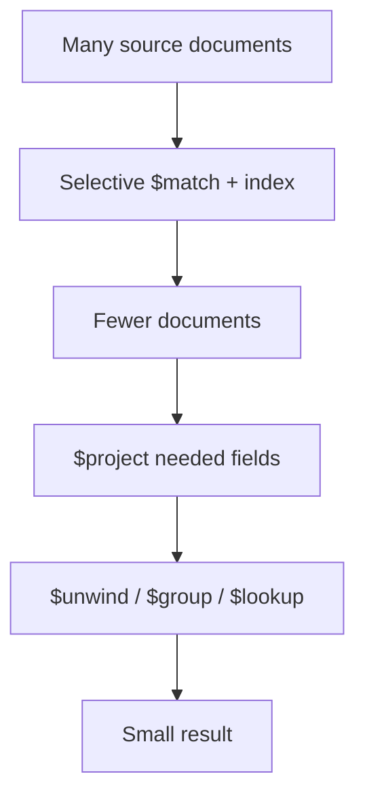

# Lesson 045 — Aggregation Optimization

[← Section 5](./README.md) · [Full curriculum](../README.md)

## Goal
Understand **why a correct pipeline may be slow**, and how to improve it without changing results.

## Pipeline performance mental model


## Shared practice dataset
Run this once in **mongosh** on a disposable learning database. All lessons use these same IDs and amounts, so you can follow the data from stage to stage.

```js
use mongoCourse
db.aggCustomers.deleteMany({_id:{$in:["u1","u2","u3"]}})
db.aggProducts.deleteMany({_id:{$in:["p1","p2","p3"]}})
db.aggOrders.deleteMany({_id:{$in:["o1","o2","o3","o4"]}})
db.aggCustomers.insertMany([
 {_id:"u1",name:"Asha",city:"Patna"},
 {_id:"u2",name:"Ravi",city:"Pune"},
 {_id:"u3",name:"Neha",city:"Patna"}
])
db.aggProducts.insertMany([
 {_id:"p1",name:"Mouse",category:"Accessories"},
 {_id:"p2",name:"Keyboard",category:"Accessories"},
 {_id:"p3",name:"Monitor",category:"Electronics"}
])
db.aggOrders.insertMany([
 {_id:"o1",customerId:"u1",status:"PAID",createdAt:ISODate("2026-01-10T10:00:00Z"),items:[{productId:"p1",qty:2,unitPrice:500},{productId:"p2",qty:1,unitPrice:1500}]},
 {_id:"o2",customerId:"u2",status:"PAID",createdAt:ISODate("2026-01-20T10:00:00Z"),items:[{productId:"p1",qty:1,unitPrice:500}]},
 {_id:"o3",customerId:"u1",status:"CANCELLED",createdAt:ISODate("2026-02-03T10:00:00Z"),items:[{productId:"p3",qty:1,unitPrice:12000}]},
 {_id:"o4",customerId:"u3",status:"PAID",createdAt:ISODate("2026-02-15T10:00:00Z"),items:[{productId:"p3",qty:1,unitPrice:12000}]}
])
```
Prices here are **illustrative whole currency units** for easy arithmetic. In a production shop, store money consistently as integer minor units or Decimal128 and handle currency and refunds explicitly.


## 1. Filter early
```js
db.aggOrders.aggregate([
 {$match:{status:"PAID"}},
 {$unwind:"$items"},
 {$group:{_id:"$items.productId",units:{$sum:"$items.qty"}}}
])
```
The cancelled order is excluded **before** its items are expanded. This reduces work. MongoDB may reorder some safe stages automatically, but not every transformation can be moved.

## 2. Index the initial match and sort
```js
db.aggOrders.createIndex({status:1,createdAt:-1})
db.aggOrders.aggregate([
 {$match:{status:"PAID"}},
 {$sort:{createdAt:-1}},
 {$limit:10}
])
```
A compatible index can support early filtering/sorting. Once a pipeline transforms documents (e.g., after `$group`), the same index may no longer be usable for downstream sorting.

## 3. Limit after the correct sort
```js
db.aggOrders.aggregate([
 {$match:{status:"PAID"}},
 {$sort:{createdAt:-1,_id:-1}},
 {$limit:10}
])
```
The order matters. Moving `$limit` before `$group` changes totals unless you truly want statistics for only that subset.

## 4. Use explain, not guesses
```js
db.aggOrders.explain("executionStats").aggregate([
 {$match:{status:"PAID"}},
 {$sort:{createdAt:-1}},
 {$limit:10}
])
```
Look for index scans, collection scans, documents/keys examined, sort behavior and execution time. Explain output differs by MongoDB version and execution engine; inspect the plan rather than expecting one fixed JSON shape.

## 5. Memory and disk spilling
Some stages such as `$sort` and `$group` may require substantial memory. Depending on server version and settings, supported stages can spill temporary data to disk, including when `allowDiskUse:true` is supplied.

```js
db.aggOrders.aggregate([
 {$group:{_id:"$customerId",orders:{$sum:1}}},
 {$sort:{orders:-1}}
],{allowDiskUse:true})
```
Disk spilling can avoid some memory errors but is **not free**; it may be slow. **$facet has its own limits and cannot spill its intermediate result to disk** using allowDiskUse. The final BSON output document still must fit within 16 MiB.

## 6. $lookup performance
Prefer selective outer documents and an index on the joined field. For an order-to-customer lookup, `aggCustomers._id` is indexed automatically. Avoid joining entire unbounded arrays when a paginated child query would suffice.

## 7. Avoid over-projecting prematurely
Projection can reduce data carried forward, but the optimizer already performs some field pruning. A complicated early `$project` can make a pipeline harder to read and may interfere with index-friendly stages. Start with **clear semantics**, then measure.

## 8. When to precompute
If a dashboard repeatedly groups millions of orders for the same monthly report, consider a materialized summary collection updated periodically or incrementally. Plan late-arriving payments, cancellations and refunds so summaries stay correct.

## Mongoose
```js
const report = await Order.aggregate([
 {$match:{status:"PAID"}},
 {$group:{_id:"$customerId",count:{$sum:1}}}
]).allowDiskUse(true);
```
Mongoose pipelines generally do not cast string IDs to ObjectIds automatically.

## Optimization checklist
1. Confirm the metric is correct.
2. Measure the current plan and response time.
3. Filter early with suitable indexes.
4. Avoid unnecessary unwinding/joins.
5. Sort and limit in the correct order.
6. Re-run explain with realistic data volume.
7. Monitor memory, spills and write overhead of added indexes.

## Final practice
Compare explain plans for a paid-order listing before/after adding `{status:1,createdAt:-1}`. Explain why moving `$limit` before a revenue `$group` would be incorrect.

**Interview:** **How do you optimize aggregation?** Preserve correctness, measure plans, filter early, index common predicates, reduce unnecessary intermediate data.

[Aggregation optimization](https://www.mongodb.com/docs/manual/core/aggregation-pipeline-optimization/)
