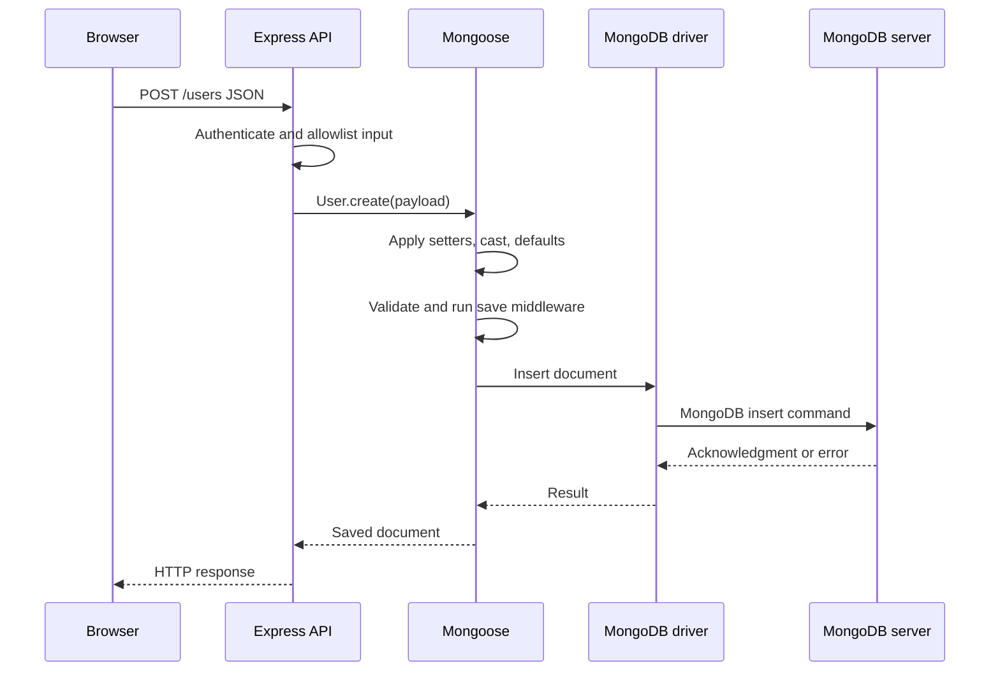
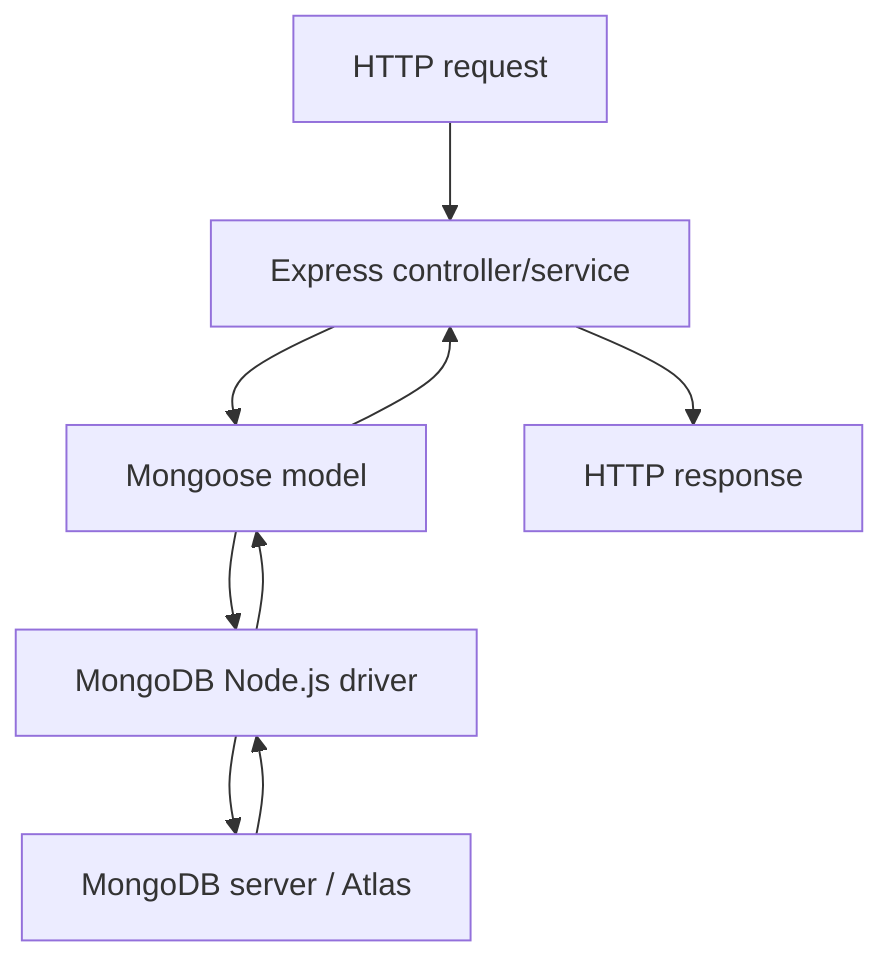
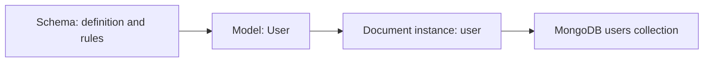

# Lesson 046 — Why Mongoose? Driver vs ODM

[← Section 6](./README.md) · [Full curriculum](../README.md)

## Deep theory: what problem are we actually solving?

MongoDB does not require every document in a collection to have the same shape. This flexibility is useful when product categories have different attributes, but an application still needs **predictable input**. Consider a checkout service that expects `priceMinor` to be a nonnegative integer. If one code path writes a string and another writes a number, the database may contain both. The problem is not that MongoDB cannot store data; the problem is that **application code cannot safely assume the stored shape**.

Mongoose introduces a model layer between your Node.js code and the database. It gives the team a consistent place to describe field types, defaults, validation rules, indexes, and reusable document behavior. It does **not** turn MongoDB into a relational database, and it does not replace request authorization.

### A complete write journey



The **driver** is responsible for communicating with the server, selecting suitable connections, and handling the wire protocol. Mongoose works **before and after** that driver call: it casts values, builds queries, hydrates returned documents, and runs configured hooks. MongoDB itself decides whether a write succeeds, based on server-side rules such as unique indexes and collection validators.

### Walk through an input carefully

```js
const userSchema = new mongoose.Schema({
  name: { type: String, required: true, trim: true },
  age: { type: Number, min: 18, required: true },
  role: { type: String, enum: ["USER", "ADMIN"], default: "USER" }
});
const User = mongoose.model("CourseUser", userSchema);

const user = new User({ name: "  Asha  ", age: "24" });
console.log(user.name); // "Asha": setter applied
console.log(user.age);  // 24: numeric casting
console.log(user.role); // "USER": default
console.log(user.isNew); // true: not saved yet
await user.validate();  // checks document validators, but does not insert
await user.save();      // writes to MongoDB if successful
```

**Why does `validate()` not save?** Validation checks whether the document satisfies rules. Persistence is a separate operation. **Why might `save()` still fail after validation?** Another document could already own a unique email, the database could be unavailable, or a server-side validator could reject the data. A Mongoose validation success is not a promise that the database write will succeed.

### Read journey: hydration and plain objects

```js
const hydrated = await User.findOne({ name: "Asha" });
console.log(typeof hydrated?.save); // "function" if found

const plain = await User.findOne({ name: "Asha" }).lean();
console.log(typeof plain?.save); // "undefined"
```

Normal Mongoose queries generally convert results into **Mongoose document instances** with methods and change tracking. `lean()` returns plain objects and avoids that hydration overhead. Choose it for read-only responses when you do not need document features.

### ODM trade-offs in real projects

Mongoose is helpful when many endpoints share the same domain rules. But it adds abstraction: developers must learn differences between `save()`, `updateOne()`, `findOneAndUpdate()`, and `aggregate()`. Casting and middleware are **not identical across all APIs**. A driver-only approach is reasonable when you want direct control, use independent validation (for example Zod), and do not need Mongoose document behavior.

**Checkpoint:** Which layer enforces a unique email? The MongoDB unique index. Which layer converts `"24"` into a Number for a Mongoose document? Mongoose casting. Which layer must decide whether a user is allowed to set `role:"ADMIN"`? Your application's authorization logic.

---
## Learning goals
Explain what MongoDB, the official Node.js driver, and Mongoose each do; understand the request-to-database flow; decide when an ODM helps and what it cannot guarantee.

## 1. Three layers, three jobs
- **MongoDB server** stores BSON documents, runs queries, enforces database indexes and configured validators.
- **MongoDB Node.js driver** communicates with the server and exposes collection operations such as `insertOne()`, `findOne()`, and `updateOne()`.
- **Mongoose** is an **Object Document Mapper (ODM)** built on the driver. It provides schemas, models, document instances, casting, validation, middleware, query helpers, virtuals, and population.



**Important:** Atlas is a managed hosting service for MongoDB, not an alternative database language or ODM.

## 2. Why an ODM? A practical problem
Suppose a registration request sends:
```js
{ name:"Asha", age:"24", role:"admin", email:"asha@example.test" }
```
A raw database insert will generally store what you give it. The driver does **not** automatically apply your app's Mongoose schema. An ODM can cast `"24"` to a Number, validate fields, set defaults, and omit unknown properties under its default strict behavior. **Do not rely on casting for API security**: validate request payloads and explicitly allow only client-editable fields.

## 3. Same operation using the official driver
```js
import { MongoClient } from "mongodb";
const client = new MongoClient(process.env.MONGODB_URI);
await client.connect();
try {
  const db = client.db("learning");
  const result = await db.collection("users").insertOne({
    name:"Asha",age:24,email:"asha@example.test"
  });
  console.log(result.insertedId);
} finally {
  await client.close();
}
```
This is a **standalone script**. A running Express server should **reuse one long-lived client**, not connect and close for every request.

## 4. Same operation using Mongoose
```js
import mongoose from "mongoose";
await mongoose.connect(process.env.MONGODB_URI, {dbName:"learning"});
const userSchema = new mongoose.Schema({
  name:{type:String,required:true,trim:true},
  age:{type:Number,min:0},
  email:{type:String,required:true,lowercase:true}
});
const User = mongoose.model("User",userSchema);
try {
  const user = await User.create({
    name:" Asha ",age:"24",email:"ASHA@EXAMPLE.TEST"
  });
  console.log(user.name,user.age,user.email);
} finally {
  await mongoose.disconnect();
}
```
Expected fields after casting/setters: name `"Asha"`, age `24`, email `"asha@example.test"`. This does **not** validate real-world email format by itself, nor enforce email uniqueness.

## 5. Schema → Model → Document

- **Schema:** blueprint (field types, rules, defaults, indexes, hooks).
- **Model:** compiled constructor + collection query interface.
- **Document:** an instance with field values and methods such as `save()`.

## 6. What Mongoose does not do
1. It doesn't replace MongoDB indexes or the database query engine.
2. `ref` does not enforce foreign keys or cascade deletes.
3. `unique:true` declares a database index, **not a Mongoose validator**.
4. Validation on `save()` and update queries is not identical.
5. `populate()` is convenient but can be costly for large relationships.
6. It cannot make multiple document writes atomic without a supported transaction or careful workflow.
7. It cannot protect your API from authorization bugs or malicious input by itself.

## 7. Driver vs ODM decision
| Choose driver when... | Choose Mongoose when... |
| --- | --- |
| You want low-level control and fewer abstractions | You want reusable schemas/models and hooks |
| You already validate everything separately | You benefit from casting, defaults, and document methods |
| You need direct access to specific driver features | Your Node.js app uses document-oriented domain models |

Both are legitimate. Mongoose still uses the MongoDB driver underneath.

## 8. Performance and debugging
An ODM adds some overhead for document hydration and casting. For read-only listings, `.lean()` can skip Mongoose document hydration (covered in Lesson 055). For debugging, know the MongoDB command/operator behind the Mongoose method.

## Practice
Write a `Product` schema with name, price and stock. Explain which checks happen in Node.js vs which require a database index. List two scenarios where you might prefer the driver.

## Interview check
**Q: Is Mongoose a database?** No, it's a Node.js ODM library.

**Q: Can I use MongoDB without Mongoose?** Yes, with the official driver or other clients.

**Q: Does a Mongoose schema prevent invalid direct mongosh writes?** No. Database-level validation is separate.

**Official references:** [Mongoose guide](https://mongoosejs.com/docs/guide.html) · [MongoDB Node driver](https://www.mongodb.com/docs/drivers/node/current/)
