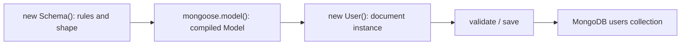

# Lesson 048 — Schemas and Models

[← Section 6](./README.md) · [Full curriculum](../README.md)

## Learning goals
Understand **Schema vs Model vs Document**, compilation, collection naming, document creation, model reuse and schema design options.

## 1. Core mental model

A **Schema** defines structure and behavior. A **Model** is the class-like interface created from a schema, used for CRUD and queries. A **Document** is one instance with actual field values.

## 2. A real schema
```js
import mongoose from "mongoose";
const {Schema} = mongoose;

const userSchema = new Schema({
  name:{type:String,required:true,trim:true},
  email:{type:String,required:true,lowercase:true},
  age:{type:Number,min:0},
  isActive:{type:Boolean,default:true},
  address:{
    city:{type:String,default:"Unknown"},
    pincode:String
  }
},{timestamps:true});

const User = mongoose.model("User",userSchema);
export default User;
```
`timestamps:true` manages `createdAt` and `updatedAt` for supported Mongoose operations. `mongoose.model("User", ...)` typically uses the pluralized `users` collection. Collection names can be specified explicitly if required.

## 3. Creating a document: new + save
```js
const user = new User({name:" Asha ",email:"ASHA@EXAMPLE.TEST"});
console.log(user.isNew); // true
console.log(user.name); // "Asha" (trim setter)
console.log(user.isActive); // true
await user.save();
console.log(user.isNew); // false
console.log(user._id); // ObjectId assigned by Mongoose
```
**Important:** `new User(...)` creates an in-memory Mongoose document; **it does not insert into MongoDB** until you save. `save()` validates the document before writing, then uses insert/update operations depending on whether the document is new.

## 4. Model.create shortcut
```js
const ravi = await User.create({
 name:"Ravi",email:"ravi@example.test",age:25
});
```
`Model.create()` creates and saves document(s), invoking save-related validation and middleware.

## 5. Query with the model
```js
const all = await User.find({isActive:true}).sort({createdAt:-1});
const one = await User.findOne({email:"asha@example.test"});
const byId = await User.findById(ravi._id);
```
`find()` returns an array; `findOne()` and `findById()` return a document or `null`. Query methods build **Query objects** that execute when awaited or when `.exec()` is called.

## 6. Schema does not equal collection
A schema lives in Node.js code. The collection lives in MongoDB. Schema fields are not automatically enforced on direct `mongosh` inserts unless the database also has its own validator. MongoDB remains schema-flexible.

## 7. Compile models once
```js
// Standard server-side model module:
export const User = mongoose.models.User || mongoose.model("User",userSchema);
```
This guard is useful in hot-reload environments where the same model module may be evaluated repeatedly. In a stable Node.js process, normal module caching already avoids repeated compilation. Calling `mongoose.model("User", differentSchema)` again can throw `OverwriteModelError`.

## 8. Explicit collection name
```js
const auditSchema = new Schema({action:String},{collection:"audit_events"});
const AuditEvent = mongoose.model("AuditEvent",auditSchema);
```
Now the collection is `audit_events`, not the default pluralized name.

## 9. Document vs plain object
```js
const doc = await User.findOne();
if (doc) {
  console.log(typeof doc.save); // "function"
  const plain = doc.toObject();
  console.log(typeof plain.save); // "undefined"
}
```
Hydrated documents have Mongoose methods and change tracking. `.lean()` queries skip hydration for read-only results (Lesson 055).

## 10. Relationships and indexes
```js
const orderSchema = new Schema({
 userId:{type:Schema.Types.ObjectId,ref:"User",required:true},
 totalMinor:{type:Number,required:true,min:0}
});
orderSchema.index({userId:1,createdAt:-1});
```
The `ref` enables Mongoose population; it is **not** a database foreign key. An index is created in MongoDB when the index-management workflow runs; the schema declaration alone is not a uniqueness guarantee.

## 11. Common errors
- Thinking `new User()` immediately saves data.
- Confusing `User.find()` (model query) with `user.save()` (document method).
- Compiling the same model name with different schemas.
- Expecting `required:true` to protect direct driver writes.
- Defining a `ref` and assuming automatic cascade deletes.

## Practice
Create `Product` schema with name, price, tags, timestamps. Insert using `new Product().save()` and `Product.create()`, then query and compare `toObject()`.

## Interview check
**Q: Schema vs Model?** Blueprint vs compiled database-facing constructor/query API.

**Q: Model vs Document?** Model represents a collection interface; document represents one record.

**Q: Does creating a schema create a collection immediately?** Not necessarily; collections are typically created on first write or through explicit collection creation/index operations.

**Official references:** [Schemas](https://mongoosejs.com/docs/guide.html) · [Models](https://mongoosejs.com/docs/models.html) · [Documents](https://mongoosejs.com/docs/documents.html)
