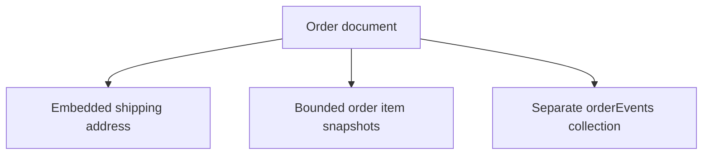
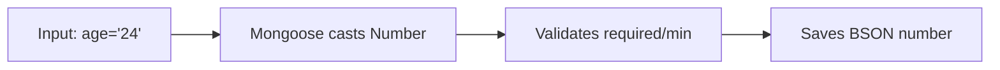

# Lesson 049 — Schema Types, Defaults and Required Fields

[← Section 6](./README.md) · [Full curriculum](../README.md)

## Deep theory: casting, defaults, validators and persisted BSON

A field definition is more than a JavaScript type annotation. Mongoose's **SchemaType** controls how a path is interpreted by the ODM: how incoming values are cast, what default is applied, which validators run, and how certain modifications are tracked.

### Follow one document from input to persistence

```js
const schema = new mongoose.Schema({
  name: { type: String, required: true, trim: true },
  age: { type: Number, required: true, min: 18 },
  active: { type: Boolean, required: true, default: false },
  joinedAt: { type: Date, default: Date.now }
});
const Member = mongoose.model("CourseMemberTypes", schema);
const member = new Member({ name: "  Asha ", age: "24" });

console.log(member.name);     // "Asha"
console.log(member.age);      // 24
console.log(member.active);   // false
console.log(member.joinedAt instanceof Date); // true
await member.validate();      // validation, no database insert
```

**Casting** tries to convert values into the declared path type. **Setters** such as `trim` transform values. **Defaults** fill in paths whose value is strictly `undefined`. **Validators** check rules, generally when validation runs. These are distinct mechanisms, even if they appear together in one field definition.

### Why defaults use `undefined`, not `null`

```js
const a = new Member({ name: "Asha", age: 24 });
const b = new Member({ name: "Ravi", age: 24, active: null });
console.log(a.active); // false: default applied
console.log(b.active); // null: explicit null prevents default
```

The second document fails the required Boolean validation because `null` is not accepted as present. By contrast, `false` **does** satisfy a required Boolean. For a required Number, `0` counts as present, although a `min` validator may reject it.

### What if casting fails?

```js
const bad = new Member({ name: "Neha", age: "twenty" });
try {
  await bad.validate();
} catch (error) {
  console.log(error.name); // typically "ValidationError"
  console.log(error.errors.age?.name); // "CastError"
}
```

The underlying path problem is a **CastError** because `"twenty"` cannot be converted to a number. It is not a `min:18` failure: the value never became a usable number. When handling API errors, distinguish casting problems, failed validators and database duplicate-key errors.

### Required is not the same as uniqueness

```js
const userSchema = new mongoose.Schema({
  email: { type: String, required: true, lowercase: true, trim: true }
});
userSchema.index({ email: 1 }, { unique: true });
```

`required` is a Mongoose validation rule; a unique index is enforced by **MongoDB** once created. Two concurrent requests may both pass Mongoose validation, but the database rejects the duplicate key. Handle error code `11000` and do not treat `unique` as a regular validator.

### Arrays, embedded documents, and ownership

A shipping address is often small and read with its parent order, so embedding makes sense. An order's growing event history may belong in a separate collection. Mongoose's ability to define `[subSchema]` does **not** mean embedding an unlimited array is a good database design.



A single nested subdocument has its own validation/middleware behavior and can be absent. A plain nested object is treated differently. For arrays of subdocuments, Mongoose usually gives each child an `_id` unless the child schema disables it.

### Numeric precision: why money needs a policy

JavaScript floating-point arithmetic can surprise you:

```js
console.log(0.1 + 0.2 === 0.3); // false
```

For many INR applications, storing `priceMinor: 50100` to represent ₹501.00 is simple and predictable, provided amounts remain within JavaScript's safe integer range. Decimal128 is another option but requires deliberate conversion and serialization. Do not mix rupees, paise and floating-point totals across different code paths.

### Update validators: an important trap

```js
await Member.updateOne(
  { _id: member._id },
  { $set: { age: 12 } },
  { runValidators: true }
);
```

Query updates do **not** behave exactly like `member.age = 12; await member.save()`. Update validators are opt-in for many query update methods and generally validate updated paths/operators rather than the entire existing document. They also have special `this` behavior for custom validators. Use the right operation for the rule you're enforcing, and test edge cases.

### Schema-level security boundaries

`strict:true` normally prevents unknown fields from being persisted through a model, but it is **not authorization**. A request containing `role:"ADMIN"` is dangerous if `role` is a legitimate schema path and you pass the entire request body to an update. Always validate the request and allowlist writable fields:

```js
const { name } = req.body; // only allow a user to edit their name
await User.updateOne({ _id: req.user.id }, { $set: { name } }, { runValidators: true });
```

The example assumes authentication middleware has already established `req.user.id`; validate `name` before use.

**Checkpoint:** Explain the difference between `undefined` and `null` for defaults, a cast error vs validator error, a required field vs unique index, and a schema type vs the BSON value actually stored in MongoDB.

---
## Learning goals
Understand important Mongoose SchemaTypes, casting, defaults, `required`, arrays, subdocuments, maps, ObjectIds and timestamps. Know where validation is and is not automatic.

## 1. What is a SchemaType?
A SchemaType describes how Mongoose **casts, validates, defaults, and tracks** a path. It is not the same as a JavaScript type or a MongoDB collection schema.



## 2. Common types
```js
import mongoose from "mongoose";
const {Schema} = mongoose;

const exampleSchema = new Schema({
 name:String,                       // text
 age:Number,                        // numeric
 active:Boolean,                    // true/false
 joinedAt:Date,                     // timestamp
 userId:Schema.Types.ObjectId,      // MongoDB ObjectId
 avatar:Buffer,                     // binary
 tags:[String],                     // array of strings
 settings:Schema.Types.Mixed,       // arbitrary structure; less change tracking
 score:Schema.Types.Decimal128,     // precise decimal BSON type
 preferences:{type:Map,of:String}   // dynamic string keys
});
```
Other types and options exist (e.g. UUID-related support, BigInt, and nested schema types) and vary with Mongoose versions. Use official docs for your installed version.

## 3. Required fields
```js
const productSchema = new Schema({
 name:{type:String,required:[true,"Name is required"]},
 priceMinor:{type:Number,required:true,min:0},
 stock:{type:Number,required:true,min:0}
});
```
`required:true` rejects missing/null values on document validation. **Caveat:** an empty string is also invalid for a required String, but numeric `0` and Boolean `false` are valid when required. For required arrays and nested objects, semantics differ; test what your model actually enforces.

## 4. Defaults
```js
const taskSchema = new Schema({
 title:{type:String,required:true},
 status:{type:String,default:"OPEN"},
 priority:{type:Number,default:1},
 createdAt:{type:Date,default:Date.now}
});
const Task = mongoose.model("Task",taskSchema);
const task = new Task({title:"Prepare resume"});
console.log(task.status);   // OPEN
console.log(task.priority); // 1
```
Defaults apply when a path's value is **strictly undefined**. Explicit `null` does not trigger a default. Pass `Date.now`, not `Date.now()`, so each document gets its own creation time.

## 5. Validation constraints and setters
```js
const accountSchema = new Schema({
 email:{type:String,required:true,trim:true,lowercase:true},
 role:{type:String,enum:["USER","ADMIN"],default:"USER"},
 age:{type:Number,min:18,max:100}
});
```
`trim` and `lowercase` are setters; `enum`, `min`, `max` are validators. `lowercase:true` does **not** validate email syntax.

## 6. ObjectId and ref
```js
const orderSchema = new Schema({
 userId:{type:Schema.Types.ObjectId,ref:"User",required:true},
 totalMinor:{type:Number,min:0}
});
```
`Schema.Types.ObjectId` describes a field in the schema; `mongoose.Types.ObjectId` creates an actual ObjectId value:
```js
const id = new mongoose.Types.ObjectId();
const order = new (mongoose.model("OrderExample",orderSchema))({userId:id,totalMinor:500});
```
`ref:"User"` provides metadata for `populate()` and does not enforce the existence of a user.

## 7. Embedded subdocuments
```js
const addressSchema = new Schema({
 city:{type:String,required:true},
 pincode:String
},{_id:false});

const customerSchema = new Schema({
 name:String,
 shippingAddress:addressSchema,
 addresses:[addressSchema]
});
```
`shippingAddress` is a single nested subdocument; `addresses` is a document array. `{_id:false}` prevents automatic IDs for these address subdocuments. By default, a subdocument schema may get its own `_id`.

## 8. Plain nested paths vs subdocuments
```js
const schemaA = new Schema({profile:{city:String}});
const schemaB = new Schema({profile:new Schema({city:String})});
```
These look similar but behave differently: single nested subdocuments can be **undefined** and have their own middleware/validation; plain nested paths are treated as nested path structures. The difference matters when marking entire nested objects required.

## 9. Arrays and defaults
```js
const blogSchema = new Schema({
 tags:{type:[String],default:[]},
 ratings:[Number]
});
```
Mongoose array paths typically default to `[]` unless configured otherwise. `default:undefined` can disable the automatic empty array default when distinguishing “not supplied” from “empty” matters. Never let unbounded history arrays grow forever inside one document.

## 10. Maps vs Mixed
```js
const preferencesSchema = new Schema({
 settings:{type:Map,of:String},
 arbitrary:Schema.Types.Mixed
});
```
Maps are suited to dynamic keys with a known value type. Use `.set(key,value)` on a Mongoose Map. Mixed paths permit arbitrary shapes but Mongoose may not detect deep in-place changes; call `doc.markModified("arbitrary")` when needed.

## 11. Dates and timestamps
```js
const schema = new Schema({title:String},{timestamps:true});
```
Mongoose maintains `createdAt` and `updatedAt` for supported operations. Dates are instants; format with the correct timezone when presenting them.

## 12. Decimal128 and money
For monetary values, choose a consistent representation: integer minor units or BSON Decimal128. JavaScript `Number` can lose decimal precision for some calculations; don't mix money types casually. Decimal128 values need explicit conversion/handling when serializing.

## 13. Casting is not validation
Input `"24"` may be cast to Number 24. Input `"abc"` cannot be cast and can cause a `CastError` during validation/save or query casting. Do not confuse a cast failure with a failed `min` validator.

## 14. Update validation caveat
Document `save()` runs validation by default. Query updates such as `updateOne()` and `findOneAndUpdate()` have **different validation behavior**; use `runValidators:true` where appropriate and understand that update validators are limited to certain paths/operators (Lessons 052–053).

## 15. Practical model
```js
const productSchema2 = new Schema({
 name:{type:String,required:true,trim:true,minlength:2},
 category:{type:String,enum:["Electronics","Accessories"],required:true},
 priceMinor:{type:Number,required:true,min:0},
 stock:{type:Number,required:true,min:0,default:0},
 tags:{type:[String],default:[]},
 attributes:{type:Map,of:String},
 dimensions:new Schema({
  width:Number,height:Number,unit:{type:String,default:"cm"}
 },{_id:false})
},{timestamps:true});

const Product = mongoose.models.CourseProduct ||
 mongoose.model("CourseProduct",productSchema2);
```
A production API should validate requests separately, restrict editable fields, and add indexes for actual queries.

## Practice
1. Create a user schema with required email, default role, optional age, and address subdocument.
2. Test `undefined` vs `null` for a default.
3. Test `required:true` with String `""`, Number `0`, Boolean `false`.
4. Store a map, update a key, and save.
5. Explain ObjectId schema type vs actual ObjectId instance.

## Interview check
**Q: What triggers a default?** An undefined path.

**Q: Is `unique:true` a validator?** No, it creates a MongoDB unique index.

**Q: Are all update operations validated like save()?** No; query updates have separate rules.

**Official references:** [SchemaTypes](https://mongoosejs.com/docs/schematypes.html) · [Defaults](https://mongoosejs.com/docs/defaults.html) · [Subdocuments](https://mongoosejs.com/docs/subdocs.html) · [Validation](https://mongoosejs.com/docs/validation.html)
