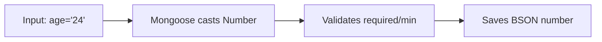

# Lesson 049 — Schema Types, Defaults and Required Fields

[← Section 6](./README.md) · [Full curriculum](../README.md)

## Learning goals
Understand important Mongoose SchemaTypes, casting, defaults, `required`, arrays, subdocuments, maps, ObjectIds and timestamps. Know where validation is and is not automatic.

## 1. What is a SchemaType?
A SchemaType describes how Mongoose **casts, validates, defaults, and tracks** a path. It is not the same as a JavaScript type or a MongoDB collection schema.



## 2. Common types
```js
import mongoose from "mongoose";
const {Schema} = mongoose;

const exampleSchema = new Schema({
 name:String,                       // text
 age:Number,                        // numeric
 active:Boolean,                    // true/false
 joinedAt:Date,                     // timestamp
 userId:Schema.Types.ObjectId,      // MongoDB ObjectId
 avatar:Buffer,                     // binary
 tags:[String],                     // array of strings
 settings:Schema.Types.Mixed,       // arbitrary structure; less change tracking
 score:Schema.Types.Decimal128,     // precise decimal BSON type
 preferences:{type:Map,of:String}   // dynamic string keys
});
```
Other types and options exist (e.g. UUID-related support, BigInt, and nested schema types) and vary with Mongoose versions. Use official docs for your installed version.

## 3. Required fields
```js
const productSchema = new Schema({
 name:{type:String,required:[true,"Name is required"]},
 priceMinor:{type:Number,required:true,min:0},
 stock:{type:Number,required:true,min:0}
});
```
`required:true` rejects missing/null values on document validation. **Caveat:** an empty string is also invalid for a required String, but numeric `0` and Boolean `false` are valid when required. For required arrays and nested objects, semantics differ; test what your model actually enforces.

## 4. Defaults
```js
const taskSchema = new Schema({
 title:{type:String,required:true},
 status:{type:String,default:"OPEN"},
 priority:{type:Number,default:1},
 createdAt:{type:Date,default:Date.now}
});
const Task = mongoose.model("Task",taskSchema);
const task = new Task({title:"Prepare resume"});
console.log(task.status);   // OPEN
console.log(task.priority); // 1
```
Defaults apply when a path's value is **strictly undefined**. Explicit `null` does not trigger a default. Pass `Date.now`, not `Date.now()`, so each document gets its own creation time.

## 5. Validation constraints and setters
```js
const accountSchema = new Schema({
 email:{type:String,required:true,trim:true,lowercase:true},
 role:{type:String,enum:["USER","ADMIN"],default:"USER"},
 age:{type:Number,min:18,max:100}
});
```
`trim` and `lowercase` are setters; `enum`, `min`, `max` are validators. `lowercase:true` does **not** validate email syntax.

## 6. ObjectId and ref
```js
const orderSchema = new Schema({
 userId:{type:Schema.Types.ObjectId,ref:"User",required:true},
 totalMinor:{type:Number,min:0}
});
```
`Schema.Types.ObjectId` describes a field in the schema; `mongoose.Types.ObjectId` creates an actual ObjectId value:
```js
const id = new mongoose.Types.ObjectId();
const order = new (mongoose.model("OrderExample",orderSchema))({userId:id,totalMinor:500});
```
`ref:"User"` provides metadata for `populate()` and does not enforce the existence of a user.

## 7. Embedded subdocuments
```js
const addressSchema = new Schema({
 city:{type:String,required:true},
 pincode:String
},{_id:false});

const customerSchema = new Schema({
 name:String,
 shippingAddress:addressSchema,
 addresses:[addressSchema]
});
```
`shippingAddress` is a single nested subdocument; `addresses` is a document array. `{_id:false}` prevents automatic IDs for these address subdocuments. By default, a subdocument schema may get its own `_id`.

## 8. Plain nested paths vs subdocuments
```js
const schemaA = new Schema({profile:{city:String}});
const schemaB = new Schema({profile:new Schema({city:String})});
```
These look similar but behave differently: single nested subdocuments can be **undefined** and have their own middleware/validation; plain nested paths are treated as nested path structures. The difference matters when marking entire nested objects required.

## 9. Arrays and defaults
```js
const blogSchema = new Schema({
 tags:{type:[String],default:[]},
 ratings:[Number]
});
```
Mongoose array paths typically default to `[]` unless configured otherwise. `default:undefined` can disable the automatic empty array default when distinguishing “not supplied” from “empty” matters. Never let unbounded history arrays grow forever inside one document.

## 10. Maps vs Mixed
```js
const preferencesSchema = new Schema({
 settings:{type:Map,of:String},
 arbitrary:Schema.Types.Mixed
});
```
Maps are suited to dynamic keys with a known value type. Use `.set(key,value)` on a Mongoose Map. Mixed paths permit arbitrary shapes but Mongoose may not detect deep in-place changes; call `doc.markModified("arbitrary")` when needed.

## 11. Dates and timestamps
```js
const schema = new Schema({title:String},{timestamps:true});
```
Mongoose maintains `createdAt` and `updatedAt` for supported operations. Dates are instants; format with the correct timezone when presenting them.

## 12. Decimal128 and money
For monetary values, choose a consistent representation: integer minor units or BSON Decimal128. JavaScript `Number` can lose decimal precision for some calculations; don't mix money types casually. Decimal128 values need explicit conversion/handling when serializing.

## 13. Casting is not validation
Input `"24"` may be cast to Number 24. Input `"abc"` cannot be cast and can cause a `CastError` during validation/save or query casting. Do not confuse a cast failure with a failed `min` validator.

## 14. Update validation caveat
Document `save()` runs validation by default. Query updates such as `updateOne()` and `findOneAndUpdate()` have **different validation behavior**; use `runValidators:true` where appropriate and understand that update validators are limited to certain paths/operators (Lessons 052–053).

## 15. Practical model
```js
const productSchema2 = new Schema({
 name:{type:String,required:true,trim:true,minlength:2},
 category:{type:String,enum:["Electronics","Accessories"],required:true},
 priceMinor:{type:Number,required:true,min:0},
 stock:{type:Number,required:true,min:0,default:0},
 tags:{type:[String],default:[]},
 attributes:{type:Map,of:String},
 dimensions:new Schema({
  width:Number,height:Number,unit:{type:String,default:"cm"}
 },{_id:false})
},{timestamps:true});

const Product = mongoose.models.CourseProduct ||
 mongoose.model("CourseProduct",productSchema2);
```
A production API should validate requests separately, restrict editable fields, and add indexes for actual queries.

## Practice
1. Create a user schema with required email, default role, optional age, and address subdocument.
2. Test `undefined` vs `null` for a default.
3. Test `required:true` with String `""`, Number `0`, Boolean `false`.
4. Store a map, update a key, and save.
5. Explain ObjectId schema type vs actual ObjectId instance.

## Interview check
**Q: What triggers a default?** An undefined path.

**Q: Is `unique:true` a validator?** No, it creates a MongoDB unique index.

**Q: Are all update operations validated like save()?** No; query updates have separate rules.

**Official references:** [SchemaTypes](https://mongoosejs.com/docs/schematypes.html) · [Defaults](https://mongoosejs.com/docs/defaults.html) · [Subdocuments](https://mongoosejs.com/docs/subdocs.html) · [Validation](https://mongoosejs.com/docs/validation.html)
