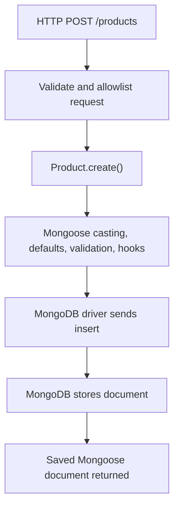

# Lesson 050 — Creating and Reading Documents

[← Section 6](./README.md) · [Full curriculum](../README.md)

## Learning objectives
Understand how Mongoose creates documents, when MongoDB actually stores them, how read queries execute, what different methods return, and how to write safe Express 5 CRUD endpoints.

## 1. Why do we need these operations?
Consider an e-commerce application. Admins add products, customers view a product catalog, and users open a single product detail page. These tasks need two fundamental database actions: **create** and **read**.

MongoDB stores BSON documents. Mongoose lets us work with these documents through a **Model** created from a **Schema**. Creating a JavaScript object is not the same as inserting a document into the database.



## 2. Shared practice setup

Run this in a Node.js ES-module project after installing `mongoose` and setting `MONGODB_URI`. Use a **practice database**, not production.

```js
import mongoose from "mongoose";

await mongoose.connect(process.env.MONGODB_URI, {
  dbName: "mongoose_course"
});

const productSchema = new mongoose.Schema({
  name: { type: String, required: true, trim: true, minlength: 2 },
  sku: { type: String, required: true, uppercase: true },
  priceMinor: { type: Number, required: true, min: 0 },
  stock: { type: Number, default: 0, min: 0 },
  category: { type: String, enum: ["ACCESSORIES", "ELECTRONICS"], required: true },
  active: { type: Boolean, default: true }
}, { timestamps: true });

productSchema.index({ sku: 1 }, { unique: true });

const Product = mongoose.models.CourseProduct ||
  mongoose.model("CourseProduct", productSchema);

// In a new learning database, wait for declared indexes to build.
await Product.init();
```

**Theory:** A schema defines rules in Node.js. The model provides collection operations. MongoDB enforces its own database indexes. `unique` is **not** a Mongoose validator: duplicate SKU writes are rejected by MongoDB only after the unique index exists.

## 3. Creating a document: new + save()

```js
const product = new Product({
  name: "  Wireless Mouse  ",
  sku: "mouse-001",
  priceMinor: "49900",
  stock: 10,
  category: "ACCESSORIES"
});

console.log(product.name);       // "Wireless Mouse"
console.log(product.sku);        // "MOUSE-001"
console.log(product.priceMinor); // 49900
console.log(product.active);     // true
console.log(product.isNew);      // true

await product.save();
console.log(product.isNew);      // false
console.log(product._id);        // ObjectId
```

**Step-by-step:**
1. `new Product()` constructs an in-memory **Mongoose document**.
2. Mongoose applies setters (trim/uppercase), casts values (string to number when possible), and supplies defaults.
3. `product.isNew` is true because the document has not yet been persisted.
4. `save()` runs document validation and the configured save lifecycle, then asks the driver to insert the document.
5. When the write succeeds, `isNew` becomes false. A database error rejects the promise.

**Important:** An `_id` may be generated before the document is saved. Having an `_id` does **not** prove the document exists in MongoDB.

## 4. create(): shorter create-and-save

```js
const keyboard = await Product.create({
  name: "Keyboard",
  sku: "KEY-001",
  priceMinor: 149900,
  stock: 4,
  category: "ACCESSORIES"
});

console.log(keyboard.name); // "Keyboard"
console.log(keyboard.isNew); // false after successful save
```

`Model.create()` is a convenient way to construct and save documents. It runs save-related validation and middleware. Choose `new + save` when you need to work with a document before saving; choose `create` for straightforward inserts.

## 5. insertMany(): batch inserts and differences

```js
const inserted = await Product.insertMany([
  { name: "Monitor", sku: "MON-001", priceMinor: 899900, stock: 3, category: "ELECTRONICS" },
  { name: "USB Cable", sku: "CAB-001", priceMinor: 9900, stock: 20, category: "ACCESSORIES" }
]);
console.log(inserted.length); // 2
```

`insertMany()` is designed for inserting many records efficiently. Mongoose validates documents by default but **does not execute document `save` middleware**. It has separate `insertMany` middleware. This distinction matters if your application hashes or normalizes values in a `pre("save")` hook.

With `ordered:true` (default), the operation stops processing further inserts after a write error; earlier inserts may already have succeeded. With `ordered:false`, MongoDB may continue processing other inserts. Do not assume a bulk insert is automatically all-or-nothing.

| Method | Returns | Save hooks? | Best use |
| --- | --- | --- | --- |
| `new Product(data)` | Unsaved document | Not yet | Prepare a document |
| `doc.save()` | Saved document | Yes | Document lifecycle |
| `Product.create(data)` | Saved document | Yes | Normal insertion |
| `Product.insertMany(data)` | Inserted documents by default | No | Batch insertion |

## 6. Reading: find(), findOne(), findById()

```js
const accessories = await Product.find({ category: "ACCESSORIES" });
console.log(Array.isArray(accessories)); // true

const mouse = await Product.findOne({ sku: "MOUSE-001" });
console.log(mouse?.name); // "Wireless Mouse" if it exists

const byId = await Product.findById(keyboard._id);
console.log(byId?.sku); // "KEY-001" if it exists
```

**What each method means:**
- `find(filter)` returns an **array**, even when there is one or zero matches.
- `findOne(filter)` returns the first matching document or **null**.
- `findById(id)` is shorthand for `findOne({ _id: id })`; returns a document or **null**.

A syntactically invalid ObjectId string generally causes a **CastError**, whereas a valid ObjectId with no matching record returns **null**. Handle these separately in APIs.

## 7. What is a Mongoose Query? When does it run?

```js
const query = Product.find({ active: true });
const products = await query
  .sort({ priceMinor: 1, _id: 1 })
  .limit(10)
  .exec();
```

Calling `find()` constructs a **Query object**; it does not immediately give you an array of records. Methods like `sort()`, `limit()`, and `select()` configure the query. Awaiting the query or calling `.exec()` executes it. Query objects are **thenables**, not ordinary reusable Promises. If you need to run a query again, build a new query or clone it rather than executing the same query repeatedly.

```mermaid
sequenceDiagram
 participant App as Node.js
 participant M as Mongoose Query
 participant DB as MongoDB
 App->>M: Product.find({active:true})
 Note over M: Build filter; no results yet
 App->>M: sort().limit().exec()
 M->>DB: Execute find command
 DB-->>M: Matching BSON documents
 M-->>App: Hydrated document array
```

## 8. Filtering with operators

```js
const filtered = await Product.find({
  category: "ACCESSORIES",
  priceMinor: { $gte: 10000, $lte: 200000 },
  active: true
});
```

This means: category is ACCESSORIES **AND** price is between 10000 and 200000 minor currency units **AND** active is true. MongoDB query operators such as `$gte`, `$lte`, `$in`, `$ne`, `$or`, and `$elemMatch` also work inside Mongoose filters. Mongoose may cast filter values based on schema paths; that does not make arbitrary user-supplied filters safe.

## 9. Projection, sorting and pagination

```js
const page = await Product.find({ active: true })
  .select("name sku priceMinor -_id")
  .sort({ priceMinor: 1, _id: 1 })
  .skip(0)
  .limit(10)
  .lean();
```

- **Projection (`select`)**: which fields MongoDB returns. `_id` is included by default unless excluded.
- **Sorting**: `1` ascending; `-1` descending. Use a unique tie-breaker such as `_id` for stable pagination.
- **`skip` and `limit`**: select a page. Large offsets can become expensive.
- **`lean()`**: return plain objects without Mongoose document hydration; useful for read-only endpoints. See Lesson 055.

An index can improve frequently used filter/sort combinations. `lean()` does not repair a slow database query.

## 10. countDocuments() and exists()

```js
const total = await Product.countDocuments({ active: true });
const found = await Product.exists({ sku: "MOUSE-001" });

console.log(typeof total); // "number"
console.log(found); // {_id: ...} or null
```

`countDocuments()` counts matches. `exists()` checks whether a matching record exists and returns an object containing `_id` or null; it does **not** return a Boolean directly.

## 11. Express 5 API: a complete practical example

Assume `app` is an Express 5 application, `express.json()` is registered, and `Product` is imported from your model module.

```js
app.post("/api/products", async (req, res) => {
  // In a real API, authenticate and authorize the admin first.
  const { name, sku, priceMinor, stock, category } = req.body;
  const product = await Product.create({ name, sku, priceMinor, stock, category });
  res.status(201).json({ success: true, data: product });
});

app.get("/api/products", async (req, res) => {
  const products = await Product.find({ active: true })
    .select("name sku priceMinor category")
    .sort({ _id: 1 })
    .limit(20)
    .lean();
  res.json({ success: true, data: products });
});

app.get("/api/products/:id", async (req, res) => {
  const product = await Product.findById(req.params.id).lean();
  if (!product) return res.status(404).json({ message: "Product not found" });
  res.json({ success: true, data: product });
});
```

**Execution flow:** HTTP request → Express route → model query → MongoDB driver → database → result → JSON response. Express 5 forwards rejected async route promises to error middleware automatically. In production, validate request bodies and route parameters, restrict editable fields, authenticate admins, and map validation/cast/duplicate-key errors to appropriate HTTP responses.

## 12. Common mistakes and edge cases

1. Forgetting `await product.save()`: the document remains in memory.
2. Assuming `Product.find()` returns a single object rather than an array.
3. Assuming `findOne()` throws if nothing matches; it returns null.
4. Assuming `findById("bad-id")` returns null; it may throw a CastError.
5. Forgetting `await` on a query.
6. Expecting `insertMany()` to run `pre("save")` hooks.
7. Returning unlimited rows without pagination.
8. Passing `req.body` directly into database operations without input validation and authorization.
9. Treating `unique:true` as a validator instead of a database index.
10. Confusing `lean()` plain objects with hydrated Mongoose documents.

## 13. Hands-on exercises

1. Create three products using `Product.create()`; retrieve them using `find()`.
2. Retrieve one product by SKU and then by `_id`.
3. Find accessories priced below ₹2,000 (store amounts in minor units).
4. Write a route that validates `limit` and caps it at 50.
5. Compare `new Product()`, `create()`, and `insertMany()` when a save hook is registered.
6. Predict the output of `find()`, `findOne()`, and `exists()` when no records match.

## 14. Interview questions

**Q: What is the difference between `new Model()` and `Model.create()`?** The first constructs an unsaved document; the second saves it.

**Q: When does a Mongoose query execute?** When awaited, `.then()` is used, or `.exec()` is called.

**Q: Does `findById()` always return a document?** No. It returns null for a missing valid ID and can throw on invalid IDs.

**Q: Why is `insertMany()` not interchangeable with `create()`?** It uses different bulk and middleware semantics.

**Q: What is the difference between `select()` and `lean()`?** `select()` chooses returned fields; `lean()` skips Mongoose document hydration.

## Official references

- [Mongoose Models](https://mongoosejs.com/docs/models.html)
- [Mongoose Documents](https://mongoosejs.com/docs/documents.html)
- [Mongoose Queries](https://mongoosejs.com/docs/queries.html)
- [Mongoose Validation](https://mongoosejs.com/docs/validation.html)
