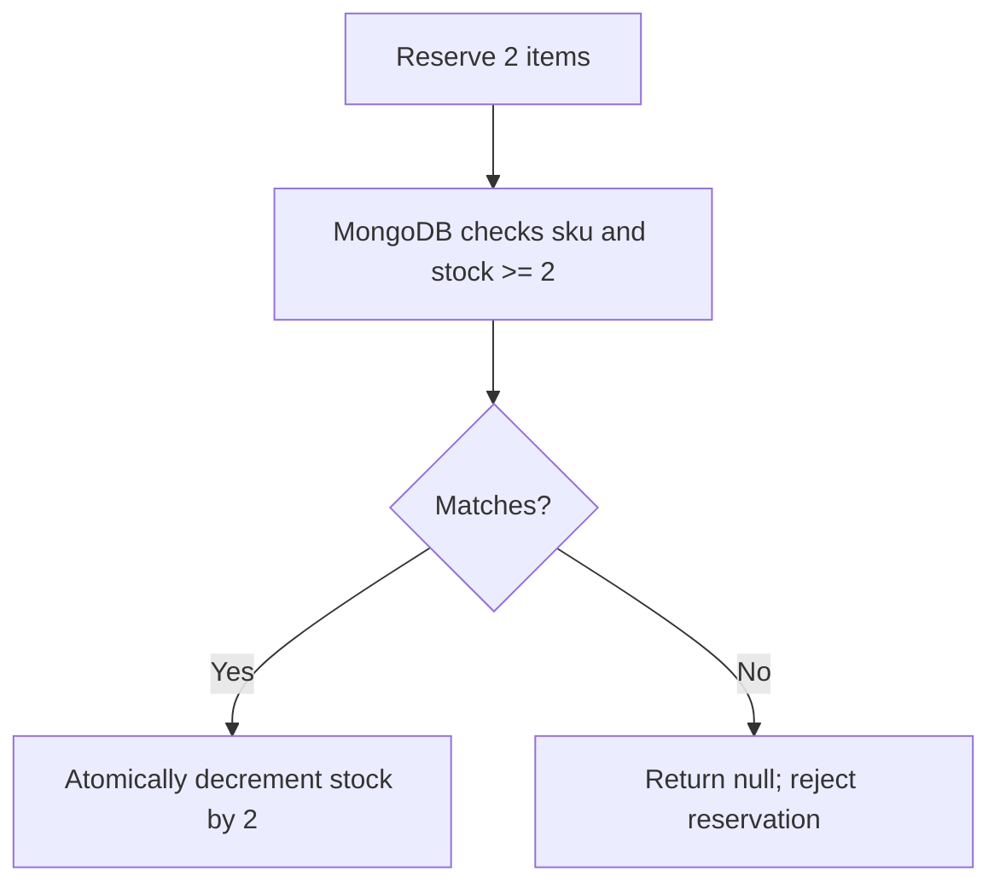

# Lesson 051 — Updating and Deleting Documents

[← Section 6](./README.md) · [Full curriculum](../README.md)

## Why updates need care
A shop must change a price, reserve stock, disable a product, and sometimes delete a test product. An update is not just “replace a value”: we must choose the **matching filter**, **operator**, **return value**, **validation behavior**, and **concurrency guarantee**. An accidental broad filter can update every product.

## Practice setup
Use the connected `Product` model from [Lesson 050](./050-creating-reading-documents.md): `name`, `sku`, `priceMinor`, `stock`, `category`, `active`, and `timestamps`. Assume `await mongoose.connect(process.env.MONGODB_URI)` ran once during application startup. Examples mutate a **disposable learning database**. Product prices use **minor currency units** (e.g., 49900 paise = ₹499). For independent experiments, create fresh sample products.

## 1. Update one document
```js
const result = await Product.updateOne(
  { sku: "MOUSE-001" },
  { $set: { priceMinor: 45900 }, $inc: { stock: 2 } },
  { runValidators: true }
);
console.log(result.matchedCount); // 0 or 1
console.log(result.modifiedCount); // 0 or 1
```
The first argument is a **filter**; the second describes changes; the third holds options. `$set` assigns a value, while `$inc` adds to the existing number. `matchedCount=1` and `modifiedCount=0` can occur when the requested value was already stored. A query update does not run document `save` middleware.

## 2. Update many documents
```js
const result = await Product.updateMany(
  { category: "ACCESSORIES" },
  { $set: { active: false } },
  { runValidators: true }
);
console.log(result.matchedCount, result.modifiedCount);
```
Every matching document is considered. Each document update is atomic, but a multi-document update is **not one all-or-nothing transaction**. Never use an empty filter casually.

## 3. Get the updated document
```js
const updated = await Product.findOneAndUpdate(
  { sku: "MOUSE-001" },
  { $set: { priceMinor: 42900 } },
  { new: true, runValidators: true }
);
console.log(updated?.priceMinor); // 42900 when matched
```
Unlike `updateOne()`, this returns a document (or `null`). By default it returns the **old** version; `new:true` asks for the **new** version. `findByIdAndUpdate(id, update, options)` is a convenience method.

## 4. Upsert: update or insert
```js
const createdOrUpdated = await Product.findOneAndUpdate(
  { sku: "ADAPTER-1" },
  { $set: { name: "Adapter", category: "ACCESSORIES", priceMinor: 19900, stock: 5 } },
  { upsert: true, new: true, runValidators: true, setDefaultsOnInsert: true }
);
```
If a matching SKU exists, update it. Otherwise, insert a new document. A suitable **unique index** on SKU is important to prevent concurrent upserts creating duplicates. The inserted document must still satisfy required fields and database rules.

## 5. Atomic stock reservation
Imagine two customers each try to purchase two items when stock is two. This is unsafe:
```js
const p = await Product.findOne({ sku: "MOUSE-001" });
if (p.stock >= 2) {
  p.stock -= 2;
  await p.save();
}
```
Both requests could read the same stock before either writes. Use one **conditional database operation**:
```js
const reserved = await Product.findOneAndUpdate(
  { sku: "MOUSE-001", stock: { $gte: 2 } },
  { $inc: { stock: -2 } },
  { new: true }
);
if (!reserved) throw new Error("Product missing or insufficient stock");
```

This guarantees the **single-document** check and decrement are atomic. It does not reserve inventory across several different products atomically; that may need a transaction or different workflow.

## 6. Replacement vs partial update
```js
await Product.replaceOne(
  { sku: "CAB-001" },
  { name: "USB Cable", sku: "CAB-001", priceMinor: 12900,
    stock: 10, category: "ACCESSORIES", active: true },
  { runValidators: true }
);
```
`replaceOne()` supplies a new document body rather than modifying only named paths. Omitted fields may disappear or take defaults depending on operation and schema. Avoid it for ordinary PATCH endpoints.

## 7. Deleting
```js
const one = await Product.deleteOne({ sku: "CAB-001" });
console.log(one.deletedCount); // 0 or 1

const removedDocument = await Product.findOneAndDelete({ sku: "ADAPTER-1" });
console.log(removedDocument?.name); // deleted product name, or undefined

const many = await Product.deleteMany({ active: false });
console.log(many.deletedCount);
```
`deleteOne()` returns a **write result**, while `findOneAndDelete()` returns the **deleted document** or null. `findByIdAndDelete()` is shorthand for deleting by ID. `deleteMany({})` could remove every record.

## 8. Hard vs soft delete
Hard delete removes a document. Soft delete keeps it but marks `deletedAt` or `active:false`. Soft deletion helps with audit and recovery but requires **consistent filters** and careful unique-index design. Do not assume it meets legal retention requirements without a policy.

## 9. Express 5 example
```js
app.patch("/api/products/:id", async (req, res) => {
  // Assume authenticated admin and validated request.
  const patch = {};
  if (typeof req.body.name === "string") patch.name = req.body.name;
  if (typeof req.body.category === "string") patch.category = req.body.category;
  if (!Object.keys(patch).length) return res.status(400).json({ message: "No allowed changes" });
  const updated = await Product.findByIdAndUpdate(
    req.params.id, { $set: patch }, { new: true, runValidators: true }
  );
  if (!updated) return res.status(404).json({ message: "Not found" });
  res.json({ data: updated });
});
```
This is a teaching example: validate values with a request schema, enforce admin authorization, and handle malformed IDs centrally. Express 5 forwards rejected async handlers.

## Common mistakes
- Treating `matchedCount` as `modifiedCount`.
- Assuming `runValidators:true` validates all fields and operators; it does not.
- Expecting query updates to run `save` hooks.
- Using read-then-write for stock without concurrency protection.
- Using `replaceOne` when only a few fields should change.
- Deleting without an explicit filter or authorization.

## Exercises
1. Update a product price and explain both counts.
2. Reserve stock with a conditional update and test two concurrent requests.
3. Implement soft delete and exclude deleted products from listings.
4. Compare `updateOne()` and `findOneAndUpdate()` outputs.

## Interview check
**Is updateMany atomic across all matched documents?** No, individual document writes are atomic. **What does new:true do?** Returns the post-update document. **Why use $inc with a stock guard?** Prevents a read-modify-write race.

**Official:** [Mongoose Model API](https://mongoosejs.com/docs/api/model.html) · [findOneAndUpdate](https://mongoosejs.com/docs/tutorials/findoneandupdate.html)