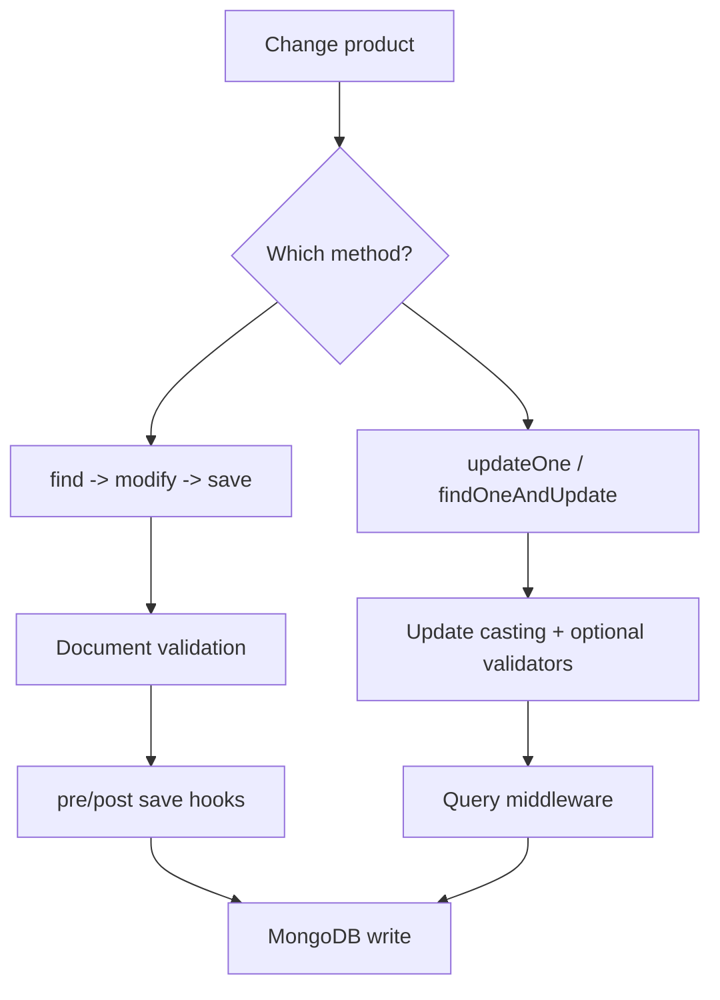

# Lesson 052 — Document save vs Query Updates

[← Section 6](./README.md) · [Full curriculum](../README.md)

## The problem: same result, different behavior
Changing a document with `doc.save()` and with `Model.updateOne()` can produce the same database value, but Mongoose processes them differently. Understanding **document middleware**, **query middleware**, **validation**, and **concurrency** is essential before writing business rules.

## Practice setup
Use the connected `Product` model from [Lesson 050](./050-creating-reading-documents.md): `name`, `sku`, `priceMinor`, `stock`, `category`, `active`, and `timestamps`. Assume `await mongoose.connect(process.env.MONGODB_URI)` ran once during application startup. Examples mutate a **disposable learning database**. Product prices use **minor currency units** (e.g., 49900 paise = ₹499). For independent experiments, create fresh sample products.

## 1. Document save: fetch, mutate, persist
```js
const product = await Product.findOne({ sku: "MOUSE-001" });
if (product) {
  product.priceMinor = 44900;
  await product.save();
}
```
`findOne()` returns a **hydrated Mongoose document**. Mongoose tracks changes to known paths. On `save()`, it validates the document and runs document save hooks before persisting changes. This is useful when business logic depends on instance methods or save middleware.

## 2. Query update: no document hydration required
```js
const result = await Product.updateOne(
  { sku: "MOUSE-001" },
  { $set: { priceMinor: 44900 } },
  { runValidators: true }
);
```
This creates a **query update**; Mongoose does not first load a document for you. Query middleware runs for the operation. `pre("save")` does **not** run. The result reports matched and modified counts, not the saved document.



## 3. Observe hooks directly
```js
const noteSchema = new mongoose.Schema({ title: { type: String, required: true } });
noteSchema.pre("save", function () {
  console.log("document pre-save:", this.title);
});
noteSchema.pre("updateOne", function () {
  console.log("query pre-updateOne:", this.getQuery());
});
const Note = mongoose.model("CourseNoteLifecycle", noteSchema);

const note = await Note.create({ title: "Draft" });
// document pre-save: Draft
note.title = "Published";
await note.save();
// document pre-save: Published
await Note.updateOne({ _id: note._id }, { $set: { title: "Edited" } });
// query pre-updateOne: { _id: ... }
```
**Register hooks before compiling the model.** For query middleware, `this` is a **Query**. Mongoose can also register document-specific `updateOne` middleware with explicit options; never assume all `updateOne` hooks receive a document.

## 4. Validation: why runValidators is not full validation
```js
const stockSchema = new mongoose.Schema({
  name: { type: String, required: true },
  stock: { type: Number, min: 0, required: true }
});
const Stock = mongoose.model("CourseStockLifecycle", stockSchema);
await Stock.create({ name: "Mouse", stock: 2 });

await Stock.updateOne(
  { name: "Mouse" },
  { $set: { stock: -1 } },
  { runValidators: true }
); // fails min:0

await Stock.updateOne(
  { name: "Mouse" },
  { $inc: { stock: -10 } },
  { runValidators: true }
); // $inc does not run normal update validators
```
On document `save()`, validators run against the document. For many query updates, validation is **off by default**; `runValidators:true` enables supported validators on updated paths/operators. Untouched required paths aren't generally checked, and `$inc` isn't covered by ordinary update validators. Guard stock with an atomic filter.

## 5. Concurrent edits and optimistic concurrency
Two requests read the same product. Both change its price and call `save()`. Without a concurrency strategy, a later write may overwrite an earlier one. The default `__v` version key does **not** protect all scalar save races.

```js
const schema = new mongoose.Schema({
  name: String, priceMinor: Number
}, { optimisticConcurrency: true });
```
When enabled, document saves use version-based checks; a conflicting save may raise `VersionError`. Your API must handle a conflict or retry after re-reading. Query updates do not automatically get the same document-save optimistic concurrency semantics.

## 6. When to choose
| Need | Prefer | Reason |
| --- | --- | --- |
| Document methods and save hooks | `doc.save()` | Document lifecycle |
| Targeted atomic counter update | `updateOne()` with `$inc` | Single DB operation |
| Updated document in response | `findOneAndUpdate()` with `new:true` | Returns result document |
| Full document validation | `doc.save()` | Document validation behavior |
| Concurrent inventory reservation | Conditional `findOneAndUpdate()` | Atomic predicate and update |

## 7. Important subtleties
- `Model.create()` runs save middleware; `insertMany()` does **not**.
- `doc.updateOne()` has query middleware by default, despite being invoked on a document.
- Query middleware cannot generally inspect the document without explicitly querying for it.
- `findOneAndUpdate()` is normally atomic for a matched document, with important caveats for unindexed upserts.
- Hooks are application-level behavior; raw MongoDB driver writes bypass them.

## Exercises
1. Register `pre("save")` and `pre("updateOne")` hooks; predict console output.
2. Show why `$inc` with `runValidators:true` can bypass a min validator.
3. Demonstrate a version conflict using `optimisticConcurrency:true`.
4. Explain when a conditional update is better than `find + save`.

## Interview check
**Does updateOne call save middleware?** No. **Is runValidators full-document validation?** No. **What is this in query middleware?** The Query object.

**Official:** [Middleware](https://mongoosejs.com/docs/middleware.html) · [Validation](https://mongoosejs.com/docs/validation.html) · [Optimistic concurrency](https://mongoosejs.com/docs/guide.html#optimisticConcurrency)