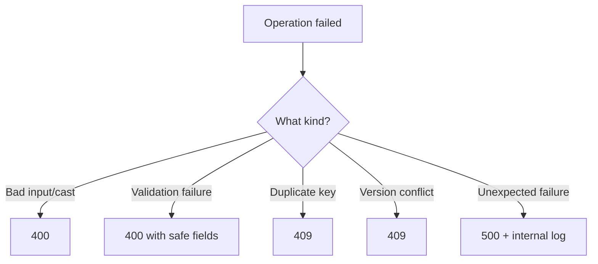

# Lesson 053 — Casting, Validation and Error Types

[← Section 6](./README.md) · [Full curriculum](../README.md)

## Why error categories matter
A malformed ID, negative price, duplicate SKU and unreachable MongoDB cluster have different causes. Good APIs distinguish **client input problems**, **conflicts**, and **server failures**. Treating every failure as HTTP 500 makes debugging difficult.

## Practice setup
Use the connected `Product` model from [Lesson 050](./050-creating-reading-documents.md): `name`, `sku`, `priceMinor`, `stock`, `category`, `active`, and `timestamps`. Assume `await mongoose.connect(process.env.MONGODB_URI)` ran once during application startup. Examples mutate a **disposable learning database**. Product prices use **minor currency units** (e.g., 49900 paise = ₹499). For independent experiments, create fresh sample products.

## 1. Casting: converting input to schema types
```js
const doc = new Product({
  name: "Mouse", sku: "ERR-1",
  priceMinor: "abc", category: "ACCESSORIES"
});
try {
  await doc.validate();
} catch (err) {
  console.log(err.name); // "ValidationError"
  console.log(err.errors.priceMinor?.name); // "CastError"
}
```
Mongoose tries to convert `"abc"` into Number. It cannot, so the path records a **CastError**. Document validation may surface that error inside an overall **ValidationError**. The `min:0` validator cannot meaningfully check an uncastable value.

## 2. Validation: value has a type but violates a rule
```js
const doc = new Product({
  name: "Mouse", sku: "ERR-2",
  priceMinor: -50, category: "ACCESSORIES"
});
try {
  await doc.validate();
} catch (err) {
  console.log(err.name); // "ValidationError"
  console.log(err.errors.priceMinor?.kind); // "min"
}
```
Other validators include `required`, `max`, `enum`, `minlength`, `maxlength`, `match`, and custom validators. A document can have multiple invalid paths; inspect `err.errors`.

## 3. Query casting: malformed vs absent ID
```js
try {
  await Product.findById("not-an-id");
} catch (err) {
  console.log(err.name); // "CastError"
}
const missing = await Product.findById("507f1f77bcf86cd799439011");
console.log(missing); // null if no document has that ID
```
An invalid ObjectId string fails casting. A valid but absent ObjectId yields null. A **404** is appropriate for an absent resource; a **400** can be appropriate for malformed client input.

## 4. Unique index: database conflict
```js
await Product.init(); // wait for index build in a new learning collection
await Product.create({
  name: "Mouse", sku: "DUP-001", priceMinor: 100,
  category: "ACCESSORIES"
});
try {
  await Product.create({
    name: "Keyboard", sku: "DUP-001", priceMinor: 200,
    category: "ACCESSORIES"
  });
} catch (err) {
  console.log(err.code); // 11000 for duplicate key
}
```
`unique:true` or `schema.index(...,{unique:true})` describes a MongoDB **unique index**. It is not a Mongoose validator. A duplicate-key error generally has code **11000**, often surfaced as a MongoDB server error.

## 5. Other error families
| Error | Typical meaning | Next action |
| --- | --- | --- |
| `ValidationError` | Document rules failed | Show safe field errors |
| `CastError` | Value could not be cast | Validate input/ID |
| MongoDB error code `11000` | Unique index conflict | 409 Conflict |
| `VersionError` | Optimistic concurrency conflict | 409 or retry |
| `StrictModeError` | Unknown path with strict throw mode | Fix request/code |
| Server selection timeout | No suitable DB server available | Check Atlas/network/DNS |
| Authentication error | DB credentials rejected | Check secret and permissions |

## 6. Express 5 centralized error middleware
Place this **after** routes:
```js
app.use((err, req, res, next) => {
  if (err.name === "CastError") {
    return res.status(400).json({ message: "Invalid identifier or value" });
  }
  if (err.name === "ValidationError") {
    const fields = Object.values(err.errors).map(e => ({
      field: e.path, message: e.message
    }));
    return res.status(400).json({ message: "Validation failed", fields });
  }
  if (err.code === 11000) {
    return res.status(409).json({ message: "Duplicate unique value" });
  }
  if (err.name === "VersionError") {
    return res.status(409).json({ message: "Document changed; retry" });
  }
  console.error("Unexpected API error", err);
  return res.status(500).json({ message: "Internal server error" });
});
```
Express 5 forwards thrown/rejected async handlers automatically. This is a teaching baseline; production apps should also handle authentication, authorization, malformed JSON, rate limiting, observability and transient infrastructure failures.



## 7. Security and error hygiene
Never send stack traces, database credentials or raw driver details to clients. Even duplicate-key messages can leak whether a user email exists. Validate request bodies **before** database calls (for example with Zod), but retain Mongoose validation as another layer. Not every CastError indicates a client problem; internal bugs can also pass incorrect values.

## Exercises
1. Trigger a required error, min error, malformed ObjectId, duplicate SKU, and missing valid ObjectId.
2. For each, predict error class and HTTP response.
3. Add a custom `priceMinor` validator and inspect the resulting error object.
4. Test centralized middleware using Express 5.

## Interview check
**CastError vs ValidationError?** Casting is type conversion failure; document validation can aggregate casting and validator failures. **Is duplicate key a Mongoose validator?** No. **Why separate 400 and 409?** Invalid input differs from a conflict with existing state.

**Official:** [Validation](https://mongoosejs.com/docs/validation.html) · [Mongoose errors](https://mongoosejs.com/docs/api/error.html) · [Express error handling](https://expressjs.com/en/guide/error-handling.html)