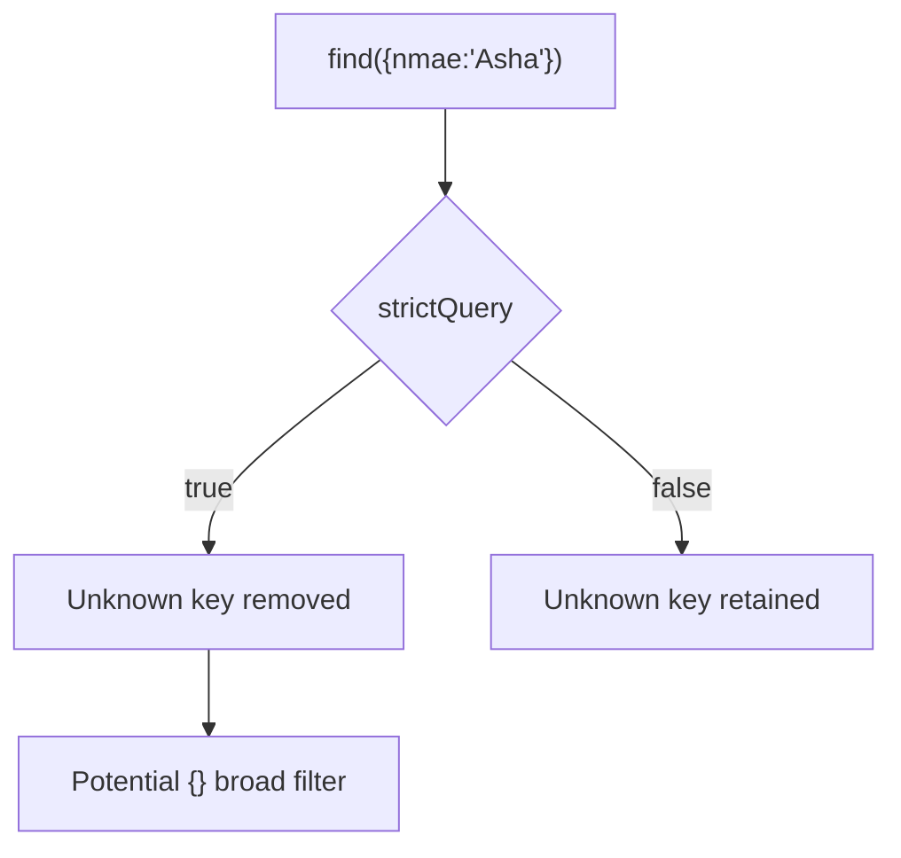

# Lesson 054 — Strict Mode, strictQuery and Schema Options

[← Section 6](./README.md) · [Full curriculum](../README.md)

## Why these settings exist
MongoDB allows flexible document shapes, but application models often need predictable paths. Mongoose provides `strict` for **document/write paths** and `strictQuery` for **query filters**. They sound similar but can cause very different behavior. Neither is an authorization system.

## Practice setup
Use the connected `Product` model from [Lesson 050](./050-creating-reading-documents.md): `name`, `sku`, `priceMinor`, `stock`, `category`, `active`, and `timestamps`. Assume `await mongoose.connect(process.env.MONGODB_URI)` ran once during application startup. Examples mutate a **disposable learning database**. Product prices use **minor currency units** (e.g., 49900 paise = ₹499). For independent experiments, create fresh sample products.

## 1. strict: unknown fields in documents
```js
const schema = new mongoose.Schema({ name: String }, { strict: true });
const Person = mongoose.model("CourseStrictPerson", schema);
const person = new Person({ name: "Asha", isAdmin: true });
console.log(person.toObject()); // { _id: ..., name: "Asha" }; no isAdmin
```
With `strict:true` (the common default), unknown fields supplied to supported Mongoose writes are generally discarded. `strict:false` permits unknown fields. `strict:"throw"` raises errors for unknown paths in supported operations.

**Crucial:** `strict:true` does not block a malicious client from setting a **known** schema field like `role:"ADMIN"`. Your controller must allowlist fields and authorize changes.

## 2. strictQuery: unknown filter fields
```js
const schema = new mongoose.Schema(
  { name: String },
  { strictQuery: true }
);
const Person = mongoose.model("CourseQueryPerson", schema);

const result = await Person.find({ nmae: "Asha" }); // typo
```
When `strictQuery:true`, Mongoose may **remove unknown query filter paths**. A typo can turn `{nmae:"Asha"}` into `{}`, unintentionally matching every document. When `strictQuery:false` (default in modern Mongoose), unknown filter paths are not automatically stripped.


**Lesson:** Never trust `strictQuery` as an input sanitizer. Validate filters explicitly and cap results.

## 3. Safe filters and operator injection
```js
// Unsafe: untrusted objects may include unexpected operators
await Product.find(req.query);

// Safer: allow only known fields and expected value types
const filter = {};
if (typeof req.query.category === "string" &&
    ["ACCESSORIES", "ELECTRONICS"].includes(req.query.category)) {
  filter.category = req.query.category;
}
const products = await Product.find(filter).limit(20).lean();
```
Mongoose has options such as `sanitizeFilter`, but no option replaces authentication, request validation, allowlisted operators and explicit query construction.

## 4. Important schema options
| Option | Meaning | Caveat |
| --- | --- | --- |
| `timestamps:true` | Maintain `createdAt` and `updatedAt` | Replacement operations can behave differently |
| `versionKey:"__v"` | Version metadata | Not full concurrency protection by itself |
| `optimisticConcurrency:true` | Detect conflicting document saves | Handle `VersionError` |
| `collection:"products"` | Explicit collection name | Overrides naming convention |
| `_id:false` on subdocument schema | Avoid automatic child IDs | Don't casually remove root identity |
| `minimize:true` | Remove empty objects on save | May change shape |
| `toJSON`/`toObject` | Configure serialization | Lean results differ |
| `autoIndex:false` | Disable automatic index builds | Manage indexes separately |
| `bufferCommands:false` | Disable Mongoose operation buffering | Disconnected operations fail promptly |

## 5. Response serialization
```js
const accountSchema = new mongoose.Schema(
  { email: String, passwordHash: { type: String, select: false } },
  { toJSON: {
    transform(doc, ret) {
      delete ret.passwordHash;
      delete ret.__v;
      return ret;
    }
  }}
);
```
`select:false` excludes a sensitive field from ordinary queries; `toJSON` transforms hydrated documents when serialized. **Lean results do not automatically run document `toJSON` transforms.** For security, also return explicit DTOs or projections, and never rely on a single transformation.

## 6. Other options worth recognizing
- `strictPopulate`: helps catch attempts to populate paths not defined for population.
- `discriminatorKey`: names the field used by discriminators.
- `capped`: configures capped collection behavior for certain use cases.
- `read` and `writeConcern`: configure relevant database read preference and write acknowledgment behavior.
- `id` and `virtuals` in serialization: affect convenience getters and JSON shape.

Consult the documentation for exact version-specific defaults. Settings are not a replacement for database-side validation and indexes.

## 7. Practical experiment
Create one model with `strict:true` and another with `strict:false`; insert an unknown field and inspect stored BSON. Then compare `strictQuery:true` and `false` with a misspelled filter. Run this only in a small disposable collection to avoid broad queries on production data.

## Common mistakes
Confusing `strict` and `strictQuery`; expecting strict mode to enforce authorization; assuming `toJSON` applies to lean objects; using broad filters created by misspelled keys; treating schema options as server-side MongoDB collection validators.

## Interview check
**strict vs strictQuery?** Write/document paths vs query filter paths. **Can strictQuery:true be dangerous?** Yes, stripping unknown keys can broaden a filter. **Does select:false guarantee privacy?** No; explicit selection and other access paths still require protection.

**Official:** [Schema guide/options](https://mongoosejs.com/docs/guide.html) · [Queries](https://mongoosejs.com/docs/queries.html)