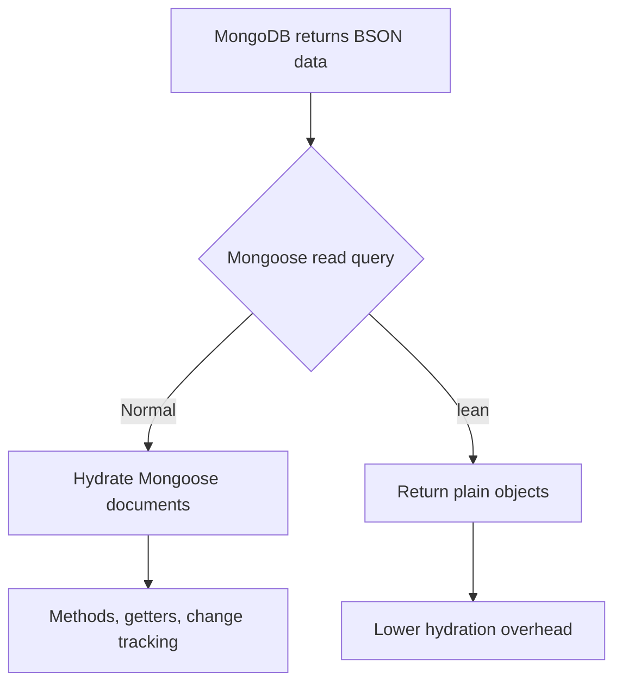

# Lesson 055 — Lean Queries and Projections

[← Section 6](./README.md) · [Full curriculum](../README.md)

## The problem: read-only endpoints pay for features they do not need
A catalog page may display hundreds of products. Full Mongoose documents support methods, change tracking, getters and validation. A listing endpoint usually just needs **plain data**. `lean()` avoids the cost of turning each result into a hydrated Mongoose document, while **projection** avoids returning unnecessary fields.

## Practice setup
Use the connected `Product` model from [Lesson 050](./050-creating-reading-documents.md): `name`, `sku`, `priceMinor`, `stock`, `category`, `active`, and `timestamps`. Assume `await mongoose.connect(process.env.MONGODB_URI)` ran once during application startup. Examples mutate a **disposable learning database**. Product prices use **minor currency units** (e.g., 49900 paise = ₹499). For independent experiments, create fresh sample products.

## 1. Hydration vs lean
```js
const hydrated = await Product.findOne({ sku: "MOUSE-001" });
const plain = await Product.findOne({ sku: "MOUSE-001" }).lean();

console.log(typeof hydrated?.save); // "function" when found
console.log(typeof plain?.save); // "undefined"
```
**Hydration** creates Mongoose document instances from query results. `lean()` returns plain JavaScript objects instead. Lean objects do not have document methods, change tracking, or normal document getters/virtuals/defaults behavior.



## 2. Demonstrate missing virtuals
```js
const personSchema = new mongoose.Schema({
  firstName: String, lastName: String
});
personSchema.virtual("fullName").get(function () {
  return `${this.firstName} ${this.lastName}`;
});
const Person = mongoose.model("CourseLeanPerson", personSchema);
const created = await Person.create({ firstName: "Asha", lastName: "Kumar" });

const doc = await Person.findById(created._id);
const lean = await Person.findById(created._id).lean();

console.log(doc.fullName); // "Asha Kumar"
console.log(lean.fullName); // undefined
```
Lean behavior can be extended with plugins or certain version-specific features, but do not assume a lean object behaves like a Mongoose document.

## 3. Projection: choose fields returned by MongoDB
```js
const list = await Product.find({ active: true })
  .select("name sku priceMinor -_id")
  .limit(20)
  .lean();
```
Projection happens at the query/result-field level: MongoDB returns only requested fields. `_id` is included by default unless excluded. You can usually **include** fields or **exclude** fields, but cannot arbitrarily mix both styles except for `_id`.

```js
.select("name priceMinor")   // include these (+ _id by default)
.select("-stock")           // exclude stock
.select("name priceMinor -_id") // include name/price, exclude _id
```

## 4. Why projection and lean are different
| Feature | Projection | lean() |
| --- | --- | --- |
| Controls returned fields | Yes | No |
| Avoids Mongoose hydration | No | Yes |
| Reduces network payload | Often | Not by itself |
| Preserves document methods | Usually yes | No |
| Guarantees safe API response | No | No |

Use **both** when a read-only endpoint needs a small, predictable response. Neither one repairs missing database indexes.

## 5. Performance considerations
Lean can reduce Node.js memory and CPU used for hydration, but it does not necessarily make MongoDB execute the query faster. For performance, also inspect **indexes**, **sort patterns**, **limit**, and **query plans**. Very large offsets with `skip()` can be expensive; cursor pagination is often better.

## 6. Populate and lean
```js
const orderSchema = new mongoose.Schema({
  customerId: { type: mongoose.Schema.Types.ObjectId, ref: "Customer" }
});
```
If you call `lean()` on a query and also `populate()`, lean behavior generally propagates to populated documents. Population can add query work and memory use. Explicitly select the referenced fields you need, and avoid large unbounded populations.

## 7. Aggregation is already plain-object oriented
`Model.aggregate()` normally returns plain JavaScript result objects rather than hydrated Mongoose documents. Aggregation pipeline stages are evaluated by MongoDB and do not automatically cast schema fields in the same way as ordinary Mongoose queries.

## 8. Express 5 catalog route
```js
app.get("/api/products", async (req, res) => {
  const products = await Product.find({ active: true })
    .select("name sku priceMinor category")
    .sort({ _id: 1 })
    .limit(20)
    .lean();
  res.json({ data: products });
});
```
This uses a bounded result set, a stable sort, explicit public fields, and no hydration. Still enforce authentication where required and validate user-controlled filters. A lean result can leak sensitive data if you select it.

## 9. Covered query vs lean
A **covered query** is a MongoDB indexing optimization: an appropriate index can satisfy the filter, sort and projected fields without fetching full documents. `lean()` is a **Mongoose-side** optimization after data is returned. They solve different problems.

## Common mistakes
Calling `.save()` on a lean object; expecting virtuals on lean results; thinking lean automatically removes secrets; thinking lean fixes unindexed scans; returning unbounded arrays; assuming projection and lean are interchangeable.

## Exercises
1. Query one product normally and with `lean()`; inspect methods.
2. Create a virtual and observe its absence in lean results.
3. Build a catalog endpoint that projects only name and price.
4. Explain when you should **not** use lean (editing an existing hydrated document).
5. Compare query execution time with and without an index separately from hydration cost.

## Interview check
**What is hydration?** Converting database results into Mongoose document instances. **What does lean skip?** That hydration. **What does select do?** Controls fields returned. **Does lean automatically speed up MongoDB?** No.

**Official:** [Lean](https://mongoosejs.com/docs/tutorials/lean.html) · [Queries](https://mongoosejs.com/docs/queries.html) · [Aggregate](https://mongoosejs.com/docs/api/aggregate.html)