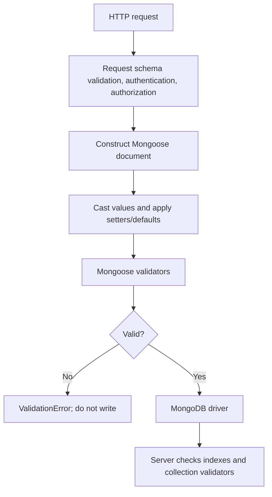

# Lesson 56 — Schema Validation: Built-in and Custom

[← Section 7](./README.md) · [Full curriculum](../README.md)

## The problem validation solves
A database can store documents that are syntactically valid BSON yet meaningless to the business: a negative price, an unsupported order status, or an end date before a start date. **Validation** checks business constraints before writes. Mongoose validation applies to writes through Mongoose; it does not automatically protect direct MongoDB driver writes. Keep HTTP input validation and database constraints as separate layers.

## 1. Where validation fits

Casting and validation are different: `"25"` may cast to number 25, while `"abc"` cannot. When document validation runs, a casting failure is usually included in a `ValidationError` as a path-level `CastError`.

## 2. Built-in validators and meaning
```js
import mongoose from "mongoose";
const { Schema } = mongoose;
const productSchema = new Schema({
 name: { type: String, required: [true, "Name is required"], trim: true, minlength: 2, maxlength: 100 },
 priceMinor: { type: Number, required: true, min: [0, "Price cannot be negative"], max: 100000000 },
 category: { type: String, enum: ["BOOKS", "ELECTRONICS"] },
 sku: { type: String, required: true, match: /^[A-Z0-9-]+$/ },
 active: { type: Boolean, default: true }
});
const Product = mongoose.model("CourseValidationProduct", productSchema);
```
- `required`: rejects missing/null paths; for required strings, empty string is invalid. `0` and `false` count as present.
- `min/max`: numeric bounds (and relevant date types); `minlength/maxlength`: string lengths.
- `enum`: value must belong to the allowed set.
- `match`: string must match the regex.
- `trim`: **setter**, not validator; it changes input.
- `unique:true`: **not** a validator. It declares a MongoDB unique index.

## 3. Custom synchronous validators
```js
const couponSchema = new Schema({
 code: { type: String, required: true, uppercase: true },
 percentOff: {
  type: Number,
  validate: {
   validator(value) { return Number.isInteger(value) && value >= 1 && value <= 90; },
   message: "percentOff must be a whole number from 1 to 90"
  }
 }
});
const Coupon = mongoose.model("CourseCoupon", couponSchema);
```
The validator returns `true` for acceptable values and `false` otherwise. `this` in a **document validator** usually refers to the document; in **query update validation**, context can be a Query instead. Avoid relying on `this.otherField` in update validators without explicitly designing for that behavior.

## 4. Cross-field rules
```js
const eventSchema = new Schema({
 startsAt: { type: Date, required: true },
 endsAt: {
  type: Date, required: true,
  validate: {
   validator(value) { return !this.startsAt || value > this.startsAt; },
   message: "endsAt must be later than startsAt"
  }
 }
});
```
This works for a document validated as a whole. **Trap:** `updateOne({$set:{endsAt:...}},{runValidators:true})` may not have the current `startsAt` available and update validators run only on certain updated paths. For cross-field invariants under concurrent writes, prefer carefully designed atomic predicates, document workflows with concurrency protection, or server-side validation where appropriate.

## 5. Asynchronous validators
```js
const accountSchema = new Schema({
 username: {
  type: String, required: true,
  validate: {
   async validator(value) {
    return !["admin", "root", "system"].includes(value.toLowerCase());
   },
   message: "Reserved username"
  }
 }
});
```
An async validator can await a service or query, but **a database lookup for uniqueness is not safe against races**. Two concurrent requests can both observe “not taken” and insert. Enforce uniqueness with a MongoDB unique index and handle duplicate-key code 11000.

## 6. Validation APIs and timing
```js
const p = new Product({ name: "A", priceMinor: -5, category: "OTHER", sku: "bad sku" });
try { await p.validate(); } catch (err) {
 console.log(err.name); // ValidationError
 console.log(Object.keys(err.errors)); // invalid paths, order not guaranteed
}
const validationError = p.validateSync(); // sync validators only; does not await async validators
```
`validate()` checks without persisting. `save()` validates by default as part of the save lifecycle. Mongoose registers validation as a built-in pre-save hook; later pre-save modifications are not necessarily revalidated. Define business-critical rules where their timing is reliable.

## 7. Update validators: the important exception
```js
await Product.updateOne(
 { sku: "ABC-1" },
 { $set: { priceMinor: -10 } },
 { runValidators: true }
); // min validator rejects
```
Update validators are off by default for common query updates, must be enabled with `runValidators:true`, and only apply to supported update paths/operators. For example `$inc` does **not** run the usual numeric min/max update validators. Untouched required paths are not checked like full document validation. `required` may run on an explicit `$unset` of a required field.

## 8. Error handling and security
```js
try { await Product.create({ name: "A", priceMinor: -1, sku: "BAD", category: "BOOKS" }); }
catch (err) {
 if (err.name === "ValidationError") {
  for (const [path, issue] of Object.entries(err.errors)) {
   console.log(path, issue.kind, issue.message);
  }
 }
}
```
Do not return raw error objects or stack traces to clients. Translate known field failures into safe 400 responses. Unique index conflicts are typically **11000** and often merit 409. Validate and allowlist request bodies **before** passing them to a model.

## 9. Practice
1. Create a JobApplication schema with `status` enum and required company name.
2. Add a custom salary validator that rejects negative and fractional minor units.
3. Try `validateSync()` and an async validator; explain why they differ.
4. Demonstrate `$set` versus `$inc` with `runValidators:true`.
5. Explain why checking username uniqueness in an async validator is insufficient.

## Interview questions
**Does Mongoose validation protect direct mongosh writes?** No. **Is unique a validator?** No, it is a MongoDB index. **Does runValidators make updateOne equivalent to save?** No. **Why can async uniqueness validation race?** The check and insert are separate operations.

**Official:** [Validation](https://mongoosejs.com/docs/validation.html) · [SchemaTypes](https://mongoosejs.com/docs/schematypes.html)
