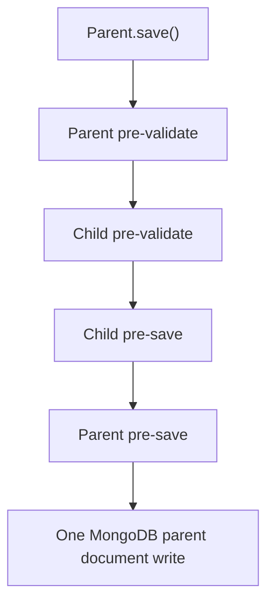

# Lesson 57 — Nested Schemas and Subdocuments

[← Section 7](./README.md) · [Full curriculum](../README.md)

## The problem: related data inside one document
An order often contains a shipping address and purchased-item snapshots. Embedding them makes reading an order simple, and MongoDB can update that **single document atomically**. But Mongoose has two constructs that look alike in JavaScript: **plain nested paths** and **subdocuments**. Their initialization, validation, defaults, middleware and identity differ.

## 1. Understand the MongoDB shape first
```js
{
 _id: ObjectId("507f1f77bcf86cd799439011"),
 customerId: ObjectId("507f191e810c19729de860ea"),
 shippingAddress: { city: "Patna", pincode: "800001" },
 items: [
  { productId: "P1", quantity: 2, unitPriceMinor: 49900 },
  { productId: "P2", quantity: 1, unitPriceMinor: 19900 }
 ]
}
```
The order is **one MongoDB document** with embedded objects and an array. Embedded items are not independent MongoDB collection records.

## 2. Plain nested path vs single nested subdocument
```js
import mongoose from "mongoose";
const { Schema } = mongoose;

const plainSchema = new Schema({ address: { city: String } });
const childSchema = new Schema({ city: { type: String, required: true } }, { _id: false });
const subdocSchema = new Schema({ address: childSchema });

const Plain = mongoose.model("CoursePlainAddress", plainSchema);
const Subdoc = mongoose.model("CourseSubdocAddress", subdocSchema);

const a = new Plain();
const b = new Subdoc();
console.log(a.address); // Mongoose nested path object
console.log(b.address); // undefined
```
A plain nested path is generally initialized as a nested structure, whereas a **single nested subdocument can be absent**. This matters when the entire address is optional or when you want child-level hooks/validation.

## 3. Required subdocument vs required child fields
```js
const addressSchema = new Schema({
 city: { type: String, required: true },
 pincode: String
}, { _id: false });

const orderSchema = new Schema({
 shippingAddress: { type: addressSchema, required: true }
});
```
Here, `shippingAddress` itself must exist, and its `city` must exist. If you define only `city.required` inside an optional subdocument, a missing whole subdocument may bypass that child requirement because there is no child to validate.

## 4. Document arrays
```js
const itemSchema = new Schema({
 productId: { type: String, required: true },
 quantity: { type: Number, required: true, min: 1 },
 unitPriceMinor: { type: Number, required: true, min: 0 }
}); // _id is enabled for child items by default

const Order = mongoose.model("CourseOrderSubdocs", new Schema({
 customerId: { type: Schema.Types.ObjectId, required: true },
 shippingAddress: addressSchema,
 items: { type: [itemSchema], default: [] }
}, { timestamps: true }));
```
```js
const order = new Order({
 customerId: new mongoose.Types.ObjectId(),
 shippingAddress: { city: "Patna" },
 items: [{ productId: "P1", quantity: 2, unitPriceMinor: 49900 }]
});
console.log(order.items[0]._id); // child ObjectId by default
order.items[0].quantity = 3;
await order.save(); // parent save persists embedded child changes
```
Subdocuments live inside the parent document. **Saving a subdocument alone is not a separate database insert**; persist by saving the parent. `order.items.id(childId)` finds an embedded item by its child `_id` when IDs are enabled.

## 5. Middleware order and ownership
```js
const child = new Schema({ value: Number });
child.pre("validate", function () { console.log("child validate"); });
child.pre("save", function () { console.log("child save"); });
const parent = new Schema({ child });
parent.pre("validate", function () { console.log("parent validate"); });
parent.pre("save", function () { console.log("parent save"); });
const Parent = mongoose.model("CourseParentHooks", parent);
await Parent.create({ child: { value: 1 } });
```
Conceptual ordering: parent pre-validate → child pre-validate → child pre-save → parent pre-save (with other relevant built-in middleware). Hooks run as part of **parent** validation/save, not separate child collection writes.



## 6. Defaults in subdocuments
Defaults on child fields only apply when that subdocument exists. To create a child automatically:
```js
const childDefaults = new Schema({ city: { type: String, default: "Unknown" } }, { _id: false });
const parentDefaults = new Schema({
 address: { type: childDefaults, default: () => ({}) }
});
```
The `default:()=>({})` creates the child, allowing its own defaults to apply. Without it, an absent optional subdocument remains undefined.

## 7. _id: false trade-off
For immutable shipping-address snapshots or small value objects, child IDs may not be needed; use `{_id:false}`. For array elements you must individually identify and update, keeping child `_id` is convenient. The parent/root MongoDB document still needs its own `_id`.

## 8. Atomicity and modeling trade-offs
One MongoDB document update is atomic. That does **not** mean separate orders and products update together atomically. Embedding reduces joins and fits bounded, owned data; it is dangerous for unbounded chat histories, activity logs or arrays that grow toward MongoDB's **16 MiB document limit**. Query patterns, update frequency and growth decide embedding vs referencing.

## 9. Common mistakes and exercises
- Assuming child `save()` inserts into its own collection.
- Marking only a child field required when the entire optional subdocument must exist.
- Disabling child `_id` and then trying to find it by ID.
- Embedding an unlimited list because it is convenient initially.

**Practice:** Model a job application with a single nested recruiter contact and a bounded list of interview rounds. Validate the whole contact and compare it with a plain nested path. Predict the console order of parent/child hooks.

**Official:** [Subdocuments](https://mongoosejs.com/docs/subdocs.html) · [Schemas](https://mongoosejs.com/docs/guide.html)
