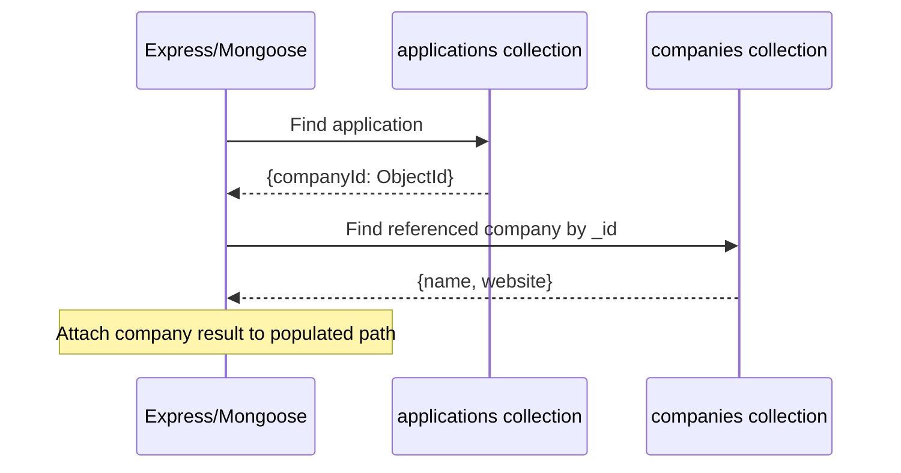

# Lesson 58 — populate() and ref

[← Section 7](./README.md) · [Full curriculum](../README.md)

## The problem: related documents live in different collections
A `JobApplication` references a `Company`. MongoDB normally stores the company's `_id` in the application document. When the UI needs the company's name too, the application can fetch it separately or use Mongoose **populate**. Population is an ODM convenience, **not a foreign key** or automatic MongoDB join in the relational sense.

## 1. Model the relationship
```js
import mongoose from "mongoose";
const { Schema } = mongoose;
const Company = mongoose.model("CourseCompany", new Schema({
 name: { type: String, required: true },
 website: String
}));
const Application = mongoose.model("CourseApplication", new Schema({
 role: { type: String, required: true },
 companyId: { type: Schema.Types.ObjectId, ref: "CourseCompany", required: true },
 status: { type: String, default: "APPLIED" }
}));
```
The `ref` string must name the **Mongoose model**, not necessarily the MongoDB collection. `Schema.Types.ObjectId` defines the path type; `new mongoose.Types.ObjectId()` creates an ObjectId value.

## 2. What is actually stored?
```js
const company = await Company.create({ name: "Acme" });
const app = await Application.create({ role: "Frontend Developer", companyId: company._id });
console.log(app.companyId); // ObjectId, not full company document
```
MongoDB stores the reference ID. It does not verify that the company exists. If the company is deleted later, the application can hold a **dangling reference**. Handle deletion policies explicitly.

## 3. Populate one reference
```js
const result = await Application.findById(app._id)
 .populate("companyId", "name website");
console.log(result.companyId.name); // "Acme" if company exists
```
Population resolves the reference into a company document using additional database work. The stored application still contains an ObjectId; population changes the **returned representation**, not the underlying schema. If no matching company exists, a singular populated reference becomes `null`.



## 4. Populate arrays and select only needed fields
```js
const postSchema = new Schema({
 title: String,
 authorId: { type: Schema.Types.ObjectId, ref: "CourseCompany" },
 reviewerIds: [{ type: Schema.Types.ObjectId, ref: "CourseCompany" }]
});
const Post = mongoose.model("CoursePopPost", postSchema);
const posts = await Post.find()
 .populate({ path: "authorId", select: "name" })
 .populate({ path: "reviewerIds", select: "name" })
 .limit(20);
```
For an array of references, populate returns matching documents as an array. Mongoose often **batches** related lookups rather than issuing one query per parent; however, multiple populate paths, nested population, `perDocumentLimit`, or per-row queries can still create expensive N+1-like patterns. Inspect actual query counts and performance rather than assuming every populate is one query.

## 5. Nested population
```js
// Only valid when CourseCompany has a suitable ownerId ref path:
// await Application.find().populate({
//   path: "companyId",
//   populate: { path: "ownerId", select: "name" }
// });
```
Nested populate can traverse several reference levels. Each level adds work and can produce large result graphs. Avoid deep population for large listing endpoints.

## 6. Virtual populate (inverse relationship)
```js
const companySchema = new Schema({ name: String }, { toJSON: { virtuals: true } });
companySchema.virtual("applications", {
 ref: "CourseApplication", localField: "_id", foreignField: "companyId"
});
const CompanyWithVirtual = mongoose.model("CourseCompanyWithVirtual", companySchema);
```
This example illustrates the configuration, but the `CourseApplication` model refers to company IDs stored in another collection; ensure you create and query records using compatible models and collections before running it. Virtual populate does **not** store an `applications` array in the company document. It queries matching applications using the local/foreign fields.

## 7. Populate vs aggregation $lookup
- **Populate** is convenient when working with Mongoose models and references.
- **`$lookup`** performs a join-like stage **inside MongoDB's aggregation pipeline**, useful for grouping, filtering on joined fields and complex analytics.
- **Separate explicit queries** can be simpler for some APIs or caches.

Choose based on query shape, data size, indexes and the number of round trips. Index referenced foreign keys used for reverse lookups. An `_id` lookup usually benefits from MongoDB's default `_id` index.

## 8. Security and performance
```js
const list = await Application.find({ status: "APPLIED" })
 .select("role companyId")
 .limit(20)
 .populate({ path: "companyId", select: "name -_id" })
 .lean();
```
Limit parents **and** populated result sizes. Populate is not authorization: you must ensure the caller can access both the parent and related records. `lean()` generally propagates to populated results. Do not populate password hashes or private fields into public API responses.

## 9. Exercises
1. Create two companies and three applications; populate their company names.
2. Delete one company and observe the dangling reference result.
3. Compare separate queries, populate and `$lookup` for a list endpoint.
4. Explain why `ref` does not enforce foreign keys.
5. Measure the query count of one populate path vs multiple nested paths.

**Interview:** **Is populate a MongoDB foreign key?** No. **Does populate store joined fields?** No. **When might $lookup be preferable?** Complex server-side joins and aggregation.

**Official:** [Populate](https://mongoosejs.com/docs/populate.html) · [MongoDB $lookup](https://www.mongodb.com/docs/manual/reference/operator/aggregation/lookup/)
