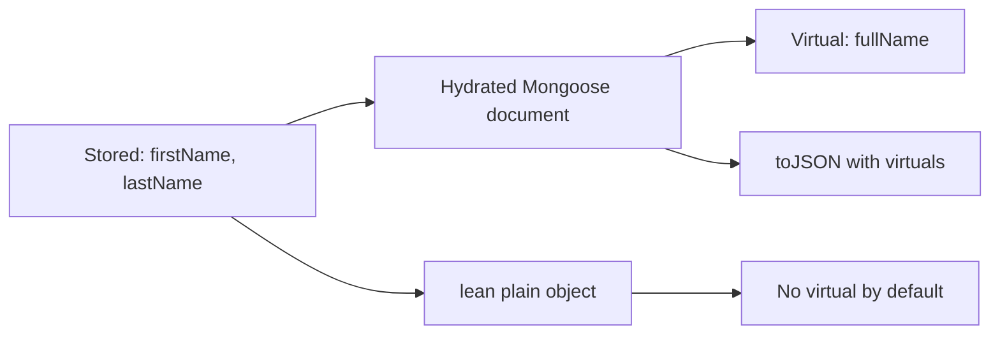

# Lesson 59 — Virtuals and Getters/Setters

[← Section 7](./README.md) · [Full curriculum](../README.md)

## The problem: stored data vs derived/presented data
A user has `firstName` and `lastName`, but the UI wants `fullName`. Storing both introduces a consistency problem: if the last name changes, someone must update `fullName` too. Mongoose offers **virtuals** for derived values and **getters/setters** for transforming values as they are accessed or assigned. They are not all the same mechanism.

## 1. Virtuals: fields not stored in MongoDB
```js
import mongoose from "mongoose";
const userSchema = new mongoose.Schema({
 firstName: { type: String, required: true },
 lastName: { type: String, required: true }
}, { toJSON: { virtuals: true }, toObject: { virtuals: true } });

userSchema.virtual("fullName").get(function () {
 return `${this.firstName} ${this.lastName}`;
});
const User = mongoose.model("CourseVirtualUser", userSchema);
const user = await User.create({ firstName: "Asha", lastName: "Kumar" });
console.log(user.fullName); // Asha Kumar
console.log(user.toObject().fullName); // Asha Kumar
```
`fullName` is computed in JavaScript from two real paths; it is **not stored** in the MongoDB document. Normal MongoDB filters like `find({fullName:"Asha Kumar"})` cannot query a nonstored virtual as though it were a database field. Use stored fields or an aggregation expression instead.

## 2. Why `function` instead of an arrow?
```js
userSchema.virtual("initials").get(function () {
 return `${this.firstName[0]}${this.lastName[0]}`;
});
```
Mongoose binds `this` to the document for ordinary virtual getters. Arrow functions capture lexical `this`, which is usually not what you want. Virtuals can also have setters:
```js
userSchema.virtual("displayName").set(function (value) {
 const [firstName, ...rest] = value.trim().split(/\s+/);
 this.firstName = firstName;
 this.lastName = rest.join(" ");
});
```
A virtual setter updates **real schema paths**; the virtual value itself is not stored. Validate empty input and naming conventions in production.

## 3. Schema path setters: normalize input
```js
const accountSchema = new mongoose.Schema({
 email: {
  type: String, required: true,
  set(value) { return typeof value === "string" ? value.trim().toLowerCase() : value; }
 }
});
const Account = mongoose.model("CourseSetterAccount", accountSchema);
const account = new Account({ email: "  ASHA@EXAMPLE.COM " });
console.log(account.email); // asha@example.com
```
A setter transforms values **when assigned** through relevant Mongoose paths. Setters may also run on query updates, where `this` is not necessarily a document. Avoid relying on other document fields inside setters used by updates.

## 4. Schema path getters: transform on read
```js
const priceSchema = new mongoose.Schema({
 priceMinor: {
  type: Number,
  get(value) { return value == null ? value : value / 100; }
 }
}, { toJSON: { getters: true } });
const Price = mongoose.model("CoursePriceGetter", priceSchema);
const item = new Price({ priceMinor: 50100 });
console.log(item.priceMinor); // 501
console.log(item.get("priceMinor", null, { getters: false })); // 50100
```
**Warning:** A getter that changes a numeric unit can confuse business logic. For money, it is often safer to keep the raw stored unit in code and expose a separately named virtual such as `priceRupees` rather than changing the meaning of `priceMinor`.

## 5. Serialization: why your API might not show a virtual
```js
const schema = new mongoose.Schema({ firstName: String, lastName: String });
schema.virtual("fullName").get(function () { return `${this.firstName} ${this.lastName}`; });
schema.set("toJSON", { virtuals: true });
```
Virtuals are not included in ordinary JSON serialization unless configured. `toObject` and `toJSON` are separate options. Express `res.json(doc)` uses JSON serialization. Be deliberate about sensitive data and explicit response DTOs.

## 6. Lean caveat
```js
const hydrated = await User.findById(user._id);
const lean = await User.findById(user._id).lean();
console.log(hydrated.fullName); // Asha Kumar
console.log(lean.fullName); // undefined by default
```
Lean results are plain objects and do not run normal document virtuals/getters by default. Plugins or version-specific options can add behavior, but do not assume it.



## 7. What not to use virtuals for
Virtuals are not a substitute for database-side search, indexed computed fields, or expensive cross-collection reporting. A virtual getter should generally be cheap and predictable. A virtual that expects populated references may return incomplete data when they are not populated.

## 8. Exercises
1. Add a `fullName` virtual to a recruiter model.
2. Normalize email with a setter; test document assignment and a query update.
3. Compare `res.json(doc)` with `doc.toObject()` when virtuals are configured.
4. Observe `lean()` output and explain why the virtual is absent.
5. Implement `priceRupees` virtual without altering the raw stored `priceMinor` field.

**Interview:** **Is a virtual persisted?** No. **Can MongoDB index a Mongoose virtual?** Not directly. **Setter vs getter?** Transform assignment vs read. **Why no virtual in lean?** No document hydration.

**Official:** [Virtuals](https://mongoosejs.com/docs/tutorials/virtuals.html) · [Getters/Setters](https://mongoosejs.com/docs/tutorials/getters-setters.html)
