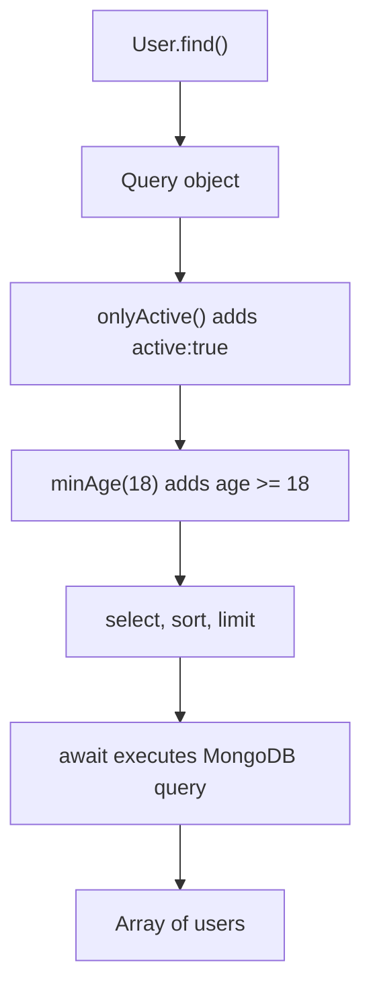

# Lesson 60 — Instance Methods, Static Methods and Query Helpers

[← Section 7](./README.md) · [Full curriculum](../README.md)

## 1. The problem: where should reusable database logic live?
Suppose your application repeatedly checks whether a user is an adult, looks up users by email, and filters only active users. Writing the same logic in every controller creates duplication. Mongoose provides three different extension points, each attached to a different object.

| Extension | Belongs to | Called as | Best for |
| --- | --- | --- | --- |
| Instance method | One hydrated document | `user.isAdult()` | Logic involving that document |
| Static method | Model/collection | `User.findByEmail(email)` | Reusable model-level operations |
| Query helper | Query builder | `User.find().onlyActive()` | Composable query filters |

**Mental model:** Document = one record; Model = gateway to a collection; Query = an operation you are constructing.

## 2. Complete runnable schema
```js
import mongoose from "mongoose";
await mongoose.connect(process.env.MONGODB_URI, { dbName: "mongoose_course" });

const userSchema = new mongoose.Schema({
 name: { type: String, required: true },
 email: { type: String, required: true, lowercase: true, trim: true },
 age: { type: Number, required: true, min: 0 },
 active: { type: Boolean, default: true }
}, { timestamps: true });
userSchema.index({ email: 1 }, { unique: true });

// Define these BEFORE mongoose.model().
userSchema.methods.isAdult = function () {
 return this.age >= 18;
};
userSchema.methods.displayLabel = function () {
 return `${this.name} (${this.email})`;
};

userSchema.statics.findByEmail = function (email) {
 return this.findOne({ email: email.trim().toLowerCase() });
};
userSchema.statics.findActiveAdults = function () {
 return this.find({ active: true, age: { $gte: 18 } });
};

userSchema.query.onlyActive = function () {
 return this.where({ active: true });
};
userSchema.query.minAge = function (age) {
 return this.where("age").gte(age);
};

const User = mongoose.model("CourseMethodUser", userSchema);
```

## 3. Instance method: how it executes
```js
const user = await User.create({
 name: "Asha", email: "ASHA@EXAMPLE.COM", age: 21
});
console.log(user.isAdult());     // true
console.log(user.displayLabel()); // "Asha (asha@example.com)"
```
`user` is a **hydrated document**. `this` inside an ordinary function points to that document. The method reads the current in-memory `age`; it does not automatically fetch fresh data from MongoDB.

```js
user.age = 17;
console.log(user.isAdult()); // false
// Database still has age 21 until await user.save().
```
Do not use an arrow function if you need Mongoose to bind `this`. A `lean()` result is a plain object and does **not** have instance methods:
```js
const plain = await User.findById(user._id).lean();
console.log(typeof plain.isAdult); // "undefined"
```

## 4. Static method: collection-level reuse
```js
const found = await User.findByEmail(" ASHA@EXAMPLE.COM ");
console.log(found?.name); // "Asha"
```
The static belongs to the **User model**, not an individual document. `this` is the model, so `this.findOne()` is valid. Returning a Query allows callers to further customize it:
```js
const safeUser = await User.findByEmail("asha@example.com")
 .select("name email")
 .lean();
```
A static can also execute multiple operations, but do not hide unexpected writes or expensive work behind innocent-looking names.

## 5. Query helper: chainable filter
```js
const adults = await User.find()
 .onlyActive()
 .minAge(18)
 .select("name age")
 .sort({ age: -1 })
 .limit(20)
 .lean();
```
A query helper runs while constructing the query; it returns the **Query** (`this`) so the chain continues. It does not fetch results until the query is executed by `await` or `.exec()`. The helper is available on queries for that model, not on documents.



## 6. Important distinction: methods vs middleware vs virtuals
A method runs **when your code explicitly calls it**. Middleware runs automatically at registered operation points. A virtual computes a property when accessed. A method such as `isAdult()` is suitable for explicit business checks, but it does not enforce a database validation rule by itself.

## 7. TypeScript note
With TypeScript, model generics and document interfaces can describe statics, instance methods and query helpers. Without proper typing, the runtime method may work but TypeScript reports it missing. Refer to Mongoose's official TypeScript statics/methods/query helpers documentation for version-specific generic signatures.

## 8. Common mistakes
- Calling `User.isAdult()` instead of `user.isAdult()`.
- Calling `user.findByEmail()` instead of `User.findByEmail()`.
- Expecting methods on `lean()` results.
- Using arrow functions and losing the expected `this`.
- Returning an array rather than the Query from a chainable query helper.
- Assuming an instance method automatically saves changed fields.

## 9. Practice
1. Add an `isEligibleForPremium()` instance method using `age` and `active`.
2. Add `User.findByEmail()` and test with mixed-case email.
3. Add `.onlyActive()` and `.minAge()`, then chain them in either order.
4. Explain which calls hit MongoDB and which only run in memory.
5. Test what happens when you call `isAdult()` on a lean result.

## Interview review
**Where does `this` point?** Instance method → document; static → model; query helper → query. **Why query helpers?** Reusable, composable filters. **Can instance methods enforce a rule on raw MongoDB writes?** No.

**Official:** [Instance methods](https://mongoosejs.com/docs/guide.html#methods) · [Statics](https://mongoosejs.com/docs/guide.html#statics) · [Query helpers](https://mongoosejs.com/docs/guide.html#query-helpers)
