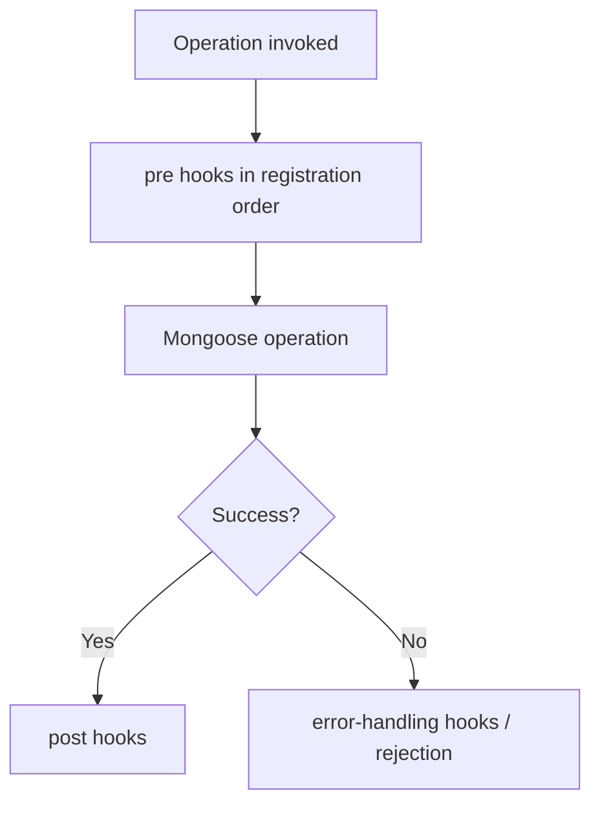

# Lesson 61 — Document, Query, Model and Aggregate Middleware

[← Section 7](./README.md) · [Full curriculum](../README.md)

## 1. Why middleware exists
Applications repeatedly need actions around database operations: normalize data before saving, log changes, check conditions, or attach standard filters. Mongoose middleware (also called **hooks**) registers code to run at defined lifecycle points. It is not the same as Express middleware.

**Most important concept:** `this` changes based on middleware type. Many bugs come from expecting a document inside query middleware.

## 2. Four middleware categories
| Type | Typical operation | `this` is | Example use |
| --- | --- | --- | --- |
| Document | `save`, `validate` | Document | Normalize fields before save |
| Query | `find`, `findOne`, `updateOne`, `findOneAndUpdate` | Query | Inspect/modify filter |
| Model | `insertMany`, `bulkWrite` (supported hooks) | Model | Batch operation policy |
| Aggregate | `aggregate` | Aggregate object | Modify aggregation pipeline |

**Always consult the middleware table for the installed Mongoose version.** Not every method has every type of hook.

## 3. Register hooks BEFORE model compilation
```js
import mongoose from "mongoose";
const schema = new mongoose.Schema({
 name: String,
 active: { type: Boolean, default: true }
});
schema.pre("save", function () {
 console.log("pre-save document:", this.name);
});
const Item = mongoose.model("CourseHookItem", schema);
await Item.create({ name: "Mouse" }); // prints pre-save
```
Adding hooks after `mongoose.model()` may not attach them to the compiled model as intended. Put schema definitions, plugins and hooks before compilation.

## 4. Document hooks
```js
schema.pre("validate", function () {
 if (typeof this.name === "string") this.name = this.name.trim();
});
schema.post("save", function (doc) {
 console.log("Saved id:", doc._id.toString());
});
```
Document middleware can access the actual document and its fields. Mongoose runs validation as a built-in pre-save hook. If you modify a validated path later in a pre-save hook, do not assume all validators run again. Prefer normalization in setters or pre-validate hooks.

## 5. Query hooks: inspect the query, not the record
```js
const taskSchema = new mongoose.Schema({
 title: String, deletedAt: { type: Date, default: null }
});
taskSchema.pre("find", function () {
 this.where({ deletedAt: null });
});
taskSchema.pre("findOne", function () {
 this.where({ deletedAt: null });
});
taskSchema.pre("updateOne", function () {
 console.log("Filter:", this.getQuery());
 console.log("Update:", this.getUpdate());
});
const Task = mongoose.model("CourseHookTask", taskSchema);
```
In query hooks `this` is a **Query**. You can use `getQuery()`, `getFilter()`, `getUpdate()`, and `setQuery()` / `setUpdate()` where appropriate. It is not the matching document. Fetching it separately costs another query and can introduce a race.

**Soft-delete warning:** Intercepting only `find` and `findOne` is incomplete: `countDocuments`, `aggregate`, update/delete operations and direct driver access may still see or mutate soft-deleted data. Design a consistent access layer and admin bypass.

## 6. updateOne: query by default, document when configured
```js
const s = new mongoose.Schema({ title: String });
s.pre("updateOne", { query: true, document: false }, function () {
 console.log("Query hook", this.getFilter());
});
s.pre("updateOne", { query: false, document: true }, function () {
 console.log("Document hook", this.title);
});
const Entry = mongoose.model("CourseUpdateHooks", s);
const entry = await Entry.create({ title: "Draft" });
await Entry.updateOne({ _id: entry._id }, { $set: { title: "A" } }); // query hook
entry.title = "B";
await entry.updateOne({ $set: { title: "C" } }); // document hook and potentially query hook per registration
```
The precise hook set depends on the registered options and operation; distinguish `Model.updateOne()` from `doc.updateOne()`. Neither is the same as `save()`.

## 7. Model hooks: bulk insertion
```js
const bulkSchema = new mongoose.Schema({ title: String });
bulkSchema.pre("insertMany", function (next, docs) {
 for (const doc of docs) if (doc.title) doc.title = doc.title.trim();
 next();
});
const Bulk = mongoose.model("CourseBulkHook", bulkSchema);
await Bulk.insertMany([{ title: "  One  " }]);
```
`insertMany()` has model middleware; it does **not** run `save` middleware for each inserted document. For modern Mongoose versions, prefer promise/async middleware where suitable; callback signatures can differ across versions. Test the exact version you use.

## 8. Aggregate hooks: pipeline changes
```js
const reportSchema = new mongoose.Schema({
 amount: Number, deletedAt: Date
});
reportSchema.pre("aggregate", function () {
 this.pipeline().unshift({ $match: { deletedAt: null } });
});
const Report = mongoose.model("CourseAggregateHook", reportSchema);
await Report.aggregate([{ $group: { _id: null, total: { $sum: "$amount" } } }]);
```
`this` is an Aggregate object. The hook prepends `$match`. **Caution:** some stages such as `$geoNear` must be first, and other pipeline semantics may be affected by an inserted stage. Blindly prepending a filter can break valid aggregations. Also, an aggregation may start with `$documents` or require special placement; account for these cases.

## 9. Error-handling post middleware
```js
const schema2 = new mongoose.Schema({ email: { type: String, unique: true } });
schema2.post("save", function (error, doc, next) {
 if (error?.code === 11000) return next(new Error("Email already exists"));
 next(error);
});
```
Error-handling middleware can **transform** errors, not convert a failed write into a success. Be careful with callback signatures and versions. Centralized HTTP error handling should still map known errors to safe responses.

## 10. Execution and side-effect pitfalls

A pre-hook throwing/rejecting aborts the operation. Async hooks must finish correctly; mixing callback `next` with promises can cause double completion or hanging. Hooks may run on retries, so external side effects (sending email, charging money) should not be placed blindly in them. Prefer an outbox/background job pattern for reliable external effects.

## 11. Practice
1. Log document save, query update, and batch insert separately.
2. Implement a soft-delete filter and identify the query methods it misses.
3. Add an aggregate hook and test it with a `$geoNear` pipeline; explain the failure.
4. Predict `this` for `pre("save")`, `pre("find")`, and `pre("aggregate")`.
5. Compare Express middleware (request lifecycle) and Mongoose middleware (ODM operation lifecycle).

## Interview review
**Does updateOne trigger save hooks?** No. **Does insertMany trigger save hooks?** No. **What is `this` in pre-find?** Query. **When register middleware?** Before compiling the model.

**Official:** [Mongoose middleware](https://mongoosejs.com/docs/middleware.html)
