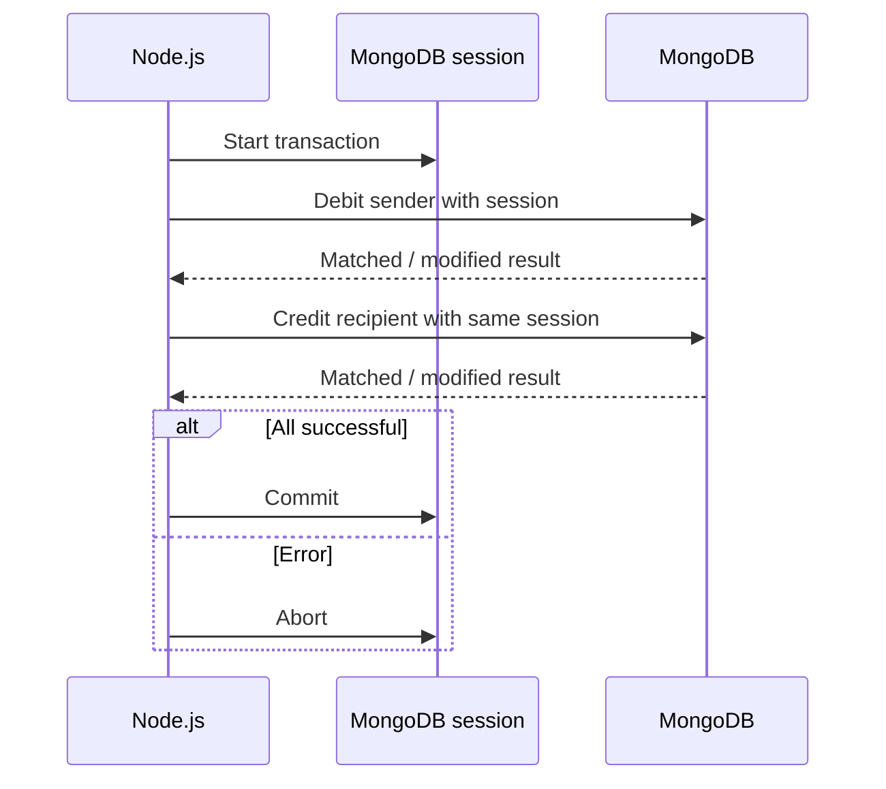

# Lesson 62 — Mongoose Transactions and Sessions

[← Section 7](./README.md) · [Full curriculum](../README.md)

## 1. Why transactions are needed
A customer places an order. The application must create an order **and** deduct a wallet balance. If the order is created but the wallet update fails, the database is inconsistent. MongoDB makes a **single document write atomic**, but two separate document writes are not automatically one atomic business operation. A transaction groups supported operations into an all-or-nothing commit.

## 2. ACID in simple language
- **Atomicity:** all writes in a transaction commit, or none do.
- **Consistency:** application and database invariants remain satisfied if transaction logic and constraints are correct; MongoDB cannot invent missing business rules.
- **Isolation:** concurrent operations follow MongoDB's transaction isolation/conflict rules. Do not assume transactions eliminate all business races.
- **Durability:** committed writes persist according to the configured write concern and deployment guarantees.

A **session** is the driver's context for related operations; a transaction is a unit of work started on that session. Sessions can also be used without transactions.

## 3. Deployment requirement
MongoDB multi-document transactions require a **replica set or sharded cluster** (with version-dependent support). Atlas clusters normally provide suitable infrastructure. A standalone local `mongod` cannot run multi-document transactions as a standalone. For local practice, use a replica set even if it has one member.

## 4. A complete wallet transfer example
```js
import mongoose from "mongoose";
await mongoose.connect(process.env.MONGODB_URI, { dbName: "mongoose_course" });
const walletSchema = new mongoose.Schema({
 owner: { type: String, required: true, unique: true },
 balanceMinor: { type: Number, required: true, min: 0 }
});
const Wallet = mongoose.model("CourseWallet", walletSchema);

await Wallet.create([
 { owner: "Asha", balanceMinor: 10000 },
 { owner: "Ravi", balanceMinor: 2000 }
]);

async function transfer(from, to, amountMinor) {
 if (!Number.isSafeInteger(amountMinor) || amountMinor <= 0) {
  throw new Error("Invalid transfer amount");
 }
 await mongoose.connection.transaction(async (session) => {
  const debit = await Wallet.updateOne(
   { owner: from, balanceMinor: { $gte: amountMinor } },
   { $inc: { balanceMinor: -amountMinor } },
   { session }
  );
  if (debit.matchedCount !== 1) throw new Error("Insufficient balance or sender missing");
  const credit = await Wallet.updateOne(
   { owner: to },
   { $inc: { balanceMinor: amountMinor } },
   { session }
  );
  if (credit.matchedCount !== 1) throw new Error("Recipient missing");
 });
}
await transfer("Asha", "Ravi", 1500);
```
Expected balances: Asha **8500** minor units; Ravi **3500**. If the recipient is absent, the callback throws and the debit is rolled back. The example assumes unique owners and an initialized practice dataset.

## 5. What the transaction actually does

Every operation that must participate needs the **same session** (or appropriate session propagation in your Mongoose version). Omitting `{session}` on one write may cause it to execute outside the transaction.

## 6. Driver withTransaction and Mongoose connection.transaction
```js
const session = await mongoose.startSession();
try {
 await session.withTransaction(async () => {
  await Wallet.updateOne({ owner: "Asha" }, { $inc: { balanceMinor: -100 } }, { session });
  await Wallet.updateOne({ owner: "Ravi" }, { $inc: { balanceMinor: 100 } }, { session });
 });
} finally {
 await session.endSession();
}
```
`session.withTransaction()` manages transaction start/commit/abort and retries some transient failures. `mongoose.connection.transaction()` wraps this and additionally integrates with Mongoose document change tracking when a transaction aborts. Prefer it for document `save()` workflows.

## 7. Retries and idempotency
A transaction callback may run **more than once** when the driver retries transient failures. Do not send emails, charge a card, or call external APIs inside it as though it runs exactly once. For payments, store a unique idempotency key and use a robust workflow/outbox for side effects. Commit outcomes can sometimes be ambiguous to the client; retry policies need careful design.

## 8. Do not use Promise.all inside a transaction
```js
// Avoid: operations in the same session running in parallel
await Promise.all([
 Wallet.updateOne({ owner: "Asha" }, { $inc: { balanceMinor: -100 } }, { session }),
 Wallet.updateOne({ owner: "Ravi" }, { $inc: { balanceMinor: 100 } }, { session })
]);
```
Mongoose warns that parallel operations inside a transaction are unsupported/undefined. Run operations **sequentially**.

## 9. Other limitations and trade-offs
Transactions hold resources and may increase contention. Keep them short. A transaction is not a substitute for good schema design; embedding related bounded data into one document can avoid a multi-document transaction. Transactions do not automatically protect against every stale read or guarantee an external service participates.

## 10. Production practices
Use appropriate read/write concern and connection configuration, handle transient errors, add monitoring, validate amounts and permissions, and ensure an idempotency strategy. For money, use exact minor units within safe integer limits or an appropriate decimal representation; do not rely on floating-point amounts.

## 11. Exercises
1. Transfer 1500 minor units between two wallets.
2. Try an insufficient-balance transfer; verify both balances are unchanged.
3. Try a missing recipient; verify rollback.
4. Remove `{session}` from the credit operation in a **disposable database** and explain the risk.
5. Explain why an external payment API cannot be rolled back by a MongoDB transaction.

## Interview review
**When is a transaction needed?** When multiple documents must commit as one unit. **Does a session imply a transaction?** No. **Can you use Promise.all in a transaction?** Avoid it. **Why keep callbacks idempotent?** They can be retried.

**Official:** [Mongoose transactions](https://mongoosejs.com/docs/transactions.html) · [MongoDB transactions](https://www.mongodb.com/docs/manual/core/transactions/)
