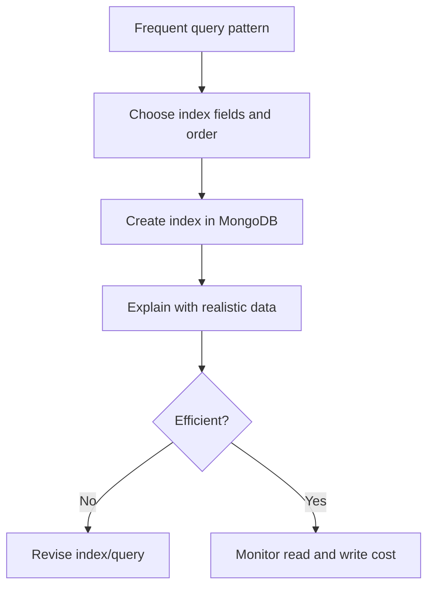

# Lesson 63 — Indexes and Unique Constraints in Mongoose

[← Section 7](./README.md) · [Full curriculum](../README.md)

## 1. Why indexes matter
Without an index, MongoDB may scan a large number of documents to find matching results. An **index** is a database-side data structure that speeds up particular searches and sorts, at the cost of disk space and additional write work. A Mongoose schema can **declare** indexes, but MongoDB must **build** them before queries benefit or uniqueness is enforced.

## 2. Declaring indexes
```js
import mongoose from "mongoose";
const applicationSchema = new mongoose.Schema({
 userId: { type: mongoose.Schema.Types.ObjectId, required: true },
 companyId: { type: mongoose.Schema.Types.ObjectId, required: true },
 status: { type: String, enum: ["APPLIED", "INTERVIEW", "OFFER", "REJECTED"] },
 appliedAt: { type: Date, default: Date.now },
 externalId: String
});
applicationSchema.index({ userId: 1, appliedAt: -1 });
applicationSchema.index({ userId: 1, status: 1, appliedAt: -1 });
applicationSchema.index({ externalId: 1 }, {
 unique: true,
 partialFilterExpression: { externalId: { $type: "string" } }
});
const Application = mongoose.model("CourseIndexedApplication", applicationSchema);
```
The first compound index supports a user's recent applications. The second helps filter by user and status, then sort by date. The partial unique index applies only to documents with a string `externalId`, allowing documents without one.

## 3. Why index field order matters
Consider `{userId:1,status:1,appliedAt:-1}`. Equality predicates on the leftmost fields often make the index effective. A query filtering only by `appliedAt` may not use that compound index efficiently. Sorting can also be constrained by index prefix and query predicates.

```js
await Application.find({ userId, status: "APPLIED" })
 .sort({ appliedAt: -1 })
 .limit(20);
```
Do not assume an index is useful just because a field appears somewhere in its definition. Confirm with `explain()` and realistic data.

## 4. Unique is NOT a Mongoose validator
```js
const userSchema = new mongoose.Schema({
 email: { type: String, required: true, lowercase: true, trim: true, unique: true }
});
```
`unique:true` asks MongoDB for a unique index. It does not produce a Mongoose `ValidationError` on duplicates. A duplicate write typically fails with MongoDB code **11000**. Uniqueness applies only once the index actually exists.

## 5. Build and inspect indexes in development
```js
await Application.init(); // useful to wait for model index initialization in a fresh practice DB
console.log(await Application.listIndexes());
```
`Model.init()` is useful in tests/new learning databases, but production index builds should be planned and monitored. Mongoose options like `autoIndex:false` avoid automatic index creation; then you must manage indexes explicitly.

## 6. Partial vs sparse vs compound unique
A **compound unique** index such as `{tenantId:1,email:1}` ensures a value is unique **within each tenant**, not globally. A **partial unique** index enforces uniqueness only on matching documents. Sparse indexes have different rules, especially for missing vs null values; don't substitute one blindly.

```js
userSchema.index({ tenantId: 1, email: 1 }, { unique: true });
```
If the schema already has a global unique email index, adding a tenant-scoped unique index does not remove the global constraint. Decide the intended uniqueness rule and remove conflicting indexes through a safe migration.

## 7. TTL indexes
```js
const tokenSchema = new mongoose.Schema({
 expiresAt: { type: Date, required: true }
});
tokenSchema.index({ expiresAt: 1 }, { expireAfterSeconds: 0 });
```
MongoDB's TTL monitor deletes expired documents **asynchronously**, not exactly at the expiration timestamp. Application code must still check expiration on access. TTL indexes have special restrictions; test against the MongoDB server version and deployment.

## 8. Analyze with explain
```js
const plan = await Application.find({ userId, status: "APPLIED" })
 .sort({ appliedAt: -1 })
 .explain("executionStats");
console.log(plan.executionStats?.totalDocsExamined);
```
Look at **IXSCAN vs COLLSCAN**, keys/documents examined, returned count, sort stages and execution time. `explain()` output structure can vary by MongoDB version and execution engine. Compare query shapes and dataset sizes; a small collection scan may be reasonable.



## 9. Production index strategy
Index creation consumes resources. Deploy new indexes with an intentional migration/rollout plan, monitor builds, and do not drop indexes automatically on startup. `syncIndexes()` can drop indexes not defined in the schema; **avoid calling it casually in production**. Too many indexes slow inserts and updates and consume storage.

## 10. Exercises
1. Create a compound index for user + status + date, then inspect explain.
2. Trigger duplicate key code 11000.
3. Compare global email uniqueness with tenant-scoped uniqueness.
4. Build a TTL index for short-lived reset tokens and explain why expiry is not instantaneous.
5. Explain why a unique index may fail to build when existing duplicates are present.

## Interview review
**Is unique:true a validator?** No. **When does it enforce uniqueness?** Once MongoDB has built the index. **What is a compound index?** Index on multiple fields with significant order. **Why not auto-build all indexes in production?** Resource and rollout risk.

**Official:** [Mongoose indexes](https://mongoosejs.com/docs/guide.html#indexes) · [MongoDB index fundamentals](https://www.mongodb.com/docs/manual/indexes/)
