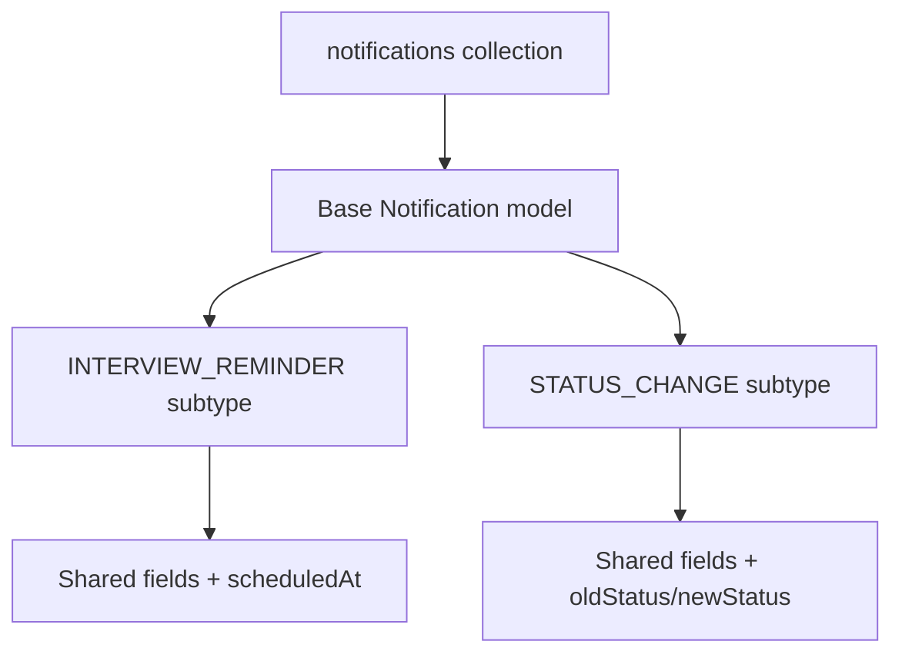

# Lesson 64 — Discriminators and Polymorphic Data

[← Section 7](./README.md) · [Full curriculum](../README.md)

## 1. The real problem

Suppose CareerLoop stores different notification types: an application status change, an interview reminder, and a recruiter follow-up. All notifications share fields such as `userId`, `createdAt`, and `read`, but each type has different fields. One approach creates three collections; another creates a single enormous schema with many optional fields. **Discriminators** offer a third choice: multiple Mongoose models with a common base schema, usually sharing one MongoDB collection.

**Key mental model:** A discriminator is a **model inheritance mechanism**, not a MongoDB inheritance feature. The stored document is ordinary BSON. Mongoose identifies the subtype using a **discriminator key**.

## 2. Base schema and subtype schemas

```js
import mongoose from "mongoose";
await mongoose.connect(process.env.MONGODB_URI, { dbName: "mongoose_course" });

const { Schema } = mongoose;
const notificationSchema = new Schema({
  userId: { type: Schema.Types.ObjectId, required: true },
  read: { type: Boolean, default: false }
}, {
  timestamps: true,
  discriminatorKey: "kind"
});

const Notification = mongoose.model("CourseNotification", notificationSchema);

const InterviewReminder = Notification.discriminator(
  "INTERVIEW_REMINDER",
  new Schema({
    applicationId: { type: Schema.Types.ObjectId, required: true },
    scheduledAt: { type: Date, required: true },
    meetingUrl: String
  })
);

const StatusChange = Notification.discriminator(
  "STATUS_CHANGE",
  new Schema({
    applicationId: { type: Schema.Types.ObjectId, required: true },
    oldStatus: { type: String, required: true },
    newStatus: { type: String, required: true }
  })
);
```

The subtype models inherit the base schema's `userId`, `read`, and timestamps, and add their own fields. Both use the base model's collection by default. The `kind` field identifies which schema applies.

## 3. Create, read, and inspect what is stored

```js
const userId = new mongoose.Types.ObjectId();
const applicationId = new mongoose.Types.ObjectId();

await InterviewReminder.create({
  userId, applicationId,
  scheduledAt: new Date("2027-01-12T10:00:00Z")
});

await StatusChange.create({
  userId, applicationId,
  oldStatus: "APPLIED", newStatus: "INTERVIEW"
});

const all = await Notification.find({ userId }).sort({ createdAt: -1 });
console.log(all.map(n => n.kind));
// ["STATUS_CHANGE", "INTERVIEW_REMINDER"] or another order for tied timestamps

const reminders = await InterviewReminder.find({ userId });
console.log(reminders.every(n => n.kind === "INTERVIEW_REMINDER")); // true
```

A base-model query can return **all variants**. A discriminator-model query automatically filters by its discriminator key. Mongoose can hydrate documents into the appropriate subtype based on that key.



## 4. Why not just use an enum and optional fields?

```js
const loose = new Schema({
  kind: String,
  scheduledAt: Date,
  oldStatus: String,
  newStatus: String
});
```

This allows nonsensical combinations: a status-change record with a meeting date, or an interview reminder with no scheduled date. Discriminators provide **subtype-specific schema validation and middleware**. They do not automatically enforce database-level constraints for direct driver writes.

## 5. Middleware and model compilation order

Declare shared middleware on the **base schema before calling `discriminator()`** so derived models inherit the intended hooks. Declare subtype-specific hooks on subtype schemas before compiling each discriminator. Adding hooks after compilation may not work as expected.

```js
const base = new Schema({ message: String }, { discriminatorKey: "kind" });
base.pre("save", function () { console.log("base save:", this.kind); });
const Event = mongoose.model("CourseEvent", base);

const emailSchema = new Schema({ address: { type: String, required: true } });
emailSchema.pre("save", function () { console.log("email save"); });
const EmailEvent = Event.discriminator("EMAIL", emailSchema);

await EmailEvent.create({ message: "Hello", address: "a@example.com" });
// Both registered save hooks run.
```

## 6. Embedded discriminators

Discriminators can also apply to **subdocuments in arrays**. For example, an audit log inside one document might contain `TextChange` and `AssignmentChange` entries with different fields. Use this for bounded arrays; do not embed an unlimited event stream because MongoDB documents have a 16 MiB size limit.

## 7. Important caveats

- Changing the discriminator key of an existing document is restricted by default. Treat a subtype change as a migration, not an ordinary edit.
- All variants share the collection's indexes and storage lifecycle. A unique index may affect every variant unless deliberately scoped (for example, with a partial index).
- Querying the base model retrieves mixed variants; clients must handle variant-specific fields.
- `lean()` returns plain objects, so discriminator-specific document methods are not available on lean results.
- Multiple collections may be better when subtypes have radically different lifecycles, permissions, query patterns, or scale.

## 8. Production decision guide

Choose discriminators when records share identity and common queries, and each variant needs its own schema rules. Choose separate collections when ownership, retention, indexing, or scaling differ significantly. Choose a simple enum plus optional fields only when the variations are small and you can still enforce coherent validation.

## 9. Practice and interview review

Build three notification variants and query them through both base and subtype models. Add one required subtype field and demonstrate validation failure. Then explain: **Where is the discriminator key stored?** In the document. **Are subtype documents stored in separate collections by default?** No. **Is a discriminator equivalent to a SQL table inheritance mechanism?** No; it is Mongoose model behavior.

**Official:** [Mongoose Discriminators](https://mongoosejs.com/docs/discriminators.html)
