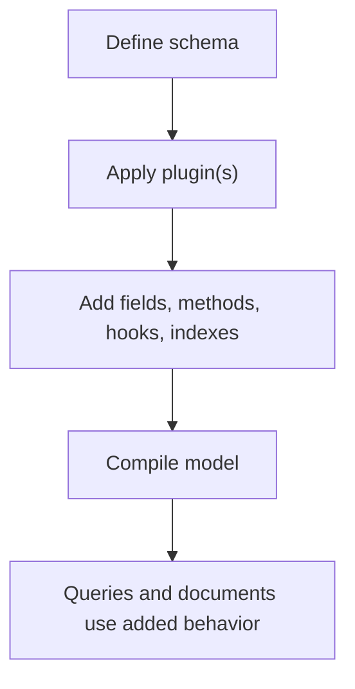

# Lesson 66 — Plugins and Reusable Schema Logic

[← Section 7](./README.md) · [Full curriculum](../README.md)

## 1. Why plugins exist

Imagine five collections—applications, companies, recruiters, notes and interviews—each needs the same `createdBy` field, a timestamp policy, and a `findActive()` query helper. Copying the same schema definitions and middleware into five files is error-prone. A **Mongoose plugin** is a function that receives a schema and modifies it **before the model is compiled**.

A plugin is a **code reuse mechanism**, not a database extension or Express plugin. It can add paths, indexes, virtuals, methods, statics, query helpers and middleware.

## 2. Your first plugin: shared audit fields

```js
import mongoose from "mongoose";

function auditPlugin(schema, options = {}) {
  schema.add({
    createdBy: { type: mongoose.Schema.Types.ObjectId, required: false },
    updatedBy: { type: mongoose.Schema.Types.ObjectId, required: false }
  });

  schema.methods.setAuditUser = function (userId) {
    if (this.isNew) this.createdBy = userId;
    this.updatedBy = userId;
    return this;
  };

  if (options.addIndex) {
    schema.index({ updatedBy: 1 });
  }
}

const noteSchema = new mongoose.Schema(
  { text: { type: String, required: true } },
  { timestamps: true }
);
noteSchema.plugin(auditPlugin, { addIndex: true });
const Note = mongoose.model("CoursePluginNote", noteSchema);

const userId = new mongoose.Types.ObjectId();
const note = new Note({ text: "Interview tomorrow" });
note.setAuditUser(userId);
await note.save();
```

**What happens:** `schema.plugin(auditPlugin)` calls the plugin during schema setup. The plugin adds fields and a document method. The method runs only when explicitly called; it does **not** magically identify the current authenticated user. Pass the actor from the request/service layer.

## 3. Reusable query helper plugin

```js
function activeQueryPlugin(schema) {
  schema.add({ active: { type: Boolean, default: true } });
  schema.query.onlyActive = function () {
    return this.where({ active: true });
  };
}

const companySchema = new mongoose.Schema({ name: String });
companySchema.plugin(activeQueryPlugin);
const Company = mongoose.model("CoursePluginCompany", companySchema);

const activeCompanies = await Company.find().onlyActive().lean();
```

The plugin configures the schema once. The query helper is available to queries for models compiled from that schema.

## 4. Soft-delete plugin: why a naive hook is dangerous

A tempting implementation is:

```js
function naiveSoftDelete(schema) {
  schema.add({ deletedAt: { type: Date, default: null } });
  schema.pre("find", function () { this.where({ deletedAt: null }); });
}
```

**Problem:** This only affects `find()`. Other operations—`findOne()`, `countDocuments()`, `aggregate()`, updates, deletes, `populate()`, and raw driver access—may still expose or modify deleted records. Blindly adding hooks to all operations can also break admin recovery, migrations and aggregation pipelines.

A safer educational baseline is an **explicit query helper**:

```js
function softDeletePlugin(schema) {
  schema.add({ deletedAt: { type: Date, default: null } });

  schema.query.notDeleted = function () {
    return this.where({ deletedAt: null });
  };

  schema.methods.softDelete = async function () {
    this.deletedAt = new Date();
    return this.save();
  };
}
```

Usage:

```js
const applicationSchema = new mongoose.Schema({ role: String });
applicationSchema.plugin(softDeletePlugin);
const Application = mongoose.model("CoursePluginApplication", applicationSchema);

const visible = await Application.find().notDeleted().lean();
```

This makes filtering **explicit**, but now every service must consistently apply it. In a production application, define a tested repository/service boundary that enforces access policy, including counts, aggregates and related queries. Soft deletion also complicates uniqueness: consider partial unique indexes scoped to active records.

## 5. Pagination plugin: input safety and performance

```js
function paginationPlugin(schema) {
  schema.statics.page = function (filter = {}, { page = 1, limit = 20 } = {}) {
    const safePage = Number.isSafeInteger(page) && page > 0 ? page : 1;
    const safeLimit = Number.isSafeInteger(limit)
      ? Math.min(Math.max(limit, 1), 100)
      : 20;
    return this.find(filter)
      .sort({ _id: 1 })
      .skip((safePage - 1) * safeLimit)
      .limit(safeLimit);
  };
}
```

`skip`-based pagination is easy to understand but becomes expensive at high offsets. For large datasets, use cursor/keyset pagination with a stable indexed sort. A pagination plugin must not blindly accept user-supplied MongoDB filter objects.

## 6. Plugin order and collisions

Register plugins **before** `mongoose.model()`. Plugins can conflict when they add the same field, method or hook. Global plugins (`mongoose.plugin(...)`) affect many schemas, so use them carefully. If you use discriminators or nested schemas, test whether plugin application and inheritance create duplicate hooks or paths.



## 7. Security and architecture

Plugins are best for **cross-cutting, deterministic schema behavior**. They should not silently send emails, charge customers, or depend on request-local state that is not explicitly passed. For authorization, keep policy decisions in your service/controller layer and treat plugins as helpers rather than the only security boundary.

## 8. Exercises and review

1. Build an audit plugin and attach it to two different schemas.
2. Add `onlyActive()` as a query helper plugin.
3. Implement a soft-delete service and list all operations it must protect.
4. Demonstrate how a pagination plugin can produce an expensive query for large page numbers.
5. Explain why applying a plugin after model compilation is unsafe.

**Interview:** **What does a plugin receive?** A schema and optional configuration. **Can plugins add hooks?** Yes. **Does a soft-delete plugin automatically make data private?** No.

**Official:** [Plugins](https://mongoosejs.com/docs/plugins.html) · [Middleware](https://mongoosejs.com/docs/middleware.html)
