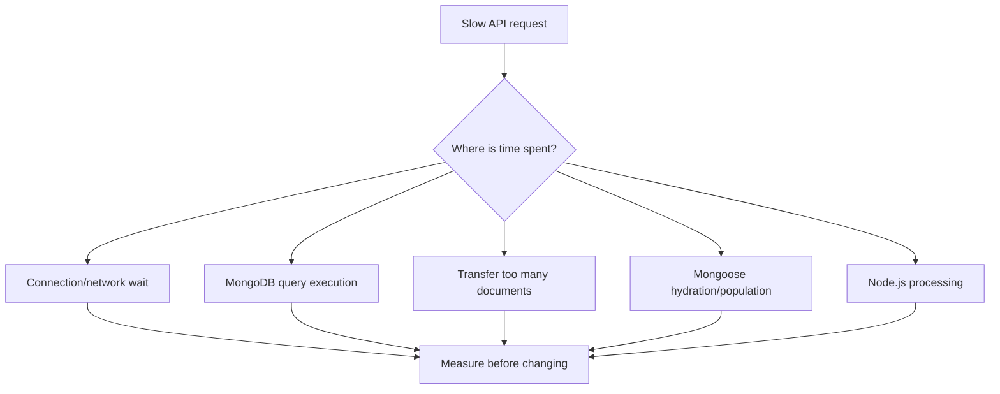

# Lesson 67 — Mongoose Anti-patterns and Performance

[← Section 7](./README.md) · [Full curriculum](../README.md)

## 1. Why performance problems happen

An endpoint can be logically correct but slow because it transfers too much data, runs too many queries, creates connections repeatedly, performs expensive hydration, or uses the wrong indexes. The goal is not to use every Mongoose optimization. The goal is to identify **where time and resources are spent**.



## 2. Anti-pattern: connecting inside every route

```js
// BAD
app.get("/api/products", async (req, res) => {
  await mongoose.connect(process.env.MONGODB_URI);
  const products = await Product.find();
  res.json(products);
});
```

Database connection setup involves network and authentication work. Repeated connection attempts can waste resources and create unpredictable startup behavior. **Connect once at application startup**, let the driver manage a connection pool, and reuse the model/connection across requests.

```js
await mongoose.connect(process.env.MONGODB_URI, {
  maxPoolSize: 20,
  serverSelectionTimeoutMS: 5000
});
app.listen(3000);
```

`maxPoolSize` is the maximum size of the main pool per server in the driver's topology, not the maximum number of HTTP users your application can serve. Choose pool settings based on measured concurrency and deployment topology, not arbitrary high values.

## 3. Anti-pattern: unlimited find()

```js
// BAD: unbounded response
const products = await Product.find();

// BETTER: explicit filter, fields, sort, and bound
const products = await Product.find({ active: true })
  .select("name sku priceMinor")
  .sort({ _id: 1 })
  .limit(25)
  .lean();
```

Unlimited queries increase MongoDB work, network payload, Node.js memory and JSON serialization time. For pagination, `skip()` works for small offsets but can become costly for deep pages. Prefer cursor pagination when data grows.

## 4. Anti-pattern: N+1 queries

```js
// BAD: one extra lookup for each application
const apps = await Application.find().limit(100);
for (const app of apps) {
  const company = await Company.findById(app.companyId);
  console.log(company?.name);
}
```

This can issue 101 queries for 100 applications. Alternatives include a **batched query** using `$in`, Mongoose `populate()` (which can batch related lookups), or an aggregation `$lookup`.

```js
const apps = await Application.find()
  .limit(100)
  .populate({ path: "companyId", select: "name" })
  .lean();
```

Population is not free. Deep/nested population and per-document limits can add expensive queries and large result graphs. Choose only needed paths and fields.

## 5. Hydration and lean()

```js
const full = await Product.find({ active: true }).limit(100);
const lean = await Product.find({ active: true }).limit(100).lean();
```

Normal queries create Mongoose document instances with methods, change tracking, and other behavior. `lean()` returns plain objects and can reduce application-side CPU/memory for **read-only** endpoints. It does not directly make MongoDB's index scan faster. Lean objects do not support `.save()` or normal document virtuals/getters by default.

## 6. Anti-pattern: missing or wrong indexes

```js
await Application.find({ userId, status: "APPLIED" })
  .sort({ appliedAt: -1 })
  .limit(20);
```

For a frequently used query like this, consider an index `{ userId:1, status:1, appliedAt:-1 }`. Use `explain("executionStats")` to inspect documents examined, index usage and sort stages. Indexes speed reads but consume storage and increase write costs.

## 7. Anti-pattern: read-modify-write races

```js
// BAD for stock reservations under concurrency
const product = await Product.findById(id);
if (product.stock >= quantity) {
  product.stock -= quantity;
  await product.save();
}

// BETTER: atomic condition and update
const reserved = await Product.findOneAndUpdate(
  { _id: id, stock: { $gte: quantity } },
  { $inc: { stock: -quantity } },
  { new: true }
);
if (!reserved) throw new Error("Insufficient stock or product not found");
```

Performance and correctness overlap. An atomic update avoids an extra round trip and prevents a stale-read stock race for a single document. For multiple documents, consider transaction boundaries.

## 8. Anti-pattern: large growing arrays

Embedding every chat message into one conversation document creates a hot, ever-growing record and risks MongoDB's **16 MiB document limit**. Prefer a separate `messages` collection with `conversationId` and an index such as `{conversationId:1,createdAt:-1}` for large chat histories. Embed bounded snapshots such as order line items when that fits the access pattern.

## 9. Anti-pattern: overusing hooks

A `pre("save")` hook that calls an external payment API mixes database persistence with non-transactional side effects. Database retries and application errors can produce duplicate charges. Keep hooks focused on local, predictable operations; use a service workflow, idempotency keys, and an outbox/queue for external effects.

## 10. Query safety is part of production performance

```js
// BAD: client can supply unbounded filter and limit
await Product.find(req.query).limit(Number(req.query.limit));

// BETTER: explicitly construct an allowed filter and cap the result
const filter = {};
if (req.query.category === "ACCESSORIES") {
  filter.category = "ACCESSORIES";
}
const requested = Number(req.query.limit);
const limit = Number.isSafeInteger(requested)
  ? Math.min(Math.max(requested, 1), 50)
  : 20;
const products = await Product.find(filter).limit(limit).lean();
```

Do not pass arbitrary request objects into MongoDB filters or update operators. Validate IDs, filter fields, operator usage, sort fields, and pagination bounds. Rate limiting and authorization also protect the database.

## 11. Measuring performance

A useful sequence: record endpoint latency → inspect number of DB operations → run `explain()` → measure rows/documents examined and response payload → check indexes → compare hydration vs lean → load-test representative concurrency. Avoid drawing conclusions from a tiny dataset or one cold request.

Use Mongoose debug logging selectively in development; production logs should redact secrets and personally identifiable information.

## 12. Production checklist

- Reuse one established connection per application process; monitor pool behavior.
- Keep responses bounded and projected.
- Index actual filter and sort patterns, not every field.
- Use `lean()` for read-only data where document behavior is unnecessary.
- Avoid N+1 queries and deep, unbounded population.
- Keep transaction callbacks short and side effects idempotent.
- Do not automatically run destructive index synchronization in production.
- Validate input, enforce authorization, and handle duplicate/conflict errors.
- Monitor latency, query plans, memory, and connection failures.

## 13. Exercises

1. Implement a paginated applications endpoint with projection and lean.
2. Compare 100 sequential company lookups with a batched lookup or populate.
3. Use `explain()` before and after adding a compound index.
4. Write a stock reservation endpoint with an atomic predicate.
5. Identify five issues in an endpoint that connects per request, calls unbounded `find()`, populates all references, and returns full documents.

## Interview review

**What is N+1?** A query for parents plus a separate query for each related record. **Does lean improve DB index performance?** No; it avoids Mongoose hydration. **Why not index every field?** Storage and write overhead. **Why avoid connecting per request?** Repeated network setup and pool inefficiency.

**Official:** [Lean](https://mongoosejs.com/docs/tutorials/lean.html) · [Populate](https://mongoosejs.com/docs/populate.html) · [MongoDB Explain](https://www.mongodb.com/docs/manual/reference/command/explain/)
