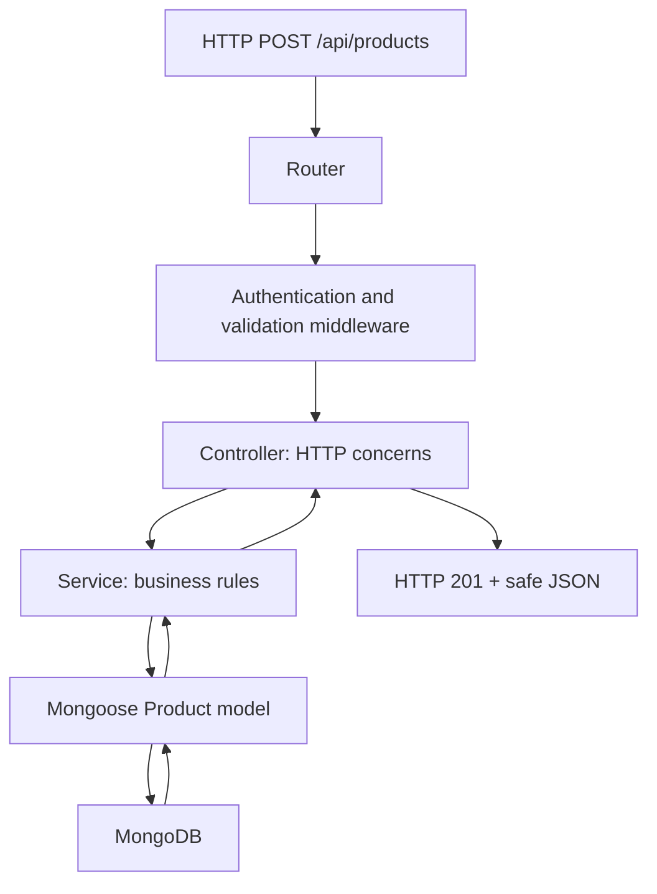

# Lesson 68 — Project Structure: Routes, Controllers and Services

[← Section 8](./README.md) · [Full curriculum](../README.md)

## What are we building?

Throughout Section 8 we will build **Shop API**, a Node.js + Express 5 + MongoDB/Mongoose backend with products, users, authentication, carts and orders. Each lesson adds a production-relevant capability. This lesson establishes the architecture so the next features don't become one enormous file.

## 1. The real problem with a single server.js

Beginners often place routes, input checks, database queries and business decisions in one callback:

```js
app.post("/products", async (req, res) => {
  const product = await Product.create(req.body);
  res.status(201).json(product);
});
```

It works for a tiny demo but becomes hard to test, reuse and secure. What if an admin imports products without HTTP? What if a controller has to check stock, call two models, and handle an error? If all logic lives in Express handlers, it cannot easily be reused in a background job or CLI script.

The solution is **separation of concerns**: each layer has a clear responsibility.

## 2. Understand each layer before writing code

| Layer | Responsibility | Should avoid |
| --- | --- | --- |
| Route | Match URL/method; compose middleware and handler | Business rules |
| Controller | Translate HTTP input/output to application calls | Complex database workflows |
| Service | Implement business rules and coordinate operations | Express `req`/`res` |
| Model | Define Mongoose schema, indexes and document methods | HTTP status codes |
| Middleware | Authentication, authorization, validation, errors | Unrelated business workflows |
| Config/bootstrap | Validate environment, connect DB, start server | Per-request connection setup |



**Important:** These are architectural boundaries, not separate Node.js processes. Most code still executes in the same application process.

## 3. Recommended folder structure

```text
shop-api/
├── package.json
├── .env
├── .env.example
├── .gitignore
├── src/
│   ├── app.js
│   ├── server.js
│   ├── config/
│   │   ├── env.js
│   │   └── database.js
│   ├── models/
│   │   ├── product.model.js
│   │   └── user.model.js
│   ├── routes/
│   │   └── product.routes.js
│   ├── controllers/
│   │   └── product.controller.js
│   ├── services/
│   │   └── product.service.js
│   ├── middlewares/
│   │   └── error.middleware.js
│   └── utils/
│       └── app-error.js
└── tests/
    └── products.test.js
```

The structure is a practical starting point, not a mandatory framework rule. Grouping by feature (`modules/products/`) is also reasonable as a codebase grows.

## 4. Why separate app.js from server.js?

**app.js** builds the Express application without starting a listening socket. **server.js** validates configuration, connects MongoDB and starts the server. Tests can import `app` and run requests without opening a real network port.

```js
// src/app.js
import express from "express";
import productRoutes from "./routes/product.routes.js";
import { errorHandler } from "./middlewares/error.middleware.js";

export const app = express();
app.use(express.json({ limit: "100kb" }));
app.use("/api/products", productRoutes);
app.use(errorHandler); // last
```

```js
// src/server.js
import { app } from "./app.js";
import { connectDatabase } from "./config/database.js";
import { env } from "./config/env.js";

try {
  await connectDatabase();
  app.listen(env.PORT, () => console.log(`Listening on \${env.PORT}`));
} catch (error) {
  console.error("Startup failed:", error);
  process.exitCode = 1;
}
```

`app` and `connectDatabase` are imports from files we'll implement in Lesson 069. **Why connect before listen?** It prevents accepting requests while the required database is unavailable. In some systems you might listen early but expose an explicit readiness endpoint; the choice must be intentional.

## 5. A complete vertical slice: route → controller → service

```js
// src/models/product.model.js
import mongoose from "mongoose";
const schema = new mongoose.Schema({
  name: { type: String, required: true, trim: true },
  priceMinor: { type: Number, required: true, min: 0 },
  active: { type: Boolean, default: true }
}, { timestamps: true });
export const Product = mongoose.model("Product", schema);
```

```js
// src/services/product.service.js
import { Product } from "../models/product.model.js";
export async function createProduct(input) {
  // Later: authorization policies, SKU rules, stock constraints, etc.
  return Product.create(input);
}
export async function listProducts() {
  return Product.find({ active: true })
    .select("name priceMinor")
    .sort({ _id: 1 })
    .limit(20)
    .lean();
}
```

```js
// src/controllers/product.controller.js
import * as productService from "../services/product.service.js";
export async function createProductController(req, res) {
  const { name, priceMinor } = req.body; // allowlist fields
  const product = await productService.createProduct({ name, priceMinor });
  return res.status(201).json({ success: true, data: product });
}
export async function listProductsController(req, res) {
  const products = await productService.listProducts();
  return res.status(200).json({ success: true, data: products });
}
```

```js
// src/routes/product.routes.js
import { Router } from "express";
import {
  createProductController, listProductsController
} from "../controllers/product.controller.js";
const router = Router();
router.get("/", listProductsController);
router.post("/", createProductController); // Protect with admin auth in Lesson 073
export default router;
```

```js
// src/middlewares/error.middleware.js
export function errorHandler(error, req, res, next) {
  console.error(error);
  res.status(500).json({ success: false, message: "Internal server error" });
}
```

This slice is **illustrative**, not a secured public API: POST needs authentication, authorization and strict request validation, added in later lessons.

## 6. Express 5 async error flow

In Express 5, if an async route/controller rejects or throws, Express forwards the error to error-handling middleware. You generally do **not** need a repetitive `try/catch(next)` around every async controller.

```js
export async function getProductController(req, res) {
  const product = await Product.findById(req.params.id);
  if (!product) return res.status(404).json({ message: "Not found" });
  res.json({ data: product });
}
```

A malformed ObjectId may throw a `CastError`, which should be mapped to 400 by a more complete error handler. A valid but absent ID returns null, usually 404.

## 7. Trace one request step by step

1. Client sends `POST /api/products` with JSON.
2. `express.json()` parses the body (subject to size limit).
3. Router selects POST `/` under `/api/products`.
4. Controller extracts allowed fields.
5. Service calls `Product.create()`.
6. Mongoose casts, applies defaults, validates and sends an insert.
7. MongoDB stores the document.
8. Controller returns HTTP 201.

The separation is useful because a background job can call the **service** without needing an Express request.

## 8. Important architecture decisions

- Keep controllers thin, but not artificially empty. They own HTTP semantics.
- Services may call several models; models shouldn't depend on controllers.
- Use explicit imports rather than circular dependencies.
- Use a consistent error class for expected business failures; centralize HTTP translation.
- Never trust `req.body` wholesale. Validate, allowlist and authorize.
- Do not create a new Mongoose connection for each request.
- Separate API response DTOs from persistence documents when sensitive fields exist.

## 9. Exercises

Build the folder structure, run GET/POST locally with a disposable database, move one business rule into the service, and write a test importing `app` without starting `server.js`. Explain what changes if a CLI script needs to create a product.

## 10. Interview preparation

**Why service layer?** Reusable business logic independent of HTTP. **Why app/server split?** Testability and controlled startup. **Does Express 5 forward rejected async handlers?** Yes. **Is a Mongoose schema a request validator?** No; it is a persistence-layer validation tool.

**References:** [Express routing](https://expressjs.com/en/guide/routing.html) · [Express error handling](https://expressjs.com/en/guide/error-handling.html) · [Mongoose Models](https://mongoosejs.com/docs/models.html)
