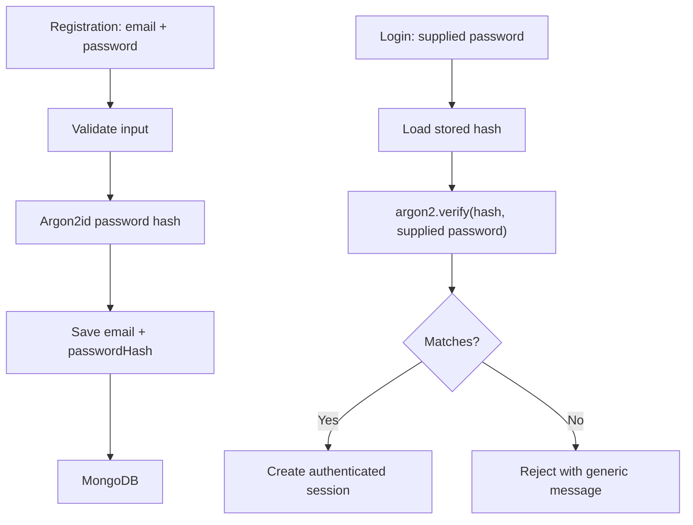

# Lesson 71 — User Registration and Password Hashing

[← Section 8](./README.md) · [Full curriculum](../README.md)

## 1. The security problem

A user registers with an email and password. The server must never store the password in plaintext. If the database leaks, plaintext passwords immediately expose users' accounts, and users may have reused passwords elsewhere.

**Hashing is not encryption.** Encryption is designed to be reversible with a key. Password hashing uses a deliberately expensive one-way password hashing algorithm; during login, the server verifies a supplied password against the stored hash. Modern choices include **Argon2id** (preferred where supported) and appropriately configured **scrypt** or **bcrypt**. A general-purpose hash like SHA-256 alone is too fast for password storage.

## 2. What gets stored?



A password hash usually encodes the algorithm parameters and a unique random salt. You do **not** need to invent a salt yourself when using a reputable password-hashing library correctly. The salt is not a secret; the password and server-side credentials are.

## 3. Install dependencies

```bash
npm install argon2 zod
```

## 4. User schema

```js
// src/models/user.model.js
import mongoose from "mongoose";

const userSchema = new mongoose.Schema({
  email: {
    type: String, required: true, trim: true, lowercase: true
  },
  passwordHash: { type: String, required: true, select: false },
  role: { type: String, enum: ["USER", "ADMIN"], default: "USER" }
}, { timestamps: true });

userSchema.index({ email: 1 }, { unique: true });
export const User = mongoose.model("User", userSchema);
```

`select:false` keeps the hash out of ordinary queries, but **is not a security boundary**: code can explicitly select the field. Never return `passwordHash` in API responses. `role` must be assigned by trusted server-side logic, not by a public registration request.

## 5. Validate registration input

```js
// src/validators/auth.validator.js
import { z } from "zod";
export const registerSchema = z.strictObject({
  email: z.email().transform(value => value.trim().toLowerCase()),
  password: z.string().min(12).max(128)
});
```

A minimum length is useful; avoid arbitrary complexity rules that make users choose predictable passwords. In production, support long passphrases, consider compromised-password screening, rate limiting and abuse controls. The `max` here is an illustrative resource bound, not a universal password-policy recommendation.

## 6. Registration service

```js
// src/services/auth.service.js
import argon2 from "argon2";
import { User } from "../models/user.model.js";

export async function registerUser({ email, password }) {
  const passwordHash = await argon2.hash(password, {
    type: argon2.argon2id
  });

  const user = await User.create({
    email,
    passwordHash,
    role: "USER" // NEVER trust a role sent by the client
  });

  return {
    id: user._id.toString(),
    email: user.email,
    role: user.role
  };
}
```

**Why hash before inserting?** A plaintext password must never be written to the database, even temporarily. Hashing is CPU/memory-intensive by design; monitor concurrency and choose Argon2id parameters according to your deployment's resources and security guidance.

## 7. Uniqueness and race conditions

```js
userSchema.index({ email: 1 }, { unique: true });
```

An application-level `findOne({email})` before `create()` can improve UX, but it cannot guarantee uniqueness: two requests can pass the check simultaneously. The MongoDB **unique index** is the authoritative constraint. A duplicate write usually fails with code **11000**; translate it to a safe 409 response, without leaking unnecessary account-existence information.

## 8. Login verification

```js
import argon2 from "argon2";
import { User } from "../models/user.model.js";

export async function verifyCredentials({ email, password }) {
  const user = await User.findOne({ email: email.trim().toLowerCase() })
    .select("+passwordHash");

  if (!user) return null;

  const valid = await argon2.verify(user.passwordHash, password);
  if (!valid) return null;

  return { id: user._id.toString(), email: user.email, role: user.role };
}
```

The login endpoint should return a generic message such as “Invalid email or password” for either failure. In high-risk environments, consider timing and user-enumeration resistance, rate limiting, monitoring, and multi-factor authentication.

## 9. Why not hash passwords in every save hook?

```js
// Common mistake:
userSchema.pre("save", async function () {
  this.passwordHash = await argon2.hash(this.passwordHash);
});
```

This can **double-hash** an already hashed password whenever the document is saved. Also, `updateOne()` and `findOneAndUpdate()` do not run `save` middleware. A dedicated service for registration/password changes makes the policy explicit. If you choose a hook-based design, detect modifications correctly and separately protect query updates.

## 10. Password reset and change

A password-reset flow should generate a cryptographically random, short-lived, **single-use** token, store a hash of the token, and deliver the original through a trusted channel. On successful use, invalidate the token and replace the password hash. Never send an existing password by email, and do not use JWT access tokens as password-reset tokens without a deliberate separate design.

## 11. Exercises and interview review

Create a user, inspect MongoDB to confirm no plaintext password is stored, verify correct/incorrect passwords, trigger a duplicate email conflict, and confirm API JSON never contains `passwordHash`. Explain **hashing vs encryption**, **salt vs pepper**, and **why a fast hash is unsuitable for passwords**.

**References:** [OWASP Password Storage](https://cheatsheetseries.owasp.org/cheatsheets/Password_Storage_Cheat_Sheet.html) · [Mongoose schema](https://mongoosejs.com/docs/guide.html)
