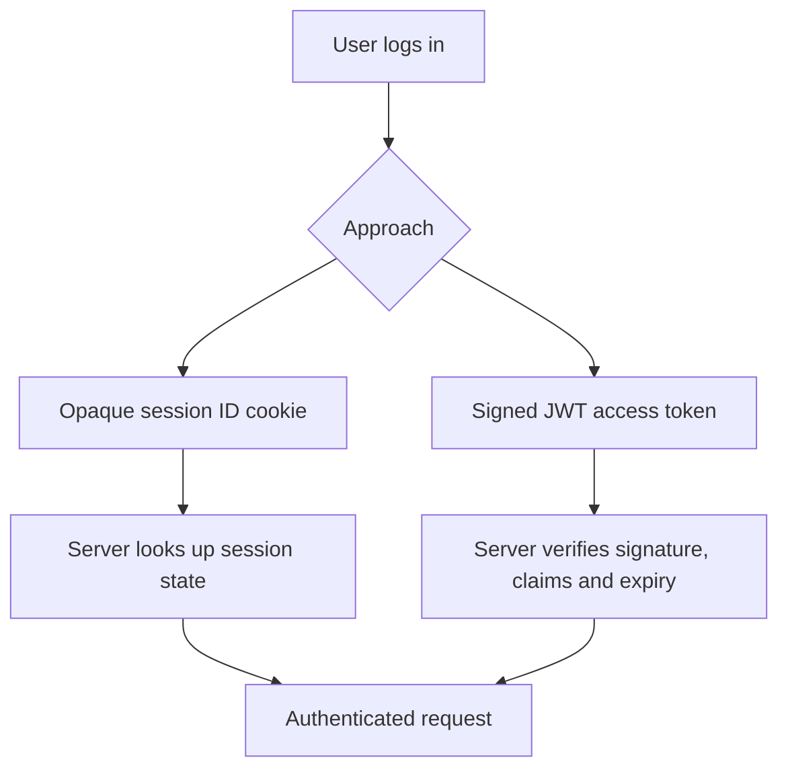

# Lesson 72 — JWT / Cookie Authentication

[← Section 8](./README.md) · [Full curriculum](../README.md)

## 1. Authentication is not authorization

**Authentication:** Who is making this request? **Authorization:** Is this identity allowed to perform this action? A valid token can prove an authenticated identity but does not automatically grant permission to edit any product or another user's order.

The browser needs a way to present proof of authentication on subsequent HTTP requests. Two common mechanisms are **server-side sessions with an opaque cookie** and **signed access tokens such as JWTs**. They solve similar needs with different trade-offs.

## 2. Understand the two models



A cookie is a **browser storage and transport mechanism**; a JWT is a **token format**. They are not alternatives in the same category: a JWT can be transported in a cookie, and a session ID can be transported in a cookie.

## 3. JWT anatomy and trust

A typical JWT has three base64url-encoded segments: header, payload and signature. The header and payload are **readable**, not encrypted by default. Never put passwords, secrets or unnecessary personal data into JWT claims.

A JWT signature lets the server verify that the token was signed by a trusted key and was not modified. Verification must restrict acceptable algorithms, validate expiry, issuer and audience where appropriate, and use a trusted key. Decoding a token is **not** the same as verifying it.

## 4. Access and refresh tokens

| Token | Purpose | Lifetime | Typical handling |
| --- | --- | --- | --- |
| Access token | Authenticate API requests | Short | Signed, verified on each protected request |
| Refresh token | Obtain new access tokens | Longer | High-value credential; rotate and revoke |

A refresh token can be an opaque random string stored hashed in a database. It does **not** have to be a JWT. Rotation means each successful refresh invalidates the previous token and issues a new one; reuse detection can help identify theft. Real systems need session/device tracking, expiration and revocation.

## 5. Install a JWT library

```bash
npm install jose cookie-parser
```

For this lesson, we use `jose` and an **HttpOnly cookie** carrying a short-lived access token. This is a learning implementation; production deployments must add CSRF protection, abuse controls and a full session lifecycle.

## 6. Sign a token with explicit claims

Add `JWT_SECRET` to your server environment. Use a **cryptographically random secret of at least 32 bytes** for HS256, securely provisioned and rotated. Do not generate a new secret on every application restart.

```js
// src/utils/jwt.js
import { SignJWT, jwtVerify } from "jose";
import { env } from "../config/env.js";

const key = new TextEncoder().encode(env.JWT_SECRET);

export async function signAccessToken(userId) {
  return new SignJWT({})
    .setProtectedHeader({ alg: "HS256" })
    .setSubject(userId)
    .setIssuer("shop-api")
    .setAudience("shop-api-client")
    .setIssuedAt()
    .setExpirationTime("15m")
    .sign(key);
}

export async function verifyAccessToken(token) {
  const { payload } = await jwtVerify(token, key, {
    issuer: "shop-api",
    audience: "shop-api-client",
    algorithms: ["HS256"]
  });
  return payload;
}
```

Extend Lesson 069's environment schema with a required `JWT_SECRET` and validate its actual cryptographic strength. A 32-character human-chosen string is not equivalent to 32 random bytes.

## 7. Set an HttpOnly cookie after login

```js
// In an authenticated login controller, after verifyCredentials succeeds:
const token = await signAccessToken(user.id);
res.cookie("access_token", token, {
  httpOnly: true,
  secure: process.env.NODE_ENV === "production",
  sameSite: "lax",
  path: "/",
  maxAge: 15 * 60 * 1000
});
return res.json({ success: true, user });
```

- **HttpOnly** prevents ordinary JavaScript from reading the cookie, reducing token theft via XSS; it does not stop XSS from making authenticated requests.
- **Secure** sends cookies only over HTTPS (with browser localhost exceptions); use HTTPS in production.
- **SameSite** reduces some cross-site cookie sending but is **not a complete CSRF defense**.
- **Max-Age** controls browser cookie lifetime; JWT `exp` independently limits token validity.

For cross-origin frontend/backend deployments, configure CORS, credentials, SameSite and CSRF defenses deliberately. Never combine wildcard CORS origin with credentialed access.

## 8. Authentication middleware

```js
// src/middlewares/auth.middleware.js
import { verifyAccessToken } from "../utils/jwt.js";
import { User } from "../models/user.model.js";

export async function requireAuth(req, res, next) {
  const token = req.cookies?.access_token;
  if (!token) return res.status(401).json({ message: "Authentication required" });

  try {
    const claims = await verifyAccessToken(token);
    if (typeof claims.sub !== "string") {
      return res.status(401).json({ message: "Invalid session" });
    }
    const user = await User.findById(claims.sub).select("_id role");
    if (!user) return res.status(401).json({ message: "Invalid session" });

    req.auth = { userId: user._id.toString(), role: user.role };
    next();
  } catch {
    return res.status(401).json({ message: "Invalid or expired session" });
  }
}
```

Register `cookie-parser` before protected routes:

```js
import cookieParser from "cookie-parser";
app.use(cookieParser());
app.use("/api/orders", requireAuth, orderRoutes);
```

Looking up the user on each request adds a database query but helps detect deleted users and current roles. Caching and session versioning are alternative designs with trade-offs.

## 9. CSRF and XSS: the two separate threats

**CSRF** tricks a logged-in browser into sending a state-changing request with its cookies. For cookie-authenticated APIs, use CSRF tokens or robust origin checks and appropriate SameSite settings, depending on architecture. **XSS** runs attacker-controlled script in your origin; HttpOnly helps protect cookie contents, but you must still prevent injection and protect sensitive actions.

## 10. Logout and revocation

```js
res.clearCookie("access_token", {
  httpOnly: true,
  secure: process.env.NODE_ENV === "production",
  sameSite: "lax",
  path: "/"
});
res.status(204).send();
```

Clearing the cookie removes it from that browser, but **does not cryptographically revoke an already issued JWT**. If the token was copied, it may remain valid until expiry. For immediate revocation, implement server-side session state, token denylisting or version checks. Refresh-token revocation and rotation are separate requirements.

## 11. End-to-end request flow

1. User submits credentials over HTTPS.
2. Server validates input and verifies the password hash.
3. Server signs a short-lived access token.
4. Server sets an HttpOnly cookie.
5. Browser includes the cookie on eligible requests.
6. Middleware verifies signature and claims, loads current user, then attaches trusted identity to the request.
7. Authorization middleware (Lesson 073) checks roles and resource ownership.

## 12. Common mistakes and exercises

Never store secrets in JWT payloads, trust a decoded-but-unverified token, assume HttpOnly prevents CSRF, or treat cookie deletion as immediate token revocation. Build a login endpoint, test missing/expired/tampered tokens, verify cookie attributes, and explain **401 vs 403**.

**Interview:** **JWT vs cookie?** Token format vs browser transport. **JWT vs server session?** Signed self-contained claims vs server-managed state. **What does a refresh token do?** Obtains new access tokens under a controlled lifecycle. **Does a valid JWT prove ownership?** No.

**References:** [JWT RFC 7519](https://www.rfc-editor.org/rfc/rfc7519) · [OWASP Session Management](https://cheatsheetseries.owasp.org/cheatsheets/Session_Management_Cheat_Sheet.html) · [OWASP CSRF](https://cheatsheetseries.owasp.org/cheatsheets/Cross-Site_Request_Forgery_Prevention_Cheat_Sheet.html)
