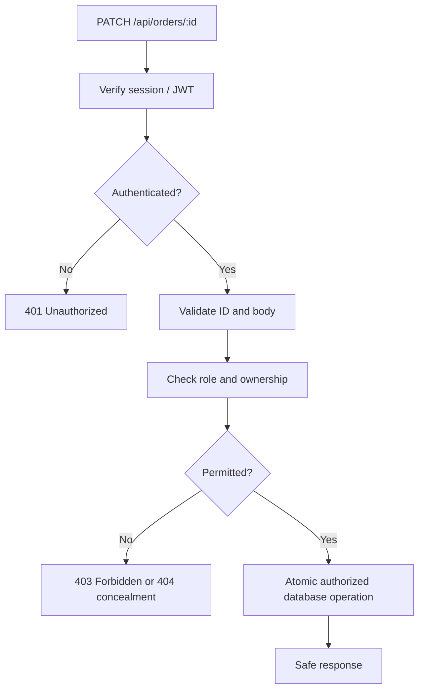

# Lesson 73 — Authorization and Ownership Checks

[← Section 8](./README.md) · [Full curriculum](../README.md)

## 1. The problem: authentication is not permission

Imagine a user logs in and requests GET /api/orders/ORDER_ID. The JWT is valid, but the order belongs to somebody else. **Authentication** establishes identity; **authorization** decides whether that identity may perform the specific action on the specific resource.

A common vulnerability is **Broken Object Level Authorization (BOLA)**, also called an insecure direct object reference (IDOR): the server accepts a user-controlled record ID but fails to check ownership. Hiding IDs in the UI does not fix it. ObjectIds are identifiers, not authorization secrets.

## 2. Understand four distinct checks

1. **Authentication:** Who is the requester? For example, verified user ID from Lesson 072.
2. **Role-based authorization:** Can this role perform this operation? For example, only admins create catalog products.
3. **Resource-level authorization:** Does this particular order belong to this user?
4. **Field-level authorization:** Which fields may this user change? For example, customers must not set order.paymentStatus = "PAID".

These checks complement each other. A user may be permitted to update *their* profile but not their role, and an admin may be allowed to update products but not arbitrarily impersonate customers.

## 3. Threat model and request flow



Never trust `req.body.userId`, `req.query.ownerId`, or a decoded-but-unverified token as the authenticated identity. Use `req.auth.userId` set by verified authentication middleware.

## 4. Role-based access control middleware

```js
// src/middlewares/authorize.middleware.js
export function requireRole(...roles) {
  return (req, res, next) => {
    if (!req.auth) {
      return res.status(401).json({ message: "Authentication required" });
    }
    if (!roles.includes(req.auth.role)) {
      return res.status(403).json({ message: "Insufficient permissions" });
    }
    next();
  };
}
```

Use it after `requireAuth`:

```js
router.post(
  "/",
  requireAuth,
  requireRole("ADMIN"),
  validateBody(createProductSchema),
  createProductController
);
```

**Why check role on the server?** React can hide an admin button, but attackers can send HTTP requests directly. UI restrictions are usability features, not security boundaries.

## 5. Ownership: include userId in the database predicate

A vulnerable implementation:

```js
// BAD: any authenticated user can retrieve any order if they know its ID
const order = await Order.findById(req.params.id);
```

A safer approach:

```js
// src/services/order.service.js
export async function getOwnOrder(orderId, userId) {
  return Order.findOne({
    _id: orderId,
    userId
  }).lean();
}
```

The query itself restricts which records are visible. If no match exists, return 404. This avoids revealing whether another user's order exists.

For updates, keep authorization in the **same atomic predicate** when possible:

```js
export async function cancelOwnPendingOrder(orderId, userId) {
  return Order.findOneAndUpdate(
    { _id: orderId, userId, status: "PENDING" },
    { $set: { status: "CANCELLED" } },
    { new: true, runValidators: true }
  );
}
```

The `userId` and `status` conditions are checked by MongoDB as part of the write. This is safer than read-check-update in separate steps, where the record's state can change between operations.

## 6. Why read-check-update can race

```js
// RISKY
const order = await Order.findById(orderId);
if (order.userId.toString() !== userId) throw new Error("Forbidden");
await Order.updateOne({ _id: orderId }, { $set: { status: "CANCELLED" } });
```

The later update no longer contains the ownership condition. Even when ownership normally does not change, an explicit predicate is easier to audit and protects against future code changes. For complex multi-document policies, use transactions or appropriate concurrency control.

## 7. Field-level authorization and mass assignment

Suppose a customer sends:

```json
{
  "displayName": "Asha",
  "role": "ADMIN",
  "emailVerified": true
}
```

This is dangerous:

```js
await User.findByIdAndUpdate(req.auth.userId, req.body);
```

Instead, validate and **allowlist** fields:

```js
import { z } from "zod";
const profilePatchSchema = z.strictObject({
  displayName: z.string().trim().min(2).max(80).optional()
}).refine(v => Object.keys(v).length > 0);

const parsed = profilePatchSchema.safeParse(req.body);
if (!parsed.success) return res.status(400).json({ message: "Invalid profile update" });

const updated = await User.findByIdAndUpdate(
  req.auth.userId,
  { $set: parsed.data },
  { new: true, runValidators: true }
).select("_id email displayName");
```

Never allow public registration to choose `ADMIN`. For admin privileges, use a separate trusted provisioning workflow.

## 8. Tenant isolation is ownership at a larger scale

In SaaS, records may belong to organizations rather than individual users. Then a safe query might be `{_id:orderId, tenantId:req.auth.tenantId}`. A globally valid role such as `ADMIN` may still be restricted to **one tenant**. Every list, get, update, delete, aggregation and populate operation must honor tenant scope.

## 9. 401, 403 and 404

| Code | Meaning | Example |
| --- | --- | --- |
| 401 | Not authenticated / invalid credentials | Missing or expired session |
| 403 | Authenticated but not permitted | USER attempts admin-only product creation |
| 404 | Resource not found (or intentionally concealed) | No order matches ID and owner |
| 400 | Invalid request syntax/shape | Malformed ObjectId |

Choose a consistent policy that avoids leaking sensitive resource existence. Never reveal another customer's order details in error messages.

## 10. Tests that matter

Create users A and B. Authenticate as A and request B's order: expect 404 or your defined denial policy. Authenticate as USER and attempt product creation: expect 403. Submit `role:"ADMIN"` to profile update: expect 400. Cancel an order already shipped: expect no state change. Confirm list endpoints filter by authenticated owner.

## 11. Interview questions

**Why is a valid JWT insufficient?** It proves authentication, not authorization. **What is BOLA?** Missing object-level permission checks. **Why put ownerId in update filters?** Authorization and state checks become part of the atomic write. **Is hiding buttons enough?** No.

**References:** [OWASP API1: Broken Object Level Authorization](https://owasp.org/API-Security/editions/2023/en/0xa1-broken-object-level-authorization/) · [OWASP API3: Object Property Level Authorization](https://owasp.org/API-Security/editions/2023/en/0xa3-broken-object-property-level-authorization/)
